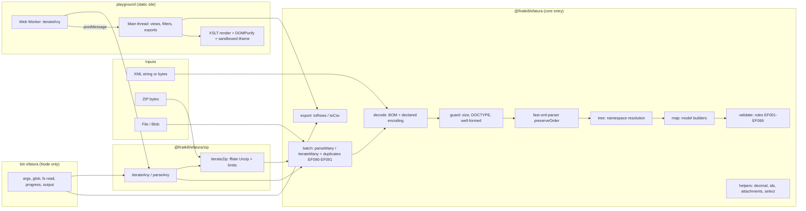

# efatura: Technical Requirements Document

This document specifies how efatura is built. It implements the requirements in `docs/PRD.md` (IDs US-xx, FR-xx, NFR-xx, D-xx) and is executed in the order given by `docs/IMPLEMENTATION_PLAN.md` (IDs T-xx). Where this document and the PRD disagree, the PRD wins for behaviour and copy, and this document wins for technical detail. Report any contradiction as an issue instead of guessing.

Conventions in this document:

- "Must" is mandatory. "Pin" means write an exact version (no `^` or `~`) in `package.json`.
- Code blocks are normative when labelled **(normative)**: implement them as written, keeping names, numbers and text. Unlabelled snippets are illustrative.
- All tunable numbers live in `src/config.ts` (section 4). Code never repeats a literal that exists there.
- Element paths use canonical prefixes regardless of the prefixes in a file: `cbc:` = `urn:oasis:names:specification:ubl:schema:xsd:CommonBasicComponents-2`, `cac:` = `urn:oasis:names:specification:ubl:schema:xsd:CommonAggregateComponents-2`, `ext:` = `urn:oasis:names:specification:ubl:schema:xsd:CommonExtensionComponents-2`. Paths are relative to the `Invoice` root unless they start with `/Invoice`.
- "Decimal" means a string in the decimal grammar of section 8.1, never a JavaScript `number`.

---

## 1. Architecture

### 1.1 Overview



The core is a pure function pipeline: bytes → text → XML tree → model → issues. Batch functions wrap it with iteration, yielding, cancellation and duplicate tracking. The ZIP entry feeds archive entries into the same batch machinery. The CLI and the playground are thin shells around `iterateAny`.

### 1.2 Module dependency rules

| Module (under `src/`)                  | May import                                                                                                              | Must not import                                               |
| -------------------------------------- | ----------------------------------------------------------------------------------------------------------------------- | ------------------------------------------------------------- |
| `config.ts`, `errors.ts`, `internal/*` | nothing in `src/` except each other                                                                                     | everything else                                               |
| `decimal/*`, `ids/*`                   | `config`, `errors`                                                                                                      | `xml`, `model`, any Node built-in                             |
| `xml/*`                                | `config`, `errors`, `internal`, `fast-xml-parser`                                                                       | `model`, `validate`, `fflate`                                 |
| `codes/*`                              | nothing                                                                                                                 | anything                                                      |
| `model/*`                              | `xml`, `codes`, `decimal`, `ids`, `config`, `internal`                                                                  | `validate`, `batch`, `zip`, `export`                          |
| `validate/*`                           | `model` (types), `decimal`, `ids`, `codes`, `config`                                                                    | `xml` (except `xml/path.ts` for path strings), `batch`, `zip` |
| `attachments/*`                        | `config`, `errors`, `model` (types)                                                                                     | `xml`, `validate`, `batch`, `zip`, `export`                   |
| `parse.ts`                             | `xml`, `model`, `validate`                                                                                              | `batch`, `zip`, `export`                                      |
| `batch/*`                              | `parse`, `validate` (catalogue and issue factory for EF090/EF091 and `rules` overrides), `errors`, `internal`, `config` | `fflate`, Node built-ins                                      |
| `export/*`                             | `model` (types), `decimal`, `codes`                                                                                     | `xml`, `batch` (runtime), `zip`                               |
| `zip/*` (bundled into `dist/zip.*`)    | `fflate`, and the core only through the package self-reference `@firatkill/efatura`                                     | relative imports of core files                                |
| `cli/*` (bundled into `dist/cli.js`)   | Node built-ins (`node:*`), `@firatkill/efatura`, `@firatkill/efatura/zip`                                               | relative imports of core or zip files                         |

Type-only imports (`import type`) from `src/types.ts` are allowed in every module (for example `export/*` uses the `BatchItem` type). ESLint enforces the Node built-in ban (section 17.3). The self-reference rule exists so that `dist/zip.*` and `dist/cli.js` share one copy of the core with the consumer (one `EfaturaParseError` class, no dual-package hazard).

### 1.3 Data flow of one `parseInvoice` call

1. `decodeInput(input)` → `{ text, encoding, issues }` (section 6.1).
2. `guardXml(text)` → throws `EfaturaParseError` for empty input, oversize, DOCTYPE, malformed XML (section 6.2).
3. `parseXmlTree(text)` → `XmlElement` root with resolved namespaces plus EF009 issues (sections 6.3–6.4).
4. Root check: local name `Invoice`, else throw `NOT_INVOICE` with `details: { root, namespace }`. When the root local name is `StandardBusinessDocument` (GİB envelope; namespace `http://www.unece.org/cefact/namespaces/StandardBusinessDocumentHeader`, verify against GİB UBL-TR documentation), add `hint: 'envelope'`; the playground then shows `fileError.NOT_INVOICE.envelope`.
5. `mapInvoice(root, ctx)` → `Invoice` plus mapping issues (EF015, EF023, EF030, EF031, EF032) (section 7).
6. `validateInvoice(invoice, options)` → validation issues (section 9), unless `validate: false`.
7. Issues are merged, de-duplicated (same code + path + message), sorted by severity (error, warning, info), then by path (code-point order), then by code. Severity overrides from `options.rules` are applied last; rules set to `'off'` are dropped.
8. If `includeRaw` is false, `invoice.raw` is `null`. If `attachments` is `'metadata'`, `attachment.base64` is `null`.

## 2. Technology stack

Pin every version at T-01 with `pnpm view <pkg> version` (latest stable of the major listed). The majors are expectations; if a newer major is current, use it only after checking the API used in this spec still exists, and record a decision (A-14).

| Area                    | Package                                                                          | Expected major    | Scope                  |
| ----------------------- | -------------------------------------------------------------------------------- | ----------------- | ---------------------- |
| XML parsing             | `fast-xml-parser`                                                                | 5                 | runtime dependency     |
| ZIP                     | `fflate`                                                                         | 0.8               | runtime dependency     |
| Language                | `typescript`                                                                     | 5 (latest stable) | dev                    |
| Build                   | `tsup`                                                                           | 8                 | dev                    |
| Script runner           | `tsx`                                                                            | 4                 | dev                    |
| Tests                   | `vitest`, `@vitest/coverage-v8`, `@vitest/browser-playwright`                    | 4                 | dev                    |
| Browsers for tests      | `playwright`                                                                     | 1                 | dev                    |
| Property tests          | `fast-check`                                                                     | 4                 | dev                    |
| Lint                    | `eslint`, `typescript-eslint`, `@eslint/js`, `eslint-config-prettier`            | 9, 8, 9, 10       | dev                    |
| Format                  | `prettier`                                                                       | 3                 | dev                    |
| Versioning              | `@changesets/cli`, `@changesets/changelog-github`                                | 2, 0              | dev                    |
| Package checks          | `size-limit`, `@size-limit/preset-small-lib`, `publint`, `@arethetypeswrong/cli` | 11, 11, 0, 0      | dev                    |
| Playground build        | `vite`                                                                           | 7                 | playground dev         |
| Playground E2E          | `@playwright/test`, `@axe-core/playwright`                                       | 1, 4              | playground dev         |
| Playground sanitiser    | `dompurify`                                                                      | 3                 | playground dependency  |
| Playground Excel (lazy) | `write-excel-file`                                                               | 2                 | playground dependency  |
| Playground fonts        | `@fontsource/schibsted-grotesk`, `@fontsource/jetbrains-mono`                    | 5                 | playground dependency  |
| Runtime                 | Node                                                                             | 20, 22, 24        | `.nvmrc` = `22`        |
| Package manager         | pnpm                                                                             | 10                | `packageManager` field |

TypeScript compiler options (normative, `tsconfig.json`):

```jsonc
{
  "compilerOptions": {
    "target": "ES2022",
    "lib": ["ES2022", "DOM", "DOM.Iterable", "WebWorker.ImportScripts"],
    "module": "ESNext",
    "moduleResolution": "Bundler",
    "strict": true,
    "noUncheckedIndexedAccess": true,
    "exactOptionalPropertyTypes": true,
    "noImplicitOverride": true,
    "noFallthroughCasesInSwitch": true,
    "noPropertyAccessFromIndexSignature": true,
    "useUnknownInCatchVariables": true,
    "verbatimModuleSyntax": true,
    "isolatedModules": true,
    "skipLibCheck": true,
    "declaration": true,
    "types": [],
    "paths": {
      "@firatkill/efatura": ["./src/index.ts"],
      "@firatkill/efatura/zip": ["./src/zip.ts"],
    },
  },
  "include": ["src"],
  "exclude": ["src/cli"],
}
```

`tsconfig.json` covers only the core (`src/` without `src/cli/`), with `"types": []`, so the core never sees Node types and `Buffer` or `process` in core code is a type error. Everything that legitimately uses Node APIs (`src/cli/**`, `scripts/**`, `fixtures/**` and all of `test/**`, whose helpers read fixture files with `node:fs`) is checked by `tsconfig.node.json`: it extends the base with `"types": ["node"]`, `"include": ["src", "test", "fixtures", "scripts"]` and `"exclude": []` (the core is type-checked a second time there, which is harmless). `src/cli/version.ts` declares `declare const __EFATURA_VERSION__: string;` (replaced at build time, section 3.2). `@types/node` is a dev dependency pinned to the Node 20 major.

## 3. Repository layout

```
efatura/
├── AGENTS.md
├── README.md                      # English; also the npm README
├── README.tr.md                   # Turkish
├── LICENSE                        # MIT, "Copyright (c) 2026 Fırat Kıl"
├── CHANGELOG.md                   # written by Changesets
├── package.json                   # the library package (section 3.1)
├── pnpm-workspace.yaml            # packages: ["playground"]
├── pnpm-lock.yaml
├── .nvmrc                         # 22
├── .gitignore                     # node_modules, dist, coverage, private/, bench/.cache/, playground/dist, playground/public/samples/, playwright-report, test-results
├── .gitattributes                 # fixtures/generated/** -text ; *.xml binary inside generated
├── .prettierrc.json  .prettierignore
├── eslint.config.js
├── tsconfig.json  tsconfig.node.json
├── tsup.config.ts
├── vitest.config.ts
├── vercel.json                    # playground hosting: build settings and headers (section 14.7)
├── .size-limit.json
├── .changeset/config.json  .changeset/README.md
├── .github/
│   ├── workflows/ci.yml  release.yml
│   ├── dependabot.yml
│   ├── pull_request_template.md
│   └── ISSUE_TEMPLATE/bug_report.yml  feature_request.yml  config.yml
├── docs/PRD.md  TRD.md  IMPLEMENTATION_PLAN.md
├── src/
│   ├── index.ts                   # core entry (section 5.1)
│   ├── zip.ts                     # zip entry (section 5.4)
│   ├── config.ts                  # constants (section 4)
│   ├── config-public.ts           # efaturaConfig (frozen public view of config.ts)
│   ├── errors.ts                  # EfaturaParseError, codes
│   ├── parse.ts                   # parseInvoice orchestration
│   ├── types.ts                   # public model and API types (section 7.2)
│   ├── internal/yield.ts  abort.ts  clock.ts
│   ├── xml/decode.ts  guard.ts  fxp.ts  tree.ts  namespaces.ts  query.ts  path.ts  select.ts
│   ├── model/invoice.ts  identity.ts  exchange-rate.ts  party.ts  line.ts  item.ts  tax.ts  allowance.ts  totals.ts  references.ts  payment.ts  attachments.ts  computed.ts  values.ts  context.ts
│   ├── codes/profiles.ts  invoice-types.ts  tax-types.ts  withholding.ts  exemptions.ts  units.ts  currencies.ts  verified.ts
│   ├── decimal/decimal.ts  minor-units.ts  format.ts
│   ├── ids/vkn.ts  tckn.ts  uuid.ts  tax-id.ts
│   ├── attachments/base64.ts  attachments.ts
│   ├── validate/index.ts  catalogue.ts  messages.ts  issue.ts  options.ts
│   │   └── rules/identity.ts  parties.ts  currency.ts  amounts.ts  totals.ts  lines.ts  taxes.ts
│   ├── batch/iterate-many.ts  parse-many.ts  duplicates.ts  source.ts  summary.ts  progress.ts  input.ts
│   ├── zip/iterate-zip.ts  limits.ts  classify.ts  encryption.ts  iterate-any.ts  errors.ts
│   ├── export/columns.ts  rows.ts  csv.ts
│   └── cli/main.ts  version.ts  args.ts  glob.ts  inputs.ts  progress.ts  output.ts  summary.ts  texts.ts
├── test/
│   ├── unit/**/*.test.ts
│   ├── snapshot/fixtures.test.ts  __snapshots__/
│   ├── property/*.test.ts
│   ├── browser/*.browser.test.ts
│   ├── cli/*.test.ts
│   └── helpers/xml.ts  csv-reference-parser.ts  load-fixture.ts
├── fixtures/
│   ├── README.md                  # how to add a scenario; privacy rules
│   ├── identities.ts              # synthetic parties and tax ids (section 15.2)
│   ├── xslt.ts                    # dummy and hostile XSLT texts
│   ├── builder/xml-writer.ts  invoice.ts  compute.ts  style.ts  zip.ts
│   ├── scenarios/index.ts  s01-plain-sale-try.ts … s43-rule-coverage.ts
│   ├── generate.ts  check.ts  bench.ts
│   ├── manifest.json
│   └── generated/<scenario-dir>/<files>
├── scripts/bench.ts  check-licenses.mjs  check-docs.ts  private-corpus.ts
├── bench/.cache/                  # git-ignored benchmark archives
├── private/                       # git-ignored; local real invoices for FR-57 only
└── playground/
    ├── package.json  tsconfig.json  vite.config.ts  playwright.config.ts  size-limit.json
    ├── index.html
    ├── public/theme-init.js  favicon.svg  robots.txt
    ├── scripts/copy-samples.mjs  third-party-licenses.mjs
    ├── src/main.ts  router.ts  store.ts  dom.ts  format.ts  download.ts  filters.ts  sort.ts
    │   ├── i18n/index.ts  en.ts  tr.ts
    │   ├── views/home.ts  processing.ts  results.ts  detail.ts  privacy.ts  not-found.ts  crash.ts
    │   ├── components/dropzone.ts  samples.ts  progress.ts  filter-bar.ts  tabs.ts  table.ts  cards.ts  pager.ts  severity.ts  issues-table.ts  file-lists.ts  export-menu.ts  dialog.ts  official-view.ts  icons.ts  header.ts  footer.ts  privacy-banner.ts
    │   ├── worker/parse.worker.ts  client.ts  protocol.ts  retain.ts
    │   ├── xslt/render.ts  guard.ts  sanitize.ts  frame.ts  fallback.ts
    │   ├── export/csv.ts  json.ts  xlsx.ts
    │   └── styles/fonts.css  tokens.css  base.css  components.css
    └── e2e/*.spec.ts  helpers.ts
```

### 3.1 `package.json` (normative, root)

Replace `<exact>` with pinned versions at T-01.

```json
{
  "name": "@firatkill/efatura",
  "version": "0.0.0",
  "description": "Parse Turkish e-invoices (UBL-TR e-Fatura and e-Arşiv) into typed data. Works in Node and the browser.",
  "keywords": [
    "e-fatura",
    "efatura",
    "e-arsiv",
    "ubl-tr",
    "ubl",
    "gib",
    "invoice",
    "fatura",
    "turkey",
    "turkiye",
    "kdv",
    "tevkifat",
    "xml",
    "parser"
  ],
  "license": "MIT",
  "author": "Fırat Kıl",
  "homepage": "https://efatura.firatkil.com",
  "repository": { "type": "git", "url": "git+https://github.com/firatkill/efatura.git" },
  "bugs": { "url": "https://github.com/firatkill/efatura/issues" },
  "type": "module",
  "sideEffects": false,
  "engines": { "node": ">=20" },
  "packageManager": "pnpm@<exact>",
  "exports": {
    ".": {
      "import": { "types": "./dist/index.d.ts", "default": "./dist/index.js" },
      "require": { "types": "./dist/index.d.cts", "default": "./dist/index.cjs" }
    },
    "./zip": {
      "import": { "types": "./dist/zip.d.ts", "default": "./dist/zip.js" },
      "require": { "types": "./dist/zip.d.cts", "default": "./dist/zip.cjs" }
    },
    "./package.json": "./package.json"
  },
  "main": "./dist/index.cjs",
  "module": "./dist/index.js",
  "types": "./dist/index.d.cts",
  "typesVersions": { "*": { "zip": ["./dist/zip.d.cts"] } },
  "bin": { "efatura": "./dist/cli.js" },
  "files": ["dist", "README.md", "README.tr.md", "LICENSE", "CHANGELOG.md"],
  "publishConfig": { "access": "public", "provenance": true },
  "scripts": {
    "build": "node -e \"require('node:fs').rmSync('dist', { recursive: true, force: true })\" && tsup",
    "dev": "tsup --watch",
    "lint": "eslint . && prettier --check .",
    "format": "prettier --write .",
    "typecheck": "tsc -p tsconfig.json --noEmit && tsc -p tsconfig.node.json --noEmit && pnpm --filter playground typecheck",
    "test": "vitest run --project unit",
    "test:coverage": "vitest run --project unit --coverage",
    "test:browser": "vitest run --project browser",
    "test:cli": "pnpm build && vitest run --project cli",
    "test:e2e": "pnpm --filter playground test:e2e",
    "fixtures:generate": "tsx fixtures/generate.ts",
    "fixtures:check": "tsx fixtures/check.ts",
    "bench": "tsx scripts/bench.ts",
    "bench:browser": "pnpm --filter playground bench",
    "size": "size-limit",
    "publint": "publint --strict",
    "attw": "attw --pack .",
    "licenses:check": "node scripts/check-licenses.mjs",
    "docs:check": "tsx scripts/check-docs.ts",
    "corpus:private": "tsx scripts/private-corpus.ts",
    "changeset": "changeset",
    "release": "pnpm build && changeset publish",
    "playground:dev": "pnpm --filter playground dev",
    "playground:build": "pnpm --filter playground build",
    "check": "pnpm lint && pnpm typecheck && pnpm test && pnpm fixtures:check && pnpm build && pnpm size && pnpm publint && pnpm attw"
  },
  "dependencies": {
    "fast-xml-parser": "<exact>",
    "fflate": "<exact>"
  },
  "devDependencies": {
    "@arethetypeswrong/cli": "<exact>",
    "@changesets/changelog-github": "<exact>",
    "@changesets/cli": "<exact>",
    "@eslint/js": "<exact>",
    "@size-limit/preset-small-lib": "<exact>",
    "@types/node": "<exact 20.x>",
    "@vitest/browser-playwright": "<exact>",
    "@vitest/coverage-v8": "<exact>",
    "eslint": "<exact>",
    "eslint-config-prettier": "<exact>",
    "fast-check": "<exact>",
    "playwright": "<exact>",
    "prettier": "<exact>",
    "publint": "<exact>",
    "size-limit": "<exact>",
    "tsup": "<exact>",
    "tsx": "<exact>",
    "typescript": "<exact>",
    "typescript-eslint": "<exact>",
    "vitest": "<exact>"
  }
}
```

Notes:

- The root package is published; the workspace package `playground` is `"private": true`.
- `"types"` and `typesVersions` point to the `.d.cts` files for `node10` resolution; `attw --pack .` must report no problems for `node10`, `node16-cjs`, `node16-esm` and `bundler` (NFR-11).
- `dist/cli.js` is ESM only, starts with `#!/usr/bin/env node`, and is executable (`tsup` `onSuccess` calls Node `chmodSync` directly, avoiding shell path escaping on Windows).

### 3.2 `tsup.config.ts` (normative)

```ts
import { chmodSync, readFileSync } from 'node:fs';
import { defineConfig } from 'tsup';

const { version } = JSON.parse(readFileSync('./package.json', 'utf8')) as { version: string };

export default defineConfig([
  {
    entry: { index: 'src/index.ts', zip: 'src/zip.ts' },
    format: ['esm', 'cjs'],
    dts: true,
    sourcemap: true,
    clean: false,
    target: 'es2022',
    platform: 'neutral',
    treeshake: true,
    splitting: false,
    external: ['fast-xml-parser', 'fflate', '@firatkill/efatura'],
  },
  {
    entry: { cli: 'src/cli/main.ts' },
    format: ['esm'],
    dts: false,
    sourcemap: true,
    clean: false,
    target: 'node20',
    platform: 'node',
    banner: { js: '#!/usr/bin/env node' },
    define: { __EFATURA_VERSION__: JSON.stringify(version) },
    external: ['fast-xml-parser', 'fflate', '@firatkill/efatura', '@firatkill/efatura/zip'],
    onSuccess: async () => {
      chmodSync('dist/cli.js', 0o755);
    },
  },
]);
```

tsup runs the two configs in parallel, so neither uses `clean: true` (one build's clean could delete the other's output); the `build` script removes `dist/` first (section 3.1). `src/cli/main.ts` must not contain its own `#!` line (the banner adds it). After building, `dist/zip.d.ts` must import types from `'@firatkill/efatura'` rather than inlining core types (check at T-02; if the dts bundler inlines them, add `dts: { resolve: false }` or the equivalent on the pinned version and record it, A-14).

`src/zip.ts` imports core symbols with `import { parseInvoice, ... } from '@firatkill/efatura'`. At runtime Node resolves this through the package's own `exports` (self-reference); bundlers do the same. In tests and type-checking, `tsconfig` `paths` and the Vitest aliases map it to `src/index.ts`.

### 3.3 Workspace files

`pnpm-workspace.yaml`:

```yaml
packages:
  - playground
```

`playground/package.json` (normative fields): `"name": "playground"`, `"private": true`, `"type": "module"`, `"dependencies": { "@firatkill/efatura": "workspace:*", "dompurify": "<exact>", "write-excel-file": "<exact>", "@fontsource/schibsted-grotesk": "<exact>", "@fontsource/jetbrains-mono": "<exact>" }`, scripts:

```json
{
  "dev": "node scripts/copy-samples.mjs && vite",
  "build": "node scripts/copy-samples.mjs && tsc --noEmit && vite build && node scripts/third-party-licenses.mjs",
  "preview": "vite preview --port 4173 --strictPort",
  "typecheck": "tsc --noEmit",
  "size": "size-limit",
  "test:e2e": "playwright test --project=parallel --project=cross-firefox --project=cross-webkit --project=isolated",
  "bench": "BENCH=1 playwright test --project=isolated --grep @bench"
}
```

`test:e2e` serves the existing `playground/dist` through `vite preview`; run `pnpm playground:build` first. E2E-20 calls `test.skip(!process.env['BENCH'], 'benchmark only')`, so it runs only through `bench` (POSIX shell syntax; on Windows set `BENCH=1` in the environment first). The root `playwright` and the playground `@playwright/test` are pinned to the same version so one browser install serves both.

The playground imports the library from source through a Vite alias (`@firatkill/efatura` → `../src/index.ts`, `@firatkill/efatura/zip` → `../src/zip.ts`), so it never needs a prior `pnpm build`.

## 4. Configuration constants

`src/config.ts` (normative). Every number used by the parser, the ZIP reader, validation and exports comes from here.

```ts
/** Maximum size of one XML input: the byte length for byte input, `string.length` (UTF-16 code units) for string input (section 6.1). */
export const MAX_XML_BYTES = 50 * 1024 * 1024;

/** Default totals tolerance in document currency (decimal string). */
export const DEFAULT_TOLERANCE = '0.01';

/** Per-line tolerance step for EF048 (Σ line tax vs invoice tax). */
export const LINE_TAX_TOLERANCE_STEP = '0.005';

/** ZIP limits (FR-24, D-08). */
export const DEFAULT_ZIP_LIMITS = {
  maxDepth: 3,
  maxEntries: 5000,
  maxTotalBytes: 500 * 1024 * 1024,
  maxEntryBytes: 50 * 1024 * 1024,
  maxRatio: 100,
  ratioMinBytes: 1024 * 1024,
} as const;

/** Chunk size when pushing archive bytes into the streaming unzipper. */
export const ZIP_PUSH_CHUNK_BYTES = 1024 * 1024;

/** Iterators yield to the event loop after this much continuous work (FR-25). */
export const YIELD_BUDGET_MS = 50;

/** Minimum interval between onProgress calls (FR-28). */
export const PROGRESS_INTERVAL_MS = 100;

/** XML namespace URIs (UBL 2.1). */
export const NS = {
  inv: 'urn:oasis:names:specification:ubl:schema:xsd:Invoice-2',
  cac: 'urn:oasis:names:specification:ubl:schema:xsd:CommonAggregateComponents-2',
  cbc: 'urn:oasis:names:specification:ubl:schema:xsd:CommonBasicComponents-2',
  ext: 'urn:oasis:names:specification:ubl:schema:xsd:CommonExtensionComponents-2',
  ds: 'http://www.w3.org/2000/09/xmldsig#',
  xades: 'http://uri.etsi.org/01903/v1.3.2#',
} as const;

/** Expected UBL-TR identifiers (A-01). */
export const EXPECTED_UBL_VERSION = '2.1';
export const EXPECTED_CUSTOMIZATION_IDS = ['TR1.2'] as const;

/** Placeholder TCKN used for anonymous final consumers in e-Arşiv (A-08, D-24). */
export const ANONYMOUS_TCKN = '11111111111';

/** Currency codes treated as TRY for EF022 (D-25). */
export const TRY_ALIASES = ['TL', 'YTL'] as const;

/** Supported declared encodings (FR-02), lower-case labels. */
export const SUPPORTED_ENCODINGS = [
  'utf-8',
  'utf8',
  'utf-16',
  'utf-16le',
  'utf-16be',
  'windows-1254',
  'iso-8859-9',
  'iso-8859-1',
  'latin1',
  'us-ascii',
  'ascii',
] as const;

/** Duplicate tracking in batches. */
export const DEFAULT_DUPLICATES = 'flag' as const;

/** CLI progress: one line per this many files when stderr is not a TTY. */
export const CLI_PROGRESS_EVERY_FILES = 500;

/** Playground. */
export const PLAYGROUND = {
  pageSize: 100,
  workerBatchMs: 100,
  workerBatchItems: 250,
  retainLimitBytes: 256 * 1024 * 1024,
  largeSelectionBytes: 200 * 1024 * 1024,
  maxXsltBytes: 5 * 1024 * 1024,
  filterDebounceMs: 200,
  mobileBreakpointPx: 640,
} as const;
```

The playground imports `PLAYGROUND` through a dedicated export `efaturaConfig` (section 5.1) so it does not duplicate numbers.

### 4.1 Why these numbers

| Constant                        | Reason                                                                                                                                                                                                   |
| ------------------------------- | -------------------------------------------------------------------------------------------------------------------------------------------------------------------------------------------------------- |
| `MAX_XML_BYTES` 50 MB           | The largest real invoices with embedded PDFs and XSLTs are a few MB; 50 MB stops accidental multi-GB inputs.                                                                                             |
| Tolerance 0.01                  | One kuruş/cent; issuers round per line and per subtotal.                                                                                                                                                 |
| `LINE_TAX_TOLERANCE_STEP` 0.005 | Each line's tax can be off by half a minor unit after rounding; n lines can drift by n × 0.005.                                                                                                          |
| ZIP depth 3                     | GİB and integrator exports nest at most two levels (archive → monthly ZIP → per-invoice ZIP); 3 leaves one spare.                                                                                        |
| 5,000 entries, 500 MB           | A mid-size company's full year of invoices fits; bombs do not.                                                                                                                                           |
| Ratio 100 above 1 MB            | XML compresses 5–20×; base64 XSLT 1.3–4×; 100× above 1 MB is not a real invoice. Small files can legitimately exceed 100× (repetitive whitespace), so they are exempt; the size limits still bound them. |
| Yield 50 ms                     | Keeps worker message latency (Cancel) and main-thread use (Node consumers) under the 100 ms responsiveness bar.                                                                                          |
| Retain 256 MB                   | The worker keeps decompressed XML for fast detail views up to this budget; beyond it, detail re-reads the source.                                                                                        |

## 5. Public API

### 5.1 Core entry `@firatkill/efatura` (normative export list)

```ts
// parsing
export { parseInvoice } from './parse';
export { parseMany, iterateMany } from './batch';
export { createDuplicateTracker } from './batch/duplicates';
export { decodeXml } from './xml/decode';

// validation
export { validateInvoice } from './validate';
export { ISSUE_CATALOGUE, ISSUE_CODES } from './validate/catalogue';

// raw access
export { select, selectAll, selectText } from './xml/select';

// helpers
export { decimal } from './decimal/decimal';
export { toMinorUnits, minorUnitsOf } from './decimal/minor-units';
export { isValidVkn, isValidTckn, isValidUuid, classifyTaxId } from './ids';
export { decodeAttachment, attachmentText, findXslt } from './attachments/attachments';

// exports
export { toRows, INVOICE_COLUMNS, LINE_COLUMNS } from './export/rows';
export { toCsv } from './export/csv';

// code lists
export {
  PROFILES,
  INVOICE_TYPES,
  TAX_TYPES,
  WITHHOLDING_CODES,
  EXEMPTION_CODES,
  UNIT_CODES,
  CURRENCIES,
  CODE_LISTS_VERIFIED,
} from './codes';

// errors and config
export { EfaturaParseError } from './errors';
export { efaturaConfig } from './config-public';

// types
export type * from './types';
```

`efaturaConfig` is a frozen object `{ maxXmlBytes, defaultTolerance, zipLimits: DEFAULT_ZIP_LIMITS, playground: PLAYGROUND }`.

### 5.2 `parseInvoice` (normative signature)

```ts
export type XmlInput = string | Uint8Array | ArrayBuffer;

export interface ParseOptions {
  /** Run validation rules (FR-17). Default true. Mapping issues (EF009, EF015, EF023, EF030, EF031, EF032, EF035) are always reported unless turned off in `rules`. */
  validate?: boolean;
  /** Severity overrides or 'off' per issue code (FR-19). */
  rules?: Partial<Record<IssueCode, Severity | 'off'>>;
  /** Totals tolerance, decimal string ≥ 0 ('0' means exact). Default '0.01'. Invalid values throw TypeError. */
  tolerance?: string;
  /** Keep the namespace-resolved XML tree in `invoice.raw`. Default true. */
  includeRaw?: boolean;
  /** 'data' keeps base64 text in attachments; 'metadata' drops it (size is still computed). Default 'data'. */
  attachments?: 'data' | 'metadata';
  /** Maximum input size in bytes. Default MAX_XML_BYTES. */
  maxBytes?: number;
}

export interface ParseResult {
  invoice: Invoice;
  issues: Issue[];
  /** Encoding used to decode bytes ('utf-8' for string input). */
  encoding: string;
}

export function parseInvoice(input: XmlInput, options?: ParseOptions): ParseResult;
```

Behaviour:

- Synchronous. Throws `EfaturaParseError` only as listed in section 5.6; throws `TypeError` only for invalid options (programmer errors), never for content.
- Accepts a string that starts with a BOM (U+FEFF), stripping it.
- The result is deterministic and JSON-safe (FR-16).

```ts
// illustrative
import { parseInvoice, decimal } from '@firatkill/efatura';

const { invoice, issues } = parseInvoice(xmlText);
invoice.totals.payableAmount?.value; // "1200.00" (fixture S01)
invoice.supplier?.taxId; // { scheme: 'VKN', value: '9990000013', ... }
issues.filter((i) => i.severity === 'error');
decimal.sum(invoice.lines.map((l) => l.lineExtensionAmount?.value ?? '0')); // "1000.00"
```

### 5.3 Batch API (normative)

```ts
export interface InputFile {
  /** Display path; used in SourceRef.path. */
  name: string;
  data: XmlInput | Blob;
}

export interface BatchOptions extends Omit<ParseOptions, 'includeRaw' | 'attachments'> {
  /** Default false in batches (D-22). */
  includeRaw?: boolean;
  /** Default 'metadata' in batches (D-22). */
  attachments?: 'data' | 'metadata';
  /** 'flag' adds EF090 and keeps the invoice; 'skip' yields a `duplicate` item. Default 'flag'. */
  duplicates?: 'flag' | 'skip';
  /** Share duplicate state across several batch calls (playground "Add files"). */
  duplicateTracker?: DuplicateTracker;
  signal?: AbortSignal;
  onProgress?: (progress: BatchProgress) => void;
  /** Keep decompressed XML bytes on each invoice item (`item.bytes`). Default false. Used by the playground worker. */
  keepBytes?: boolean;
}

export interface SourceRef {
  /** Path; archive boundaries are written as "!/", e.g. "2025.zip!/07/a.zip!/x.xml". */
  path: string;
  /** Last path segment. */
  name: string;
  /** Size of this file's bytes (decompressed for archive entries). */
  bytes: number;
  /** 0 for top-level inputs, 1 for entries of a top-level archive, and so on. */
  depth: number;
}

export type BatchItem =
  | {
      kind: 'invoice';
      source: SourceRef;
      invoice: Invoice;
      issues: Issue[];
      encoding: string;
      bytes?: Uint8Array;
    }
  | { kind: 'duplicate'; source: SourceRef; uuid: string; firstSource: string }
  | { kind: 'error'; source: SourceRef; error: ItemError }
  | { kind: 'skipped'; source: SourceRef; reason: 'unsupported-type' }; // junk entries (section 10.3) yield nothing

export interface ItemError {
  code: EfaturaParseErrorCode | ZipErrorCode | BatchErrorCode; // BatchErrorCode = 'READ_FAILED' | 'ZIP_INPUT_REQUIRES_ZIP_ENTRY' (section 10.4)
  message: string;
  messageTr: string;
  details?: Record<string, string | number>;
}

export interface BatchProgress {
  filesDone: number; // items yielded so far (all kinds)
  filesTotal: number | null; // known only for plain XML inputs without archives
  bytesDone: number; // compressed bytes consumed from top-level inputs
  bytesTotal: number | null; // sum of top-level input sizes when known
  invoices: number;
  failed: number;
  currentPath: string | null;
}

export interface BatchSummary {
  files: number;
  archives: number;
  invoices: number;
  duplicates: number;
  failed: number;
  skipped: number;
  issues: { error: number; warning: number; info: number };
  invoicesWithErrors: number;
  invoicesWithWarnings: number;
}

export interface BatchResult {
  items: BatchItem[];
  summary: BatchSummary;
}

export interface DuplicateTracker {
  /** Returns the first source path if the UUID was seen, else records it and returns null. */
  check(uuid: string, path: string): string | null;
  /** Same for supplier tax ID + invoice number (EF091). Returns the first UUID if seen with a different UUID. */
  checkNumber(supplierTaxId: string, number: string, uuid: string): string | null;
  reset(): void;
}

export function iterateMany(
  files: Iterable<InputFile | File> | AsyncIterable<InputFile | File>,
  options?: BatchOptions,
): AsyncGenerator<BatchItem, BatchSummary, undefined>;
export function parseMany(
  files: Iterable<InputFile | File> | AsyncIterable<InputFile | File>,
  options?: BatchOptions,
): Promise<BatchResult>;
export function createDuplicateTracker(): DuplicateTracker;
```

`iterateMany` processes XML only. A ZIP input (magic bytes `50 4B 03 04`) yields an `error` item with code `ZIP_INPUT_REQUIRES_ZIP_ENTRY` ("ZIP input: use @firatkill/efatura/zip") so core users get a clear message. A file whose name does not end in `.xml` and whose content does not start like XML (`looksLikeXml`, section 10.1) yields `skipped` (`unsupported-type`); anything else is parsed and fails as `NOT_XML` if it is not XML.

### 5.4 ZIP entry `@firatkill/efatura/zip` (normative)

```ts
export interface ZipLimits {
  maxDepth: number;
  maxEntries: number;
  maxTotalBytes: number;
  maxEntryBytes: number;
  maxRatio: number;
  ratioMinBytes: number;
}

export interface ZipOptions extends BatchOptions {
  limits?: Partial<ZipLimits>;
  /** Only yield leaf entries whose full path satisfies this predicate; archives are still descended. */
  entryFilter?: (path: string) => boolean;
  /** Label for the archive's own path. Default 'archive.zip'. */
  name?: string;
}

export function isZip(bytes: Uint8Array): boolean;
export function iterateZip(
  input: Uint8Array | ArrayBuffer | Blob,
  options?: ZipOptions,
): AsyncGenerator<BatchItem, BatchSummary, undefined>;
export function parseZip(input: Uint8Array | ArrayBuffer | Blob, options?: ZipOptions): Promise<BatchResult>;
export function iterateAny(
  files: Iterable<InputFile | File> | AsyncIterable<InputFile | File>,
  options?: ZipOptions,
): AsyncGenerator<BatchItem, BatchSummary, undefined>;
export function parseAny(
  files: Iterable<InputFile | File> | AsyncIterable<InputFile | File>,
  options?: ZipOptions,
): Promise<BatchResult>;
export { DEFAULT_ZIP_LIMITS };
```

Algorithm and error codes: section 10.

### 5.5 Exports API (normative)

```ts
export type RowLevel = 'invoice' | 'line';
export type ColumnType = 'string' | 'decimal' | 'integer' | 'date' | 'boolean';
export interface ColumnDef {
  key: string;
  en: string;
  tr: string;
  type: ColumnType;
}
export type RowValue = string | number | boolean | null;
export type Row = Record<string, RowValue>;
export interface RowSet {
  level: RowLevel;
  columns: readonly ColumnDef[];
  rows: Row[];
}

export interface RowInput {
  invoice: Invoice;
  issues?: Issue[];
  source?: SourceRef;
}

export function toRows(
  invoices: Iterable<Invoice | RowInput | BatchItem>,
  options: { level: RowLevel; labels?: 'en' | 'tr' },
): RowSet; // labels: language of label-valued cells (unit_label), default 'en'

export interface CsvOptions {
  delimiter?: ';' | ','; // default ';'
  bom?: boolean; // default true
  decimalSeparator?: '.' | ','; // default ',' when delimiter is ';', else '.'
  headers?: 'key' | 'en' | 'tr' | 'none'; // default 'key'
  newline?: '\r\n' | '\n'; // default '\r\n'
  escapeFormulas?: boolean; // default true
}
export function toCsv(rowSet: RowSet, options?: CsvOptions): string;
```

`toRows` accepts bare invoices, `{ invoice, issues, source }` objects or batch items (non-invoice items are ignored). Columns and value rules: section 11.

### 5.6 Errors (normative)

```ts
export type EfaturaParseErrorCode =
  'EMPTY_INPUT' | 'INPUT_TOO_LARGE' | 'NOT_XML' | 'DOCTYPE_FORBIDDEN' | 'NOT_INVOICE';

export class EfaturaParseError extends Error {
  override readonly name = 'EfaturaParseError';
  readonly code: EfaturaParseErrorCode;
  /** Turkish message. */
  readonly messageTr: string;
  /** For NOT_XML: line, column; for NOT_INVOICE: root (local name), namespace, hint ('envelope' | undefined); for INPUT_TOO_LARGE: limit, size. */
  readonly details: Readonly<Record<string, string | number>>;
  constructor(code: EfaturaParseErrorCode, details?: Record<string, string | number>);
}
```

| Code                | When                                                                        | `message` (English)                                                     | `messageTr`                                                            |
| ------------------- | --------------------------------------------------------------------------- | ----------------------------------------------------------------------- | ---------------------------------------------------------------------- |
| `EMPTY_INPUT`       | Input has 0 bytes, or only whitespace/BOM                                   | `Input is empty.`                                                       | `Girdi boş.`                                                           |
| `INPUT_TOO_LARGE`   | Byte length > `maxBytes`                                                    | `Input is {size} bytes; the limit is {limit} bytes.`                    | `Girdi {size} bayt; sınır {limit} bayt.`                               |
| `NOT_XML`           | `XMLValidator.validate` fails, `XMLParser.parse` throws, or no root element | `Input is not well-formed XML (line {line}, column {column}): {reason}` | `Girdi geçerli bir XML değil (satır {line}, sütun {column}): {reason}` |
| `DOCTYPE_FORBIDDEN` | `<!DOCTYPE` appears before the root element                                 | `DOCTYPE declarations are not allowed.`                                 | `DOCTYPE bildirimlerine izin verilmez.`                                |
| `NOT_INVOICE`       | Root local name is not `Invoice`                                            | `Root element is {root}, not Invoice.`                                  | `Kök eleman Invoice değil, {root}.`                                    |

`{reason}` is fast-xml-parser's English validator message (not translated). `instanceof EfaturaParseError` works across the core, zip and CLI bundles because of the self-reference rule (section 1.2). `Object.setPrototypeOf(this, new.target.prototype)` is called in the constructor for CJS consumers.

### 5.7 Helper APIs (normative signatures)

```ts
export const decimal: {
  isDecimal(value: string): boolean;
  normalize(value: string): Decimal; // canonical form, keeps scale ("+1.50" → "1.50", "-0.00" → "0.00", ".5" → "0.5")
  add(a: Decimal, b: Decimal): Decimal;
  sub(a: Decimal, b: Decimal): Decimal;
  mul(a: Decimal, b: Decimal): Decimal;
  neg(a: Decimal): Decimal;
  abs(a: Decimal): Decimal;
  cmp(a: Decimal, b: Decimal): -1 | 0 | 1;
  eq(a: Decimal, b: Decimal): boolean; // numeric equality ("1.0" eq "1.00")
  sum(values: Iterable<Decimal>): Decimal; // "0" for empty input
  round(a: Decimal, scale: number, mode?: 'half-away-from-zero' | 'half-even'): Decimal;
  div(a: Decimal, b: Decimal, scale: number): Decimal; // a / b rounded half away from zero to `scale`; RangeError when b is zero
  movePoint(a: Decimal, places: number): Decimal; // multiply by 10^places exactly (negative = divide), e.g. percent → fraction
  within(a: Decimal, b: Decimal, tolerance: Decimal): boolean; // |a − b| ≤ tolerance
  scale(a: Decimal): number;
};

export function toMinorUnits(
  amount: Decimal,
  currency: string,
  options?: { rounding?: 'half-away-from-zero' | 'throw'; minorUnits?: number },
): bigint;
export function minorUnitsOf(currency: string): number | null;

export function isValidVkn(value: string): boolean;
export function isValidTckn(value: string): boolean;
export function isValidUuid(value: string): boolean;
export function classifyTaxId(value: string): {
  scheme: 'VKN' | 'TCKN' | null;
  valid: boolean;
  anonymous: boolean;
};

export function decodeAttachment(attachment: Attachment): Uint8Array; // throws TypeError if base64 is null or invalid
export function attachmentText(attachment: Attachment): string; // decodes bytes with characterSetCode (default UTF-8)
export function findXslt(invoice: Invoice): Attachment | null; // first attachment with isXslt === true

export function decodeXml(input: XmlInput): { text: string; encoding: string; issues: Issue[] };

export function select(root: XmlElement | null, path: string): XmlElement | null;
export function selectAll(root: XmlElement | null, path: string): XmlElement[];
export function selectText(root: XmlElement | null, path: string): string | null;
```

`select` path grammar: segments separated by `/`; each segment is `prefix:LocalName` or `prefix:LocalName[n]` (1-based), with `prefix` one of `cbc`, `cac`, `ext`, `inv`, `ds`, `xades` or `*` (any namespace). Matching is on namespace URI and local name. A path starting with `/Invoice/` is resolved from the root element. Invalid paths throw `TypeError`. `selectText` returns the trimmed text, or `null` when the element is missing or its trimmed text is empty.

```ts
// illustrative: a field the model does not cover
const { invoice } = parseInvoice(xml);
selectText(invoice.raw, 'cac:Delivery/cbc:ActualDeliveryDate'); // "2025-07-14"
```

All exported functions have TSDoc with `@example` (NFR-18).

## 6. XML input and namespace handling

### 6.1 Decoding (normative algorithm, `src/xml/decode.ts`)

Input is a `string`, `Uint8Array` or `ArrayBuffer` (an `ArrayBuffer` is wrapped in a `Uint8Array` view without copying).

1. **String input.** If `text.length` is greater than `maxBytes`, throw `INPUT_TOO_LARGE` with `{ size: text.length, limit }`. Strip one leading U+FEFF if present. Encoding is reported as `'utf-8'`. Go to step 8 (an empty or whitespace-only string throws `EMPTY_INPUT` in the guard).
2. **Empty.** If the byte length is 0, throw `EMPTY_INPUT`.
3. **Size.** If the byte length is greater than `maxBytes` (default `MAX_XML_BYTES`), throw `INPUT_TOO_LARGE` with `{ size, limit }`.
4. **BOM.** `EF BB BF` → `utf-8`; `FF FE` → `utf-16le`; `FE FF` → `utf-16be`. Decode with `new TextDecoder(label)` (default `fatal: false`, BOM is consumed by the decoder). Go to step 8.
5. **BOM-less UTF-16.** First two bytes `3C 00` → `utf-16le`; `00 3C` → `utf-16be`. Decode. Go to step 8.
6. **Declared encoding.** Read the first 1,024 bytes as Latin-1 (one char per byte) and match (normative):
   `/^\s*<\?xml[^>]*?\sencoding\s*=\s*["']([A-Za-z0-9._-]+)["']/`.
   If matched, lower-case the label. If it is in `SUPPORTED_ENCODINGS`, decode with `new TextDecoder(label)`; if the constructor throws `RangeError`, decode as UTF-8 and add EF035 (`details: { declared }`). If it is not in the list, decode as UTF-8 and add EF035. Go to step 8.
7. **Default.** Decode with `new TextDecoder('utf-8', { fatal: true })`. If it throws (invalid UTF-8), decode again as `windows-1254`, use that text, and add EF035 (variant `fallback`) with `details: { declared: '(none)', used: 'windows-1254' }`. (A fatal decoder is used instead of searching for U+FFFD so that a correctly encoded U+FFFD does not trigger the fallback.)
8. Return `{ text, encoding, issues }`. `encoding` is the label actually used.

EF035 issues produced here have path `/Invoice` (the document); they are merged into the parse result.

### 6.2 Guard (normative, `src/xml/guard.ts`)

Run in order on the decoded text:

1. If `text.trim()` is empty, throw `EMPTY_INPUT`.
2. **DOCTYPE.** Scan the prolog from the start: skip whitespace, processing instructions (`<?…?>`) and comments (`<!--…-->`). If the next characters start with `<!DOCTYPE` (case-insensitive), throw `DOCTYPE_FORBIDDEN`. Then, as a second line of defence, scan the rest of the text and throw `DOCTYPE_FORBIDDEN` for any `<!DOCTYPE` or `<!ENTITY` (case-insensitive) outside comments and CDATA sections (fast-xml-parser's own DOCTYPE reader runs wherever it meets `<!D`, not only in the prolog).
3. **Well-formedness.** `XMLValidator.validate(text, { allowBooleanAttributes: false })` from `fast-xml-parser`. It returns `true` or a `ValidationError` object `{ err: { code, msg, line, col } }`; if the result is not `true`, throw `NOT_XML` with `{ line: result.err.line, column: result.err.col, reason: result.err.msg }` (A-14 confirms the shape on the pinned version).
4. **Parse.** `parseXmlTree` (section 6.4) wraps `xmlParser.parse(text)` in `try/catch`; any exception becomes `NOT_XML` with `{ line: 1, column: 1, reason: String(error.message) }`. No other exception may escape (NFR-10).

The validator pass is required because `XMLParser` is lenient by design. Its cost is part of the NFR-01/NFR-03 budgets.

### 6.3 Parser options (normative, `src/xml/fxp.ts`)

```ts
import { XMLParser } from 'fast-xml-parser';

export const xmlParser = new XMLParser({
  preserveOrder: true,
  ignoreAttributes: false,
  attributeNamePrefix: '',
  attributesGroupName: false,
  allowBooleanAttributes: false,
  parseTagValue: false,
  parseAttributeValue: false,
  trimValues: false,
  removeNSPrefix: false,
  processEntities: false,
  htmlEntities: false,
  ignoreDeclaration: true,
  ignorePiTags: true,
  cdataPropName: '#cdata',
  commentPropName: false,
});
```

With `preserveOrder: true`, fast-xml-parser returns arrays of single-key objects (`{ 'cbc:ID': [...children], ':@': { schemeID: 'VKN' } }`) and text nodes as `{ '#text': '…' }`. Values stay strings (no number coercion), which is required for exact amounts. A-14 confirms these option names on the pinned version.

Why these options:

- `parseTagValue: false` and `parseAttributeValue: false`: no number coercion, so `1180.10`, `0015` and `00100` stay exact strings (amounts, tax codes and IDs would otherwise lose digits).
- `preserveOrder: true`: every element's children are already an array in document order, so the `isArray` option is not needed and not set; repeating elements (`cac:InvoiceLine`, `cac:TaxSubtotal`, `cac:PartyIdentification`, `cbc:Note`, …) are never collapsed into a single object. Do not switch to the non-ordered output: it would need an `isArray` list and loses sibling order.
- `removeNSPrefix: false`: prefixes and `xmlns`/`xmlns:p` attributes are kept so section 6.4 can resolve namespaces by URI. With `true`, prefixes and `xmlns` attributes are dropped and elements in a foreign namespace could no longer be told apart from UBL ones.
- `ignoreAttributes: false`, `attributeNamePrefix: ''`: attributes such as `currencyID`, `unitCode`, `schemeID`, `listID`, `mimeCode` and `filename` arrive under `':@'` with their names as written.
- `processEntities: false` and `htmlEntities: false`: fast-xml-parser does no entity processing at all (it never resolves external entities either). `tree.ts` decodes, in one left-to-right pass over `#text` values and attribute values (not `#cdata`), the five predefined entities (`&lt;` `&gt;` `&amp;` `&quot;` `&apos;`) and numeric character references (`&#NNN;`, `&#xHHH;`; Turkish letters are often written this way). A numeric reference to a code point that is not a valid XML character, and any other `&name;`, are kept as literal text. The single pass guarantees that `&amp;lt;` becomes `&lt;`, not `<`. Together with the DOCTYPE guard this rules out entity expansion (billion laughs) and XXE. (With `processEntities: true`, fast-xml-parser decodes numeric references only when `htmlEntities` is also `true`, which would add HTML named entities that are not XML; hence the own decoder. A-14 re-checks this on the pinned version.)

### 6.4 Namespace-resolved tree (normative, `src/xml/tree.ts`)

```ts
export interface XmlElement {
  /** Resolved namespace URI; null when the element has no namespace or uses an undeclared prefix. */
  ns: string | null;
  /** Prefix as written in the file, or null. */
  prefix: string | null;
  /** Local name. */
  name: string;
  /** Attributes as written (keys include prefixes, e.g. "xsi:schemaLocation"); xmlns declarations are excluded. */
  attrs: Readonly<Record<string, string>>;
  children: XmlElement[];
  /** Concatenated direct text and CDATA, entities decoded, not trimmed. */
  text: string;
}
```

Build algorithm:

1. Walk the fast-xml-parser output with an explicit stack (no recursion), carrying a prefix scope `Map<string, string>` (key `''` is the default namespace). Each element copies its parent's scope and applies its own `xmlns` and `xmlns:p` attributes.
2. Split the tag name at the first `:` into prefix and local name. Resolve: prefixed → `scope.get(prefix)` (undefined → `ns: null`, record an undeclared-prefix event); unprefixed → `scope.get('')` or `null`.
3. Attribute values and text are entity-decoded as described in section 6.3. Comments and processing instructions are dropped. Whitespace-only text between child elements is dropped.
4. The root is the first element node. If there is none, throw `NOT_XML` with `{ line: 1, column: 1, reason: 'No root element' }`.

Matching rule for the mappers (normative, `src/xml/query.ts`). `child(el, p, name)` and `children(el, p, name)` look for direct children with local name `name` and expected namespace `NS[p]`:

1. Strict: children with `ns === NS[p]`. If any exist, return them.
2. Tolerant: otherwise, children with the same local name and `ns === null` or any other URI. Return them and record a namespace event `(expected NS[p], actual ns or 'prefix:<p>' or 'none', first path)`.

After mapping, the namespace events are folded into EF009 issues: one per distinct `(expected, actual)` pair, at the path of the first occurrence. The root is checked separately: root `ns !== NS.inv` adds EF009 with `details: { expected: NS.inv, actual }`.

Helpers (internal): `text(el)` returns `el.text.trim()` or `null` when empty; `attr(el, name)` returns the trimmed attribute value or `null`; `textOf(parent, p, name)` combines `child` and `text`. Mappers never read `fast-xml-parser` output directly.

### 6.5 Known real-world variations

The parser must handle each of these without throwing. The fixture column names the scenario that proves it (section 15.4).

| ID   | Variation                                                                                                                              | Handling                                                 | Fixture                                        |
| ---- | -------------------------------------------------------------------------------------------------------------------------------------- | -------------------------------------------------------- | ---------------------------------------------- |
| V-01 | Prefixes other than `cbc`/`cac` (`b:`, `a:`, `ns2:`), or default namespace redeclared on each element.                                 | Resolved by URI (section 6.4).                           | S20, S21                                       |
| V-02 | cbc/cac elements written without prefix inside the Invoice default namespace, or with undeclared prefixes.                             | Tolerant match + EF009.                                  | S21                                            |
| V-03 | UTF-8 BOM, UTF-16 with BOM, `encoding="windows-1254"` or `iso-8859-9`, missing XML declaration.                                        | Section 6.1.                                             | S22, S23, S24                                  |
| V-04 | Whitespace, tabs and newlines around values; CRLF line ends.                                                                           | All text values are trimmed.                             | S22                                            |
| V-05 | Empty elements (`<cbc:CityName/>`).                                                                                                    | Treated as absent (`null`).                              | S19                                            |
| V-06 | Decimal comma in an amount (`1000,50`).                                                                                                | Normalised to a dot, EF031.                              | S22                                            |
| V-07 | Exchange rate only in `TaxExchangeRate` or in a note (`Döviz Kuru: 40,6467`).                                                          | Section 7.4, EF023.                                      | S03                                            |
| V-08 | Due date only in a note (`Vade Tarihi : 29.11.2025`).                                                                                  | Section 7.4.2.                                           | S03                                            |
| V-09 | Withholding at line level, at invoice level, or both.                                                                                  | Both kept; computed totals prefer invoice level.         | S06, S07                                       |
| V-10 | `PayableAmount` not reduced by the withholding amount.                                                                                 | EF044 warning instead of EF043 error.                    | S08                                            |
| V-11 | Several `PartyIdentification` elements (MERSISNO, TICARETSICILNO, HIZMETNO, MUSTERINO), lower-case `schemeID="vkn"`, or no `schemeID`. | Tax ID algorithm (section 7.5.1), EF015.                 | S19                                            |
| V-12 | Individuals with `cac:Person` names and no `PartyName`, or both.                                                                       | `displayName` rule (section 7.5).                        | S16                                            |
| V-13 | e-Arşiv anonymous consumer TCKN `11111111111`.                                                                                         | EF016 info, no EF013.                                    | S17                                            |
| V-14 | `DocumentCurrencyCode` `TL` or `YTL`.                                                                                                  | EF020 error; treated as TRY for EF022 (D-25).            | S39                                            |
| V-15 | Large `ext:UBLExtensions` with the XAdES signature.                                                                                    | Ignored except `signed: true`.                           | (unit test; fixtures never contain signatures) |
| V-16 | Base64 with line breaks; MIME codes `application/xml`, `text/xml`, `application/xslt+xml`; missing filename.                           | Whitespace removed; XSLT detection rule (section 7.8.5). | S25                                            |
| V-17 | Same invoice in two places of one archive (same UUID).                                                                                 | EF090 (section 10.2).                                    | S37                                            |
| V-18 | Nested ZIPs with year/month folders, `__MACOSX/`, `.DS_Store`, file names like `ABC2025000000001~1923523394.zip`.                      | Section 10.                                              | S35                                            |
| V-19 | Lower-case or mixed-case UUID.                                                                                                         | Accepted; EF002 is case-insensitive.                     | S20                                            |
| V-20 | `IssueTime` with fractions or offset (`14:30:00.0000000+03:00`).                                                                       | EF005 accepts them.                                      | S21                                            |
| V-21 | More than 2 decimals on prices, quantities and rates (8 or more).                                                                      | Exact decimals; no rounding in the model.                | S12                                            |
| V-22 | Amounts without `currencyID`.                                                                                                          | EF032 warning; value still read.                         | S19                                            |

## 7. Data model and mapping

This section is the core of the specification. Every model field is listed with its source path. Implement exactly these fields; anything else is reachable through `invoice.raw` (FR-13).

### 7.1 Value conventions (normative)

| Kind             | Rule                                                                                                                                                                                                                                    |
| ---------------- | --------------------------------------------------------------------------------------------------------------------------------------------------------------------------------------------------------------------------------------- |
| Text             | `text(el)`: trimmed; empty → `null`. Internal whitespace is kept as written.                                                                                                                                                            |
| Code             | Text, then `toUpperCase()` (ASCII only, no locale) for code-list lookups; the `*Raw` field keeps the trimmed original.                                                                                                                  |
| Date             | Text as written (expected `YYYY-MM-DD`); only `issueDate` is validated (EF004).                                                                                                                                                         |
| Boolean          | Trimmed, lower-cased: `true`/`1` → `true`; `false`/`0` → `false`; otherwise `null`.                                                                                                                                                     |
| Integer          | `/^\d+$/` → `Number(text)` (safe up to `Number.MAX_SAFE_INTEGER`); otherwise `null` and EF030.                                                                                                                                          |
| Decimal          | See `decimalValue` below.                                                                                                                                                                                                               |
| Amount           | `{ value, raw, currency }`: `raw` is the trimmed text; `value = decimalValue(raw)`; `currency` is the trimmed, upper-cased `currencyID` attribute or `null` (EF032 when `null`). The whole Amount is `null` when the element is absent. |
| Quantity         | `{ value, raw, unitCode, unit }`: like Amount with the `unitCode` attribute (trimmed, upper-cased) and `unit` from the unit code list (`null` when unknown).                                                                            |
| Lists            | Arrays in document order; `[]` when absent.                                                                                                                                                                                             |
| Single aggregate | `null` when absent.                                                                                                                                                                                                                     |

`decimalValue(raw)` (normative):

1. If `raw` matches `/^-?\d+(\.\d+)?$/`, return `raw` unchanged (exactly as in the XML).
2. Else if it matches the xsd:decimal forms `/^[+-]?(\d+(\.\d*)?|\.\d+)$/`, return `decimal.normalize(raw)` (no issue).
3. Else if it matches `/^-?\d+,\d+$/`, return it with the comma replaced by a dot and add EF031 at the element path.
4. Else return `null` and add EF030 at the element path with `details: { value: raw }`.

### 7.2 Public types (normative, `src/types.ts`)

```ts
export type Decimal = string;
export type Severity = 'error' | 'warning' | 'info';

export interface Label {
  en: string;
  tr: string;
}

export interface Amount {
  /** Decimal string as written (section 7.1); null when the text is not a decimal. */
  value: Decimal | null;
  /** Trimmed text as written. */
  raw: string;
  /** currencyID attribute (upper-case) or null. */
  currency: string | null;
}

export interface UnitInfo {
  code: string;
  label: Label;
}

export interface Quantity {
  value: Decimal | null;
  raw: string;
  unitCode: string | null;
  unit: UnitInfo | null;
}

export type ProfileId =
  | 'TEMELFATURA'
  | 'TICARIFATURA'
  | 'EARSIVFATURA'
  | 'IHRACAT'
  | 'YOLCUBERABERFATURA'
  | 'KAMU'
  | 'HKS'
  | 'ENERJI'
  | 'ILAC_TIBBICIHAZ'
  | 'YATIRIMTESVIK'
  | 'OTHER';

export type InvoiceTypeCode =
  | 'SATIS'
  | 'IADE'
  | 'TEVKIFAT'
  | 'TEVKIFATIADE'
  | 'ISTISNA'
  | 'OZELMATRAH'
  | 'IHRACKAYITLI'
  | 'SGK'
  | 'KOMISYONCU'
  | 'HKSSATIS'
  | 'HKSKOMISYONCU'
  | 'KONAKLAMAVERGISI'
  | 'SARJ'
  | 'SARJANLIK'
  | 'TEKNOLOJIDESTEK'
  | 'YTBSATIS'
  | 'YTBIADE'
  | 'YTBISTISNA'
  | 'YTBTEVKIFAT'
  | 'YTBTEVKIFATIADE'
  | 'OTHER';

export type TaxKind = 'KDV' | 'OTV' | 'OIV' | 'DAMGA' | 'KONAKLAMA' | 'STOPAJ' | 'KDV_WITHHOLDING' | 'OTHER';

export interface TaxTypeInfo {
  code: string;
  short: string;
  label: Label;
  kind: TaxKind;
}
export interface CodeInfo {
  code: string;
  label: Label;
}

export type ExchangeRateSource =
  | 'PricingExchangeRate'
  | 'TaxExchangeRate'
  | 'PaymentExchangeRate'
  | 'PaymentAlternativeExchangeRate'
  | 'Note';

export interface ExchangeRate {
  sourceCurrency: string | null;
  targetCurrency: string | null;
  rate: Decimal | null;
  rateRaw: string;
  date: string | null;
  source: ExchangeRateSource;
}

export interface DueDate {
  date: string;
  source: 'PaymentMeans' | 'PaymentTerms' | 'Note';
}

export interface InvoicePeriod {
  startDate: string | null;
  endDate: string | null;
  description: string | null;
}

export interface DocumentReference {
  id: string | null;
  issueDate: string | null;
  documentTypeCode: string | null;
  documentType: string | null;
  descriptions: string[];
}

export interface Attachment extends DocumentReference {
  filename: string | null;
  mimeCode: string | null;
  encodingCode: string | null;
  characterSetCode: string | null;
  /** True when this attachment is the XSLT for the official view (section 7.8.5). */
  isXslt: boolean;
  /** Decoded size in bytes, computed from the base64 length. */
  size: number;
  /** Base64 text with whitespace removed; null when parsed with attachments: 'metadata'. */
  base64: string | null;
  /** cac:Attachment/cac:ExternalReference/cbc:URI; never fetched. */
  externalUri: string | null;
}

export interface PersonName {
  firstName: string | null;
  middleName: string | null;
  familyName: string | null;
  title: string | null;
  nameSuffix: string | null;
  nationalityId: string | null;
  identityDocumentId: string | null;
}

export interface TaxId {
  scheme: 'VKN' | 'TCKN';
  value: string;
  /** schemeID as written, or null when inferred. */
  schemeRaw: string | null;
  /** True when the scheme was inferred from the length. */
  inferred: boolean;
}

export interface PartyIdentifier {
  schemeId: string | null;
  value: string;
}

export interface Address {
  id: string | null;
  postbox: string | null;
  room: string | null;
  streetName: string | null;
  blockName: string | null;
  buildingName: string | null;
  buildingNumber: string | null;
  district: string | null; // cbc:District (mahalle/semt)
  citySubdivisionName: string | null; // ilçe
  cityName: string | null; // il
  postalZone: string | null;
  region: string | null;
  countryCode: string | null;
  countryName: string | null;
}

export interface Contact {
  name: string | null;
  telephone: string | null;
  telefax: string | null;
  email: string | null;
  note: string | null;
}

export interface Party {
  name: string | null;
  person: PersonName | null;
  /** name, else "first middle family" joined with single spaces, else null. */
  displayName: string | null;
  taxId: TaxId | null;
  identifiers: PartyIdentifier[];
  taxOffice: string | null;
  address: Address | null;
  websiteUri: string | null;
  contact: Contact | null;
}

export interface AllowanceCharge {
  isCharge: boolean | null;
  reasonCode: string | null;
  reason: string | null;
  multiplierFactor: Decimal | null;
  amount: Amount | null;
  baseAmount: Amount | null;
}

export interface TaxSubtotal {
  taxableAmount: Amount | null;
  taxAmount: Amount | null;
  percent: Decimal | null;
  calculationSequence: string | null;
  perUnitAmount: Amount | null;
  baseUnitMeasure: Quantity | null;
  categoryName: string | null;
  exemptionReasonCode: string | null;
  exemptionReason: string | null;
  exemption: CodeInfo | null;
  taxSchemeName: string | null;
  taxTypeCode: string | null;
  /** From TAX_TYPES (tax totals) or WITHHOLDING_CODES (withholding totals); null when unknown. */
  taxType: TaxTypeInfo | null;
  /** Withholding totals only: "5/10" when percent is a multiple of 10 in 10..100, else null. */
  withholdingRatio: string | null;
}

export interface TaxTotal {
  taxAmount: Amount | null;
  subtotals: TaxSubtotal[];
}

export interface MonetaryTotals {
  lineExtensionAmount: Amount | null;
  taxExclusiveAmount: Amount | null;
  taxInclusiveAmount: Amount | null;
  allowanceTotalAmount: Amount | null;
  chargeTotalAmount: Amount | null;
  payableRoundingAmount: Amount | null;
  payableAmount: Amount | null;
}

export interface ComputedTotals {
  sumOfLines: Decimal | null;
  taxTotal: Decimal | null;
  kdvTotal: Decimal | null;
  otvTotal: Decimal | null;
  otherTaxTotal: Decimal | null;
  withholdingTotal: Decimal | null;
  payableTry: Decimal | null;
}

export interface Item {
  name: string | null;
  description: string | null;
  keyword: string | null;
  brandName: string | null;
  modelName: string | null;
  buyersItemId: string | null;
  sellersItemId: string | null;
  manufacturersItemId: string | null;
  classificationCodes: Array<{ listId: string | null; value: string }>;
  originCountryCode: string | null;
}

export interface Price {
  amount: Amount | null;
  baseQuantity: Quantity | null;
}

export interface LineDelivery {
  incoterms: string | null;
  customsTariffCode: string | null; // GTİP
  transportModeCode: string | null;
  packagingTypeCode: string | null;
  deliveryAddress: Address | null;
}

export interface InvoiceLine {
  /** 1-based position among the invoice's lines. */
  position: number;
  id: string | null;
  notes: string[];
  quantity: Quantity | null;
  lineExtensionAmount: Amount | null;
  allowanceCharges: AllowanceCharge[];
  taxTotal: TaxTotal | null;
  withholdingTaxTotals: TaxTotal[];
  item: Item;
  price: Price | null;
  delivery: LineDelivery | null;
}

export interface PaymentMeans {
  code: string | null;
  dueDate: string | null;
  channelCode: string | null;
  instructionNote: string | null;
  accountId: string | null;
  accountCurrency: string | null;
  paymentNote: string | null;
  bankBranchName: string | null;
  bankName: string | null;
}

export interface PaymentTerms {
  note: string | null;
  penaltySurchargePercent: Decimal | null;
  amount: Amount | null;
  dueDate: string | null;
}

export interface Invoice {
  ublVersionId: string | null;
  customizationId: string | null;
  profileId: ProfileId;
  profileIdRaw: string | null;
  number: string | null;
  copyIndicator: boolean | null;
  uuid: string | null;
  issueDate: string | null;
  issueTime: string | null;
  typeCode: InvoiceTypeCode;
  typeCodeRaw: string | null;
  notes: string[];
  currency: string | null;
  lineCountNumeric: number | null;
  period: InvoicePeriod | null;
  exchangeRate: ExchangeRate | null;
  dueDate: DueDate | null;
  orderReferences: DocumentReference[];
  billingReferences: DocumentReference[];
  despatchReferences: DocumentReference[];
  receiptReferences: DocumentReference[];
  contractReferences: DocumentReference[];
  additionalReferences: DocumentReference[];
  attachments: Attachment[];
  supplier: Party | null;
  customer: Party | null;
  buyerCustomer: Party | null;
  paymentMeans: PaymentMeans[];
  paymentTerms: PaymentTerms[];
  allowanceCharges: AllowanceCharge[];
  taxTotals: TaxTotal[];
  withholdingTaxTotals: TaxTotal[];
  totals: MonetaryTotals;
  computed: ComputedTotals;
  lines: InvoiceLine[];
  signed: boolean;
  raw: XmlElement | null;
}

export type IssueCode = (typeof ISSUE_CODES)[number]; // 'EF001' | … | 'EF091' (section 9.3)

export interface Issue {
  code: IssueCode;
  severity: Severity;
  /** Canonical path, e.g. "/Invoice/cac:InvoiceLine[2]/cbc:InvoicedQuantity". */
  path: string;
  message: string;
  messageTr: string;
  details?: Readonly<Record<string, string | number>>;
}
```

`XmlElement` is defined in section 6.4. `MonetaryTotals` is always an object; its fields are `null` when `cac:LegalMonetaryTotal` or the field is absent.

### 7.3 Invoice identity and document-level fields

All paths are children of the root `Invoice`.

| Model field              | Source path                                                                                 | UBL-TR cardinality | Transform                                           | Issues                  |
| ------------------------ | ------------------------------------------------------------------------------------------- | ------------------ | --------------------------------------------------- | ----------------------- |
| `ublVersionId`           | `cbc:UBLVersionID`                                                                          | 1                  | text                                                | EF001 (required), EF008 |
| `customizationId`        | `cbc:CustomizationID`                                                                       | 1                  | text                                                | EF008                   |
| `profileIdRaw`           | `cbc:ProfileID`                                                                             | 1                  | text                                                | EF001                   |
| `profileId`              | `cbc:ProfileID`                                                                             | 1                  | code lookup in `PROFILES`; unknown → `'OTHER'`      | EF006                   |
| `number`                 | `cbc:ID`                                                                                    | 1                  | text                                                | EF001, EF003            |
| `copyIndicator`          | `cbc:CopyIndicator`                                                                         | 1                  | boolean                                             | —                       |
| `uuid`                   | `cbc:UUID`                                                                                  | 1                  | text (case kept)                                    | EF001, EF002            |
| `issueDate`              | `cbc:IssueDate`                                                                             | 1                  | text                                                | EF001, EF004            |
| `issueTime`              | `cbc:IssueTime`                                                                             | 0..1               | text                                                | EF005                   |
| `typeCodeRaw`            | `cbc:InvoiceTypeCode`                                                                       | 1                  | text                                                | EF001                   |
| `typeCode`               | `cbc:InvoiceTypeCode`                                                                       | 1                  | code lookup in `INVOICE_TYPES`; unknown → `'OTHER'` | EF007                   |
| `notes`                  | `cbc:Note`                                                                                  | 0..n               | text each; `null` entries dropped                   | —                       |
| `currency`               | `cbc:DocumentCurrencyCode`                                                                  | 1                  | text, upper-case                                    | EF001, EF020            |
| `lineCountNumeric`       | `cbc:LineCountNumeric`                                                                      | 0..1               | integer                                             | EF030, EF049            |
| `period.startDate`       | `cac:InvoicePeriod/cbc:StartDate`                                                           | 0..1               | text                                                | —                       |
| `period.endDate`         | `cac:InvoicePeriod/cbc:EndDate`                                                             | 0..1               | text                                                | —                       |
| `period.description`     | `cac:InvoicePeriod/cbc:Description`                                                         | 0..1               | text                                                | —                       |
| `orderReferences[]`      | `cac:OrderReference`                                                                        | 0..1               | DocumentReference (7.3.1)                           | —                       |
| `billingReferences[]`    | `cac:BillingReference/cac:InvoiceDocumentReference`                                         | 0..n               | DocumentReference                                   | —                       |
| `despatchReferences[]`   | `cac:DespatchDocumentReference`                                                             | 0..n               | DocumentReference                                   | —                       |
| `receiptReferences[]`    | `cac:ReceiptDocumentReference`                                                              | 0..n               | DocumentReference                                   | —                       |
| `contractReferences[]`   | `cac:ContractDocumentReference`                                                             | 0..n               | DocumentReference                                   | —                       |
| `additionalReferences[]` | `cac:AdditionalDocumentReference` without `cac:Attachment/cbc:EmbeddedDocumentBinaryObject` | 0..n               | DocumentReference                                   | —                       |
| `attachments[]`          | `cac:AdditionalDocumentReference` with `cac:Attachment/cbc:EmbeddedDocumentBinaryObject`    | 0..n               | section 7.8.5                                       | —                       |
| `supplier`               | `cac:AccountingSupplierParty/cac:Party`                                                     | 1                  | Party (7.5)                                         | EF001                   |
| `customer`               | `cac:AccountingCustomerParty/cac:Party`                                                     | 1                  | Party                                               | EF001                   |
| `buyerCustomer`          | `cac:BuyerCustomerParty/cac:Party`                                                          | 0..1               | Party                                               | —                       |
| `paymentMeans[]`         | `cac:PaymentMeans`                                                                          | 0..n               | 7.8.3                                               | —                       |
| `paymentTerms[]`         | `cac:PaymentTerms`                                                                          | 0..1               | 7.8.4                                               | —                       |
| `allowanceCharges[]`     | `cac:AllowanceCharge`                                                                       | 0..n               | 7.8.2                                               | —                       |
| `exchangeRate`           | see 7.4                                                                                     | 0..1               | 7.4                                                 | EF022–EF026             |
| `dueDate`                | see 7.4.2                                                                                   | —                  | 7.4.2                                               | —                       |
| `taxTotals[]`            | `cac:TaxTotal`                                                                              | 1..n               | TaxTotal (7.7)                                      | EF066                   |
| `withholdingTaxTotals[]` | `cac:WithholdingTaxTotal`                                                                   | 0..n               | TaxTotal (7.7)                                      | —                       |
| `totals`                 | `cac:LegalMonetaryTotal`                                                                    | 1                  | 7.8.1                                               | EF001                   |
| `lines[]`                | `cac:InvoiceLine`                                                                           | 1..n               | 7.6                                                 | EF050                   |
| `computed`               | derived                                                                                     | —                  | 7.8.6                                               | —                       |
| `signed`                 | any `ds:Signature` element below `ext:UBLExtensions`                                        | —                  | boolean                                             | —                       |
| `raw`                    | the root element                                                                            | —                  | `XmlElement` or `null` (`includeRaw: false`)        | —                       |

#### 7.3.1 DocumentReference (normative)

| Field              | Path (relative to the reference element) | Transform |
| ------------------ | ---------------------------------------- | --------- |
| `id`               | `cbc:ID`                                 | text      |
| `issueDate`        | `cbc:IssueDate`                          | text      |
| `documentTypeCode` | `cbc:DocumentTypeCode`                   | text      |
| `documentType`     | `cbc:DocumentType`                       | text      |
| `descriptions`     | `cbc:DocumentDescription`                | text list |

### 7.4 Exchange rate (normative)

Candidates, in order: `cac:PricingExchangeRate`, `cac:TaxExchangeRate`, `cac:PaymentExchangeRate`, `cac:PaymentAlternativeExchangeRate`. Take the first candidate element whose `cbc:CalculationRate` text is non-empty:

| Field            | Path (relative to the candidate) | Transform                             |
| ---------------- | -------------------------------- | ------------------------------------- |
| `sourceCurrency` | `cbc:SourceCurrencyCode`         | text, upper-case                      |
| `targetCurrency` | `cbc:TargetCurrencyCode`         | text, upper-case                      |
| `rateRaw`        | `cbc:CalculationRate`            | text                                  |
| `rate`           | `cbc:CalculationRate`            | `decimalValue` (EF030/EF031 possible) |
| `date`           | `cbc:Date`                       | text                                  |
| `source`         | the candidate's local name       | —                                     |

If no candidate qualifies, search `notes` in order with (normative):

```ts
export const RATE_NOTE_PATTERN =
  /(?:d[öo]v[iıİ]z\s*kuru|exchange\s*rate|kur)\s*[:=]\s*([0-9]{1,6}(?:[.,][0-9]{1,10})?)/iu;
```

The character class `[iıİ]` is required: JavaScript's `/iu` uses Unicode simple case folding, under which `İ` (U+0130) and `ı` (U+0131) do not match `i`, so the upper-case note `DÖVİZ KURU: 35,1` would otherwise fail.

The first match gives `rateRaw` = the captured group, `rate` = the group with `,` replaced by `.`, `sourceCurrency` = `currency`, `targetCurrency` = `'TRY'`, `date` = `null`, `source` = `'Note'`. No EF031 is added for notes.

If nothing matches, `exchangeRate` is `null`. Any `source` other than `PricingExchangeRate` adds EF023 (section 9).

The exchange rate is resolved for every invoice, including TRY invoices (EF026 reports a rate other than 1 on a TRY invoice).

#### 7.4.2 Due date (normative)

1. First non-empty `cac:PaymentMeans/cbc:PaymentDueDate` → `{ date, source: 'PaymentMeans' }`.
2. Else first non-empty `cac:PaymentTerms/cbc:PaymentDueDate` → `'PaymentTerms'`.
3. Else the first note matching `/vade\s*tar[iıİ]h[iıİ]\s*[:=]?\s*(\d{1,2})[./-](\d{1,2})[./-](\d{4})/iu` (groups: day, month, year) → `YYYY-MM-DD` with zero-padded month and day, only if it is a valid calendar date → `'Note'`.
4. Else the first note matching `/vade\s*tar[iıİ]h[iıİ]\s*[:=]?\s*(\d{4})-(\d{2})-(\d{2})/iu` (valid date) → `'Note'`.
5. Else `null`.

### 7.5 Parties (normative)

Applies to `cac:AccountingSupplierParty/cac:Party`, `cac:AccountingCustomerParty/cac:Party` and `cac:BuyerCustomerParty/cac:Party`. Paths are relative to `cac:Party`.

| Model field                 | Path                                              | Cardinality | Transform                                                                                                                                                                                                                                                                              |
| --------------------------- | ------------------------------------------------- | ----------- | -------------------------------------------------------------------------------------------------------------------------------------------------------------------------------------------------------------------------------------------------------------------------------------- |
| `name`                      | `cac:PartyName/cbc:Name`                          | 0..1        | text                                                                                                                                                                                                                                                                                   |
| `person.firstName`          | `cac:Person/cbc:FirstName`                        | 0..1        | text                                                                                                                                                                                                                                                                                   |
| `person.middleName`         | `cac:Person/cbc:MiddleName`                       | 0..1        | text                                                                                                                                                                                                                                                                                   |
| `person.familyName`         | `cac:Person/cbc:FamilyName`                       | 0..1        | text                                                                                                                                                                                                                                                                                   |
| `person.title`              | `cac:Person/cbc:Title`                            | 0..1        | text                                                                                                                                                                                                                                                                                   |
| `person.nameSuffix`         | `cac:Person/cbc:NameSuffix`                       | 0..1        | text                                                                                                                                                                                                                                                                                   |
| `person.nationalityId`      | `cac:Person/cbc:NationalityID`                    | 0..1        | text                                                                                                                                                                                                                                                                                   |
| `person.identityDocumentId` | `cac:Person/cac:IdentityDocumentReference/cbc:ID` | 0..1        | text (passport number in YOLCUBERABERFATURA)                                                                                                                                                                                                                                           |
| `person`                    | `cac:Person`                                      | 0..1        | `null` when absent                                                                                                                                                                                                                                                                     |
| `displayName`               | derived                                           | —           | `name`, else `[firstName, middleName, familyName]` non-null parts joined by one space, else `null`                                                                                                                                                                                     |
| `identifiers[]`             | `cac:PartyIdentification/cbc:ID`                  | 1..n        | `{ schemeId: attr schemeID, value: text }`; entries with empty text dropped. Issue paths `…/cac:PartyIdentification[n]/cbc:ID` (EF012–EF016) use `n` = 1-based index of the identifier in this array, which can differ from the XML position only when empty identifiers were dropped. |
| `taxId`                     | derived from `identifiers`                        | —           | 7.5.1                                                                                                                                                                                                                                                                                  |
| `taxOffice`                 | `cac:PartyTaxScheme/cac:TaxScheme/cbc:Name`       | 0..1        | text                                                                                                                                                                                                                                                                                   |
| `websiteUri`                | `cbc:WebsiteURI`                                  | 0..1        | text                                                                                                                                                                                                                                                                                   |
| `address`                   | `cac:PostalAddress`                               | 0..1        | Address (below); `null` when absent                                                                                                                                                                                                                                                    |
| `contact`                   | `cac:Contact`                                     | 0..1        | Contact (below); `null` when absent                                                                                                                                                                                                                                                    |

Address fields (relative to `cac:PostalAddress`, or `cac:DeliveryLocation/cac:Address` and `cac:DeliveryAddress` where used):

| Field                 | Path                                              |
| --------------------- | ------------------------------------------------- |
| `id`                  | `cbc:ID`                                          |
| `postbox`             | `cbc:Postbox`                                     |
| `room`                | `cbc:Room`                                        |
| `streetName`          | `cbc:StreetName`                                  |
| `blockName`           | `cbc:BlockName`                                   |
| `buildingName`        | `cbc:BuildingName`                                |
| `buildingNumber`      | `cbc:BuildingNumber`                              |
| `district`            | `cbc:District`                                    |
| `citySubdivisionName` | `cbc:CitySubdivisionName`                         |
| `cityName`            | `cbc:CityName`                                    |
| `postalZone`          | `cbc:PostalZone`                                  |
| `region`              | `cbc:Region`                                      |
| `countryCode`         | `cac:Country/cbc:IdentificationCode` (upper-case) |
| `countryName`         | `cac:Country/cbc:Name`                            |

Contact fields (relative to `cac:Contact`): `name` `cbc:Name`, `telephone` `cbc:Telephone`, `telefax` `cbc:Telefax`, `email` `cbc:ElectronicMail`, `note` `cbc:Note`.

#### 7.5.1 Tax ID resolution (normative)

1. For each identifier in document order, compute `scheme = schemeId?.trim().toUpperCase()` (ASCII) and `value = value.replace(/\s+/g, '')`.
2. The first identifier with `scheme === 'VKN'` or `scheme === 'TCKN'` wins: `{ scheme, value, schemeRaw: schemeId, inferred: false }`. If `schemeId` was not already upper-case, add EF015 with `details: { reason: 'case', schemeId }`.
3. Otherwise, the first identifier with `schemeId === null` whose value matches `/^\d{10}$/` (VKN) or `/^\d{11}$/` (TCKN) wins with `inferred: true` and `schemeRaw: null`; add EF015 with `details: { reason: 'missing' }`.
4. Otherwise `taxId` is `null` (EF010 / EF011 for supplier / customer).

Checksums are not applied here; they are validation rules EF012–EF016.

### 7.6 Invoice lines (normative)

Paths are relative to `cac:InvoiceLine`. `position` is the 1-based index among `cac:InvoiceLine` elements.

| Model field                  | Path                                                                                                 | Cardinality | Transform                                                                                                                                                                                                              |
| ---------------------------- | ---------------------------------------------------------------------------------------------------- | ----------- | ---------------------------------------------------------------------------------------------------------------------------------------------------------------------------------------------------------------------- |
| `id`                         | `cbc:ID`                                                                                             | 1           | text (EF054 when missing)                                                                                                                                                                                              |
| `notes`                      | `cbc:Note`                                                                                           | 0..n        | text list                                                                                                                                                                                                              |
| `quantity`                   | `cbc:InvoicedQuantity`                                                                               | 1           | Quantity                                                                                                                                                                                                               |
| `lineExtensionAmount`        | `cbc:LineExtensionAmount`                                                                            | 1           | Amount                                                                                                                                                                                                                 |
| `allowanceCharges[]`         | `cac:AllowanceCharge`                                                                                | 0..n        | 7.8.2                                                                                                                                                                                                                  |
| `taxTotal`                   | `cac:TaxTotal`                                                                                       | 0..1        | TaxTotal. If a line has more than one `cac:TaxTotal`, merge them: subtotals appended in document order, `taxAmount.value` = `decimal.sum` of the values, `raw` = the raw texts joined by `+`, `currency` of the first. |
| `withholdingTaxTotals[]`     | `cac:WithholdingTaxTotal`                                                                            | 0..n        | TaxTotal with withholding lookup                                                                                                                                                                                       |
| `item.name`                  | `cac:Item/cbc:Name`                                                                                  | 1           | text (EF055 when missing)                                                                                                                                                                                              |
| `item.description`           | `cac:Item/cbc:Description`                                                                           | 0..1        | text                                                                                                                                                                                                                   |
| `item.keyword`               | `cac:Item/cbc:Keyword`                                                                               | 0..1        | text                                                                                                                                                                                                                   |
| `item.brandName`             | `cac:Item/cbc:BrandName`                                                                             | 0..1        | text                                                                                                                                                                                                                   |
| `item.modelName`             | `cac:Item/cbc:ModelName`                                                                             | 0..1        | text                                                                                                                                                                                                                   |
| `item.buyersItemId`          | `cac:Item/cac:BuyersItemIdentification/cbc:ID`                                                       | 0..1        | text                                                                                                                                                                                                                   |
| `item.sellersItemId`         | `cac:Item/cac:SellersItemIdentification/cbc:ID`                                                      | 0..1        | text                                                                                                                                                                                                                   |
| `item.manufacturersItemId`   | `cac:Item/cac:ManufacturersItemIdentification/cbc:ID`                                                | 0..1        | text                                                                                                                                                                                                                   |
| `item.classificationCodes[]` | `cac:Item/cac:CommodityClassification/cbc:ItemClassificationCode`                                    | 0..n        | `{ listId: attr listID, value: text }`                                                                                                                                                                                 |
| `item.originCountryCode`     | `cac:Item/cac:OriginCountry/cbc:IdentificationCode`                                                  | 0..1        | text, upper-case                                                                                                                                                                                                       |
| `price.amount`               | `cac:Price/cbc:PriceAmount`                                                                          | 1           | Amount                                                                                                                                                                                                                 |
| `price.baseQuantity`         | `cac:Price/cbc:BaseQuantity`                                                                         | 0..1        | Quantity                                                                                                                                                                                                               |
| `price`                      | `cac:Price`                                                                                          | 1           | `null` when absent                                                                                                                                                                                                     |
| `delivery.incoterms`         | `cac:Delivery/cac:DeliveryTerms/cbc:ID` (prefer the one with `schemeID="INCOTERMS"`, else the first) | 0..1        | text                                                                                                                                                                                                                   |
| `delivery.customsTariffCode` | `cac:Delivery/cac:Shipment/cac:GoodsItem/cbc:RequiredCustomsID`                                      | 0..1        | text (GTİP)                                                                                                                                                                                                            |
| `delivery.transportModeCode` | `cac:Delivery/cac:Shipment/cac:ShipmentStage/cbc:TransportModeCode`                                  | 0..1        | text                                                                                                                                                                                                                   |
| `delivery.packagingTypeCode` | `cac:Delivery/cac:Shipment/cac:TransportHandlingUnit/cac:ActualPackage/cbc:PackagingTypeCode`        | 0..1        | text                                                                                                                                                                                                                   |
| `delivery.deliveryAddress`   | `cac:Delivery/cac:DeliveryAddress`                                                                   | 0..1        | Address                                                                                                                                                                                                                |
| `delivery`                   | `cac:Delivery`                                                                                       | 0..1        | `null` when absent; first element only                                                                                                                                                                                 |

`item` is always an object (all fields `null` and `classificationCodes: []` when `cac:Item` is absent).

Verify against GİB UBL-TR documentation (T-10, A-01): whether UBL-TR's `cac:Price` carries `cbc:BaseQuantity` (UBL 2.1 does; the mapping is harmless when it is absent) and the export paths under `cac:Delivery` (`cac:DeliveryTerms/cbc:ID[@schemeID='INCOTERMS']`, `cac:Shipment/cac:GoodsItem/cbc:RequiredCustomsID`, `cac:Shipment/cac:ShipmentStage/cbc:TransportModeCode`, `cac:Shipment/cac:TransportHandlingUnit/cac:ActualPackage/cbc:PackagingTypeCode`) as given in the İhracat section of the UBL-TR guide. Record differences in the decisions log and fix the table.

### 7.7 Taxes and withholding (normative)

TaxTotal (relative to `cac:TaxTotal` or `cac:WithholdingTaxTotal`):

| Field         | Path              | Transform           |
| ------------- | ----------------- | ------------------- |
| `taxAmount`   | `cbc:TaxAmount`   | Amount              |
| `subtotals[]` | `cac:TaxSubtotal` | TaxSubtotal (below) |

TaxSubtotal (relative to `cac:TaxSubtotal`):

| Field                 | Path                                            | Transform                                                                                                                                                                                                                                                   |
| --------------------- | ----------------------------------------------- | ----------------------------------------------------------------------------------------------------------------------------------------------------------------------------------------------------------------------------------------------------------- |
| `taxableAmount`       | `cbc:TaxableAmount`                             | Amount                                                                                                                                                                                                                                                      |
| `taxAmount`           | `cbc:TaxAmount`                                 | Amount                                                                                                                                                                                                                                                      |
| `calculationSequence` | `cbc:CalculationSequenceNumeric`                | text                                                                                                                                                                                                                                                        |
| `percent`             | `cbc:Percent`                                   | `decimalValue`                                                                                                                                                                                                                                              |
| `baseUnitMeasure`     | `cbc:BaseUnitMeasure`                           | Quantity                                                                                                                                                                                                                                                    |
| `perUnitAmount`       | `cbc:PerUnitAmount`                             | Amount                                                                                                                                                                                                                                                      |
| `categoryName`        | `cac:TaxCategory/cbc:Name`                      | text                                                                                                                                                                                                                                                        |
| `exemptionReasonCode` | `cac:TaxCategory/cbc:TaxExemptionReasonCode`    | text                                                                                                                                                                                                                                                        |
| `exemptionReason`     | `cac:TaxCategory/cbc:TaxExemptionReason`        | text                                                                                                                                                                                                                                                        |
| `exemption`           | derived                                         | lookup of `exemptionReasonCode` in `EXEMPTION_CODES`, else `null`                                                                                                                                                                                           |
| `taxSchemeName`       | `cac:TaxCategory/cac:TaxScheme/cbc:Name`        | text                                                                                                                                                                                                                                                        |
| `taxTypeCode`         | `cac:TaxCategory/cac:TaxScheme/cbc:TaxTypeCode` | text                                                                                                                                                                                                                                                        |
| `taxType`             | derived                                         | `cac:TaxTotal`: `TAX_TYPES[taxTypeCode]`; `cac:WithholdingTaxTotal`: `WITHHOLDING_CODES[taxTypeCode]` (kind `KDV_WITHHOLDING`); else `null`                                                                                                                 |
| `withholdingRatio`    | derived                                         | withholding totals only: if `percent` is numerically an integer `n` (scale ignored: `decimal.eq(percent, decimal.round(percent, 0))`, so `"50"` and `"50.00"` both give `n = 50`) with `n % 10 === 0` and `10 ≤ n ≤ 100`, `` `${n / 10}/10` ``; else `null` |

Withholding is never mixed into `taxTotals`. In a TEVKIFAT invoice, `taxTotals` holds the full KDV and `withholdingTaxTotals` the withheld part (for example KDV 200.00, withholding 5/10 = 100.00).

### 7.8 Totals, allowances, payment, attachments

#### 7.8.1 Monetary totals (relative to `cac:LegalMonetaryTotal`)

| Field                   | Path                        | Transform |
| ----------------------- | --------------------------- | --------- |
| `lineExtensionAmount`   | `cbc:LineExtensionAmount`   | Amount    |
| `taxExclusiveAmount`    | `cbc:TaxExclusiveAmount`    | Amount    |
| `taxInclusiveAmount`    | `cbc:TaxInclusiveAmount`    | Amount    |
| `allowanceTotalAmount`  | `cbc:AllowanceTotalAmount`  | Amount    |
| `chargeTotalAmount`     | `cbc:ChargeTotalAmount`     | Amount    |
| `payableRoundingAmount` | `cbc:PayableRoundingAmount` | Amount    |
| `payableAmount`         | `cbc:PayableAmount`         | Amount    |

#### 7.8.2 AllowanceCharge (relative to `cac:AllowanceCharge`, invoice or line)

| Field              | Path                            | Transform                                                      |
| ------------------ | ------------------------------- | -------------------------------------------------------------- |
| `isCharge`         | `cbc:ChargeIndicator`           | boolean (`true` = charge/artırım, `false` = allowance/iskonto) |
| `reasonCode`       | `cbc:AllowanceChargeReasonCode` | text                                                           |
| `reason`           | `cbc:AllowanceChargeReason`     | text                                                           |
| `multiplierFactor` | `cbc:MultiplierFactorNumeric`   | `decimalValue` (UBL-TR uses a fraction, e.g. `0.1` for 10 %)   |
| `amount`           | `cbc:Amount`                    | Amount                                                         |
| `baseAmount`       | `cbc:BaseAmount`                | Amount                                                         |

#### 7.8.3 PaymentMeans (relative to `cac:PaymentMeans`)

| Field             | Path                                                                                         |
| ----------------- | -------------------------------------------------------------------------------------------- |
| `code`            | `cbc:PaymentMeansCode`                                                                       |
| `dueDate`         | `cbc:PaymentDueDate`                                                                         |
| `channelCode`     | `cbc:PaymentChannelCode`                                                                     |
| `instructionNote` | `cbc:InstructionNote`                                                                        |
| `accountId`       | `cac:PayeeFinancialAccount/cbc:ID` (IBAN)                                                    |
| `accountCurrency` | `cac:PayeeFinancialAccount/cbc:CurrencyCode`                                                 |
| `paymentNote`     | `cac:PayeeFinancialAccount/cbc:PaymentNote`                                                  |
| `bankBranchName`  | `cac:PayeeFinancialAccount/cac:FinancialInstitutionBranch/cbc:Name`                          |
| `bankName`        | `cac:PayeeFinancialAccount/cac:FinancialInstitutionBranch/cac:FinancialInstitution/cbc:Name` |

#### 7.8.4 PaymentTerms (relative to `cac:PaymentTerms`)

| Field                     | Path                          | Transform      |
| ------------------------- | ----------------------------- | -------------- |
| `note`                    | `cbc:Note`                    | text           |
| `penaltySurchargePercent` | `cbc:PenaltySurchargePercent` | `decimalValue` |
| `amount`                  | `cbc:Amount`                  | Amount         |
| `dueDate`                 | `cbc:PaymentDueDate`          | text           |

#### 7.8.5 Attachments (relative to `cac:AdditionalDocumentReference`)

| Field                    | Path                                                        | Transform                                                                                                                                                                                                               |
| ------------------------ | ----------------------------------------------------------- | ----------------------------------------------------------------------------------------------------------------------------------------------------------------------------------------------------------------------- |
| DocumentReference fields | as 7.3.1                                                    |                                                                                                                                                                                                                         |
| `filename`               | `cac:Attachment/cbc:EmbeddedDocumentBinaryObject/@filename` | attr                                                                                                                                                                                                                    |
| `mimeCode`               | `…/@mimeCode`                                               | attr, lower-case                                                                                                                                                                                                        |
| `encodingCode`           | `…/@encodingCode`                                           | attr                                                                                                                                                                                                                    |
| `characterSetCode`       | `…/@characterSetCode`                                       | attr                                                                                                                                                                                                                    |
| `base64`                 | `…/text()`                                                  | `text.replace(/\s+/g, '')`; `null` with `attachments: 'metadata'`                                                                                                                                                       |
| `size`                   | derived                                                     | `(len * 3 - ((len * 3) % 4)) / 4 - padding` (that is ⌊3·len/4⌋ − padding, written without `Math.floor`, which ESLint bans in `src/`), where `len` is the stripped length and `padding` the number of trailing `=` (0–2) |
| `externalUri`            | `cac:Attachment/cac:ExternalReference/cbc:URI`              | text                                                                                                                                                                                                                    |
| `isXslt`                 | derived                                                     | rule below                                                                                                                                                                                                              |

`isXslt` (normative): `true` when `mimeCode` is not `application/pdf` and does not start with `image/`, and at least one holds: `filename` ends with `.xslt` or `.xsl` (case-insensitive); `documentType` upper-cased equals `XSLT`; `mimeCode` is `application/xslt+xml` or `text/xsl`.

`decodeAttachment` (section 8.5) decodes on demand; the parser never decodes base64.

#### 7.8.6 Computed totals (normative)

All sums use `decimal.sum` over non-null values.

| Field              | Formula                                                                                                                                                              |
| ------------------ | -------------------------------------------------------------------------------------------------------------------------------------------------------------------- |
| `sumOfLines`       | Σ `lines[].lineExtensionAmount.value`; `null` when there are no lines                                                                                                |
| `taxTotal`         | Σ `taxTotals[].taxAmount.value`; `null` when `taxTotals` is empty                                                                                                    |
| `kdvTotal`         | Σ `taxTotals[].subtotals[]` with `taxTypeCode === '0015'`: `taxAmount.value`; `null` when none                                                                       |
| `otvTotal`         | Σ subtotals with `taxType.kind === 'OTV'`; `null` when none                                                                                                          |
| `otherTaxTotal`    | Σ subtotals whose kind is neither `KDV` nor `OTV` (unknown codes included); `null` when none                                                                         |
| `withholdingTotal` | Σ `withholdingTaxTotals[].taxAmount.value`; if there are none, Σ of all lines' `withholdingTaxTotals[].taxAmount.value`; `null` when neither exists                  |
| `payableTry`       | `currency` is `TRY` or in `TRY_ALIASES`: `payableAmount.value`; else if `exchangeRate.rate` is non-null: `decimal.round(decimal.mul(payable, rate), 2)`; else `null` |

### 7.9 Code lists (normative initial content)

Code lists live in `src/codes/*.ts` as `ReadonlyMap`-backed objects with lookup functions. `src/codes/verified.ts` exports `CODE_LISTS_VERIFIED`:

```ts
export const CODE_LISTS_VERIFIED = {
  profiles: {
    source: 'UBL-TR Kod Listeleri',
    version: '<version from the document>',
    checkedOn: '<YYYY-MM-DD>',
  },
  invoiceTypes: { source: 'UBL-TR Kod Listeleri', version: '…', checkedOn: '…' },
  taxTypes: { source: 'UBL-TR Kod Listeleri (Vergi Kodları)', version: '…', checkedOn: '…' },
  withholding: { source: 'UBL-TR Kod Listeleri (Tevkifat Kodları)', version: '…', checkedOn: '…' },
  exemptions: { source: 'UBL-TR Kod Listeleri (İstisna Kodları)', version: '…', checkedOn: '…' },
  units: { source: 'UBL-TR Kod Listeleri (Birim Kodları) / UN/ECE Rec. 20', version: '…', checkedOn: '…' },
  currencies: { source: 'ISO 4217 List One (SIX)', version: '…', checkedOn: '…' },
} as const;
```

The tables below are the starting content. At T-10 the implementer compares each with the official source (A-02 to A-07), adds missing codes, corrects names to the official spelling, removes codes that do not exist, and fills `CODE_LISTS_VERIFIED`. English labels are written by the implementer where the official list has none; keep them short and literal.

**Profiles** (`PROFILES`, A-02):

| Code               | English                             | Turkish                      |
| ------------------ | ----------------------------------- | ---------------------------- |
| TEMELFATURA        | Basic invoice                       | Temel fatura                 |
| TICARIFATURA       | Commercial invoice                  | Ticari fatura                |
| EARSIVFATURA       | e-Archive invoice                   | e-Arşiv fatura               |
| IHRACAT            | Export invoice                      | İhracat faturası             |
| YOLCUBERABERFATURA | Tax-free traveller invoice          | Yolcu beraber fatura         |
| KAMU               | Public administration invoice       | Kamu faturası                |
| HKS                | Produce market (HKS) invoice        | HKS faturası                 |
| ENERJI             | Energy (EV charging) invoice        | Enerji faturası              |
| ILAC_TIBBICIHAZ    | Medicine and medical device invoice | İlaç ve tıbbi cihaz faturası |
| YATIRIMTESVIK      | Investment incentive invoice        | Yatırım teşvik faturası      |

**Invoice types** (`INVOICE_TYPES`, A-03):

| Code             | English                                 | Turkish           |
| ---------------- | --------------------------------------- | ----------------- |
| SATIS            | Sale                                    | Satış             |
| IADE             | Return                                  | İade              |
| TEVKIFAT         | Withholding                             | Tevkifat          |
| TEVKIFATIADE     | Withholding return                      | Tevkifat iade     |
| ISTISNA          | Exempt                                  | İstisna           |
| OZELMATRAH       | Special tax base                        | Özel matrah       |
| IHRACKAYITLI     | Export-registered sale                  | İhraç kayıtlı     |
| SGK              | Social security (SGK)                   | SGK               |
| KOMISYONCU       | Commission agent                        | Komisyoncu        |
| HKSSATIS         | HKS sale                                | HKS satış         |
| HKSKOMISYONCU    | HKS commission agent                    | HKS komisyoncu    |
| KONAKLAMAVERGISI | Accommodation tax                       | Konaklama vergisi |
| SARJ             | EV charging                             | Şarj              |
| SARJANLIK        | Instant EV charging                     | Şarj anlık        |
| TEKNOLOJIDESTEK  | Technology support                      | Teknoloji destek  |
| YTBSATIS         | Investment incentive sale               | YTB satış         |
| YTBIADE          | Investment incentive return             | YTB iade          |
| YTBISTISNA       | Investment incentive exempt             | YTB istisna       |
| YTBTEVKIFAT      | Investment incentive withholding        | YTB tevkifat      |
| YTBTEVKIFATIADE  | Investment incentive withholding return | YTB tevkifat iade |

If A-03 shows that a listed code does not exist, remove it from both the table and the `InvoiceTypeCode` union in the same change and record a decision.

**Tax types** (`TAX_TYPES`, A-04). `short` is the abbreviation printed in the official list; replace with the exact official spelling at T-10.

| Code | short                | Kind            | English                                | Turkish                                       |
| ---- | -------------------- | --------------- | -------------------------------------- | --------------------------------------------- |
| 0003 | GV STOPAJI           | STOPAJ          | Income tax withholding                 | Gelir vergisi stopajı                         |
| 0011 | KV STOPAJI           | STOPAJ          | Corporate tax withholding              | Kurumlar vergisi stopajı                      |
| 0015 | KDV                  | KDV             | Value-added tax                        | Katma değer vergisi                           |
| 0021 | BSMV                 | OTHER           | Banking and insurance transactions tax | Banka ve sigorta muameleleri vergisi          |
| 0059 | KONAKLAMA V.         | KONAKLAMA       | Accommodation tax                      | Konaklama vergisi                             |
| 0061 | KKDF                 | OTHER           | Resource utilisation support fund      | Kaynak kullanımı destekleme fonu              |
| 0071 | ÖTV 1. LİSTE         | OTV             | Special consumption tax, list I        | ÖTV I sayılı liste                            |
| 0072 | ÖTV 2. LİSTE         | OTV             | Special consumption tax, list II       | ÖTV II sayılı liste                           |
| 0073 | ÖTV 3. LİSTE         | OTV             | Special consumption tax, list III      | ÖTV III sayılı liste                          |
| 0074 | ÖTV 4. LİSTE         | OTV             | Special consumption tax, list IV       | ÖTV IV sayılı liste                           |
| 0075 | ÖTV 3A LİSTE         | OTV             | Special consumption tax, list III-A    | ÖTV III-A sayılı liste                        |
| 0076 | ÖTV 3B LİSTE         | OTV             | Special consumption tax, list III-B    | ÖTV III-B sayılı liste                        |
| 0077 | ÖTV 3C LİSTE         | OTV             | Special consumption tax, list III-C    | ÖTV III-C sayılı liste                        |
| 1047 | DAMGA V              | DAMGA           | Stamp duty                             | Damga vergisi                                 |
| 1048 | 5035SKDAMGAV         | DAMGA           | Stamp duty (Law 5035)                  | 5035 sayılı kanuna göre damga vergisi         |
| 4071 | ELK.HAV.GAZ.TÜK.VER. | OTHER           | Electricity and gas consumption tax    | Elektrik ve havagazı tüketim vergisi          |
| 4080 | Ö.İLETİŞİM V         | OIV             | Special communication tax              | Özel iletişim vergisi                         |
| 4081 | 5035ÖZİLETV.         | OIV             | Special communication tax (Law 5035)   | 5035 sayılı kanuna göre özel iletişim vergisi |
| 8001 | BORSA TES.ÜC.        | OTHER           | Commodity exchange registration fee    | Borsa tescil ücreti                           |
| 8002 | ENERJİ FONU          | OTHER           | Energy fund                            | Enerji fonu                                   |
| 8004 | TRT PAYI             | OTHER           | TRT share                              | TRT payı                                      |
| 8005 | ELK.TÜK.VER.         | OTHER           | Electricity consumption tax            | Elektrik tüketim vergisi                      |
| 8006 | TK KULLANIM          | OTHER           | Telecom usage fee                      | TK kullanım ücreti                            |
| 8007 | TK RUHSAT            | OTHER           | Telecom licence fee                    | TK ruhsat ücreti                              |
| 8008 | ÇEV. TEM .VER.       | OTHER           | Environmental cleaning tax             | Çevre temizlik vergisi                        |
| 9015 | KDV TEVKİFAT         | KDV_WITHHOLDING | VAT withholding                        | KDV tevkifatı                                 |

**Withholding codes** (`WITHHOLDING_CODES`, A-05). Rates are not stored: they come from `cbc:Percent` and change by communiqué. Initial entries (all other codes in the official list, including 610, 611, 617–623, 650 and the 800-series full-withholding codes, are added at T-10):

| Code | English                                                                              | Turkish                                                                                       |
| ---- | ------------------------------------------------------------------------------------ | --------------------------------------------------------------------------------------------- |
| 601  | Construction works and related engineering, architecture and survey-project services | Yapım işleri ile bu işlerle birlikte ifa edilen mühendislik-mimarlık ve etüt-proje hizmetleri |
| 602  | Survey, planning, consultancy, audit and similar services                            | Etüt, plan-proje, danışmanlık, denetim ve benzeri hizmetler                                   |
| 603  | Repair and maintenance of machinery, equipment, fixtures and vehicles                | Makine, teçhizat, demirbaş ve taşıtlara ait tadil, bakım ve onarım hizmetleri                 |
| 604  | Catering services                                                                    | Yemek servis hizmeti                                                                          |
| 605  | Event organisation services                                                          | Organizasyon hizmeti                                                                          |
| 606  | Labour supply services                                                               | İşgücü temin hizmetleri                                                                       |
| 607  | Private security services                                                            | Özel güvenlik hizmeti                                                                         |
| 608  | Building inspection services                                                         | Yapı denetim hizmetleri                                                                       |
| 609  | Contract textile, clothing, bag and shoe manufacturing                               | Fason olarak yaptırılan tekstil ve konfeksiyon işleri, çanta ve ayakkabı dikim işleri         |
| 612  | Cleaning services                                                                    | Temizlik hizmeti                                                                              |
| 613  | Environment and garden maintenance                                                   | Çevre ve bahçe bakım hizmetleri                                                               |
| 614  | Shuttle transport services                                                           | Servis taşımacılığı hizmeti                                                                   |
| 615  | Printing services                                                                    | Her türlü baskı ve basım hizmetleri                                                           |
| 616  | Other services                                                                       | Diğer hizmetler                                                                               |
| 624  | Freight transport services                                                           | Yük taşımacılığı hizmeti                                                                      |
| 625  | Commercial advertising services                                                      | Ticari reklam hizmetleri                                                                      |
| 626  | Other deliveries                                                                     | Diğer teslimler                                                                               |
| 627  | Iron and steel product deliveries                                                    | Demir-çelik ürünlerinin teslimi                                                               |

**Exemption codes** (`EXEMPTION_CODES`, A-06). Initial entries (the full 200-, 300-, 700- and 800-series lists are added at T-10):

| Code | English                                           | Turkish                     |
| ---- | ------------------------------------------------- | --------------------------- |
| 301  | Export of goods (Art. 11/1-a)                     | 11/1-a Mal ihracatı         |
| 302  | Export of services (Art. 11/1-a)                  | 11/1-a Hizmet ihracatı      |
| 350  | Other exemptions                                  | Diğerleri                   |
| 351  | Not exempt, other (zero VAT outside an exemption) | KDV - İstisna olmayan diğer |

**Unit codes** (`UNIT_CODES`, A-07; UN/ECE Recommendation 20 subset):

| Code | English         | Turkish     |
| ---- | --------------- | ----------- |
| C62  | piece           | adet        |
| NIU  | number of units | adet        |
| EA   | each            | adet        |
| PA   | packet          | paket       |
| BX   | box             | kutu        |
| SET  | set             | set         |
| PR   | pair            | çift        |
| KGM  | kilogram        | kilogram    |
| GRM  | gram            | gram        |
| MGM  | milligram       | miligram    |
| TNE  | tonne           | ton         |
| LTR  | litre           | litre       |
| MLT  | millilitre      | mililitre   |
| MTQ  | cubic metre     | metreküp    |
| MTK  | square metre    | metrekare   |
| MTR  | metre           | metre       |
| CMT  | centimetre      | santimetre  |
| MMT  | millimetre      | milimetre   |
| KMT  | kilometre       | kilometre   |
| HUR  | hour            | saat        |
| MIN  | minute          | dakika      |
| DAY  | day             | gün         |
| WEE  | week            | hafta       |
| MON  | month           | ay          |
| ANN  | year            | yıl         |
| KWH  | kilowatt hour   | kilovatsaat |
| MWH  | megawatt hour   | megavatsaat |
| KWT  | kilowatt        | kilovat     |

**Currencies** (`CURRENCIES`, A-11): every active alphabetic code in ISO 4217 List One with its minor-unit count (`null` for "N.A." codes such as XAU). Shape: `{ code: 'TRY', minorUnits: 2, label: { en: 'Turkish lira', tr: 'Türk lirası' } }`. Turkish labels are required for TRY, USD, EUR, GBP, CHF, JPY, RUB, CNY, SAR, AED, AZN, KWD; other codes use the English name in both fields. A-11 records the list date.

## 8. Decimal design

No amount, quantity, rate or percentage is ever converted to a JavaScript `number` in `src/` (ESLint bans `parseFloat`, `Number.parseFloat`, `.toFixed(`, `Math.round(` on these paths, section 17.3). The decimal module is about 200 lines of bigint arithmetic; no decimal library is used (D-05).

### 8.1 Grammar

- **Canonical Decimal** (what the module returns): `/^-?\d+(\.\d+)?$/`, no leading `+`, no leading zeros except a single `0` before the point, never `-0` (zero is always unsigned).
- **Accepted input** (what the functions accept): the xsd:decimal lexical space `/^[+-]?(\d+(\.\d*)?|\.\d+)$/` after trimming. Anything else throws `TypeError('Invalid decimal: <value>')`.
- **Scale** is the number of digits after the point. It is preserved: `"100.50"` has scale 2. Results of `add`/`sub` have scale `max(sa, sb)`; `mul` has scale `sa + sb`; `round` returns exactly the requested scale.

### 8.2 Representation and algorithms (normative)

Internally a value is `{ c: bigint, s: number }` meaning `c × 10^(−s)`.

```ts
function parse(v: string): { c: bigint; s: number } {
  const t = v.trim();
  const m = /^([+-]?)(\d*)(?:\.(\d*))?$/.exec(t);
  if (!m || (m[2] === '' && (m[3] ?? '') === '')) throw new TypeError(`Invalid decimal: ${v}`);
  const int = m[2] || '0';
  const frac = m[3] ?? '';
  const c = BigInt(int + frac) * (m[1] === '-' ? -1n : 1n);
  return { c, s: frac.length };
}

function format({ c, s }: { c: bigint; s: number }): string {
  const neg = c < 0n;
  const digits = (neg ? -c : c).toString().padStart(s + 1, '0');
  const body = s === 0 ? digits : `${digits.slice(0, -s)}.${digits.slice(-s)}`;
  return neg ? `-${body}` : body;
}

const pow10 = (n: number): bigint => 10n ** BigInt(n);
function align(a, b) {
  const s = Math.max(a.s, b.s);
  return [a.c * pow10(s - a.s), b.c * pow10(s - b.s), s] as const;
}
```

| Operation                 | Algorithm                                                                                                                           |
| ------------------------- | ----------------------------------------------------------------------------------------------------------------------------------- |
| `normalize(v)`            | `format(parse(v))`                                                                                                                  |
| `add(a, b)` / `sub(a, b)` | `align`, then `ca ± cb` at scale `s`                                                                                                |
| `mul(a, b)`               | `{ c: ca × cb, s: sa + sb }`                                                                                                        |
| `neg`, `abs`              | sign of `c`                                                                                                                         |
| `cmp(a, b)`               | `align`, compare `ca` and `cb`                                                                                                      |
| `eq(a, b)`                | `cmp(a, b) === 0`                                                                                                                   |
| `sum(values)`             | fold `add` from `'0'`                                                                                                               |
| `movePoint(a, k)`         | Exact `a × 10^k`. `k < 0`: `{ c, s: s +                                                                                             | k   | }`. `k ≥ 0`and`k ≤ s`: `{ c, s: s − k }`. `k > s`: `{ c × 10^(k − s), s: 0 }`. |
| `round(a, n, mode)`       | If `s ≤ n`: `{ c: c × 10^(n − s), s: n }`. Else `d = 10^(s − n)`, `q = c / d` (truncating), `r = c % d`. Half away from zero: if `2 | r   | ≥ d`, `q += sign(c)`. Half even: if `2                                         | r   | > d`, or `2                                                                             | r   | = d`and`q`is odd,`q += sign(c)`. Result `{ c: q, s: n }`. Default mode: half away from zero. |
| `div(a, b, n)`            | `b = 0` → `RangeError`. `num = ca × 10^(sb + n)`, `den = cb × 10^(sa)`; `q = num / den`, `r = num % den`; if `2                     | r   | ≥                                                                              | den | `, `q += sign(num) × sign(den)`; result `{ c: q, s: n }`(sign of`q`follows`num / den`). |
| `within(a, b, t)`         | `cmp(abs(sub(a, b)), t) ≤ 0`                                                                                                        |
| `scale(a)`                | `parse(a).s`                                                                                                                        |

Examples (normative test vectors, UT-01):

| Call                                  | Result           |
| ------------------------------------- | ---------------- |
| `add('100.50', '0.5')`                | `'101.00'`       |
| `sub('0.1', '0.3')`                   | `'-0.2'`         |
| `mul('3', '33.333')`                  | `'99.999'`       |
| `mul('1180.00', '32.1234')`           | `'37905.612000'` |
| `round('37905.612000', 2)`            | `'37905.61'`     |
| `round('2.345', 2)`                   | `'2.35'`         |
| `round('-2.345', 2)`                  | `'-2.35'`        |
| `round('2.345', 2, 'half-even')`      | `'2.34'`         |
| `round('2.355', 2, 'half-even')`      | `'2.36'`         |
| `round('7', 2)`                       | `'7.00'`         |
| `div('100', '3', 4)`                  | `'33.3333'`      |
| `div('-1', '8', 2)`                   | `'-0.13'`        |
| `movePoint('20', -2)`                 | `'0.20'`         |
| `normalize('+007.50')`                | `'7.50'`         |
| `normalize('-0.00')`                  | `'0.00'`         |
| `normalize('.5')`                     | `'0.5'`          |
| `normalize('5.')`                     | `'5'`            |
| `sum([])`                             | `'0'`            |
| `within('100.00', '100.01', '0.01')`  | `true`           |
| `within('100.00', '100.011', '0.01')` | `false`          |
| `cmp('1.0', '1.00')`                  | `0`              |

Percent computations use `movePoint(mul(base, percent), -2)`, which is exact, then `round(…, 2)` where a 2-decimal amount is needed.

The `scale` argument of `round` and `div` and the `places` argument of `movePoint` must be safe integers (`scale` ≥ 0); anything else throws `TypeError`.

### 8.3 `toMinorUnits` (normative)

```ts
export function toMinorUnits(
  amount: Decimal,
  currency: string,
  options?: { rounding?: 'half-away-from-zero' | 'throw'; minorUnits?: number },
): bigint;
```

1. `digits = options.minorUnits ?? minorUnitsOf(currency.trim().toUpperCase())`. `minorUnitsOf` returns the ISO 4217 minor units; `TL` and `YTL` return 2; unknown codes and "N.A." codes return `null`. If `digits` is `null`, throw `RangeError('Unknown minor units for currency <code>; pass options.minorUnits')`. `minorUnits` must be an integer 0–6, else `TypeError`.
2. Parse `amount` (TypeError if invalid).
3. If its scale is greater than `digits`: with `rounding: 'throw'`, throw `RangeError('<amount> has more than <digits> decimals for <code>')` when any dropped digit is non-zero; otherwise round half away from zero.
4. Return the coefficient at scale `digits` as `bigint`.

| Call                                                  | Result              |
| ----------------------------------------------------- | ------------------- |
| `toMinorUnits('1180.5', 'TRY')`                       | `118050n`           |
| `toMinorUnits('0.005', 'TRY')`                        | `1n`                |
| `toMinorUnits('-0.005', 'TRY')`                       | `-1n`               |
| `toMinorUnits('100', 'JPY')`                          | `100n`              |
| `toMinorUnits('1.2345', 'KWD')`                       | `1235n`             |
| `toMinorUnits('1.234', 'USD', { rounding: 'throw' })` | throws `RangeError` |
| `toMinorUnits('1.230', 'USD', { rounding: 'throw' })` | `123n`              |
| `toMinorUnits('5', 'XAU')`                            | throws `RangeError` |
| `toMinorUnits('5', 'XAU', { minorUnits: 3 })`         | `5000n`             |

### 8.4 Base64 decoding (`src/attachments/base64.ts`)

An own decoder (no `atob`, no `Buffer`): a 256-entry lookup table for the standard alphabet, input already stripped of whitespace, length padded to a multiple of 4 if 2 or 3 characters short, `=` allowed only in the last two positions. Any other character throws `TypeError('Invalid base64 at position <i>')`. Output is a `Uint8Array` of exactly `size` bytes. `attachmentText` decodes with `new TextDecoder(characterSetCode ?? 'utf-8')`, falling back to UTF-8 if the label is unknown.

## 9. Validation

### 9.1 Framework

- `src/validate/catalogue.ts` holds `ISSUE_CATALOGUE`: for each code its default severity, category, whether it is a mapping issue or a validation rule, and its message templates (section 9.3). `ISSUE_CODES` is the tuple of all codes, in catalogue order.
- A rule is `(invoice: Invoice, ctx: RuleContext) => void`, where `ctx.report(code, path, params?, details?, variant?)` creates an issue. Rules never throw; any missing input makes a rule skip silently (EF001 and EF030 already report it).
- Messages are rendered from templates by replacing `{name}` with `params[name]`. A param may be a string (inserted in both languages) or a `Label` (`en` inserted into `message`, `tr` into `messageTr`).
- `validateInvoice(invoice, options)` runs every validation rule in catalogue order, applies `options.rules` (severity override or `'off'`), and returns the sorted issues (section 1.3 step 7). It does not run mapping issues (those exist only at parse time).
- Paths are built by `src/xml/path.ts` from model positions, for example `linePath(3) = '/Invoice/cac:InvoiceLine[3]'`, `partyPath('supplier') = '/Invoice/cac:AccountingSupplierParty/cac:Party'`. Indexes are 1-based and always written for repeated elements (`cac:TaxTotal[1]`), never for single ones.
- `walkAmounts(invoice)` (`src/validate/rules/amounts.ts`) yields every `Amount` in the model with its canonical path, in model order; EF021 uses it.
- Tolerance `T` = `options.tolerance ?? DEFAULT_TOLERANCE`. Invalid tolerance (not a decimal ≥ 0) or an unknown code in `options.rules` throws `TypeError`.

### 9.2 Identifier algorithms (normative)

#### VKN (10 digits)

```ts
export function isValidVkn(value: string): boolean {
  if (!/^\d{10}$/.test(value)) return false;
  const d = Array.from(value, Number);
  let sum = 0;
  for (let i = 0; i < 9; i++) {
    const t = (d[i]! + 9 - i) % 10;
    let r = (t * 2 ** (9 - i)) % 9;
    if (t !== 0 && r === 0) r = 9;
    sum += r;
  }
  return (10 - (sum % 10)) % 10 === d[9];
}
```

(`d[i]!` is allowed here because the regex guarantees the length; AGENTS.md permits non-null assertions only with such a guarantee and a comment.)

Worked example for `9990000013` (check digit 3):

| i+1 | digit | t = (digit + 9 − i) mod 10 | 2^(9−i) | t × 2^(9−i) | r (mod 9, 0→9 if t≠0) |
| --- | ----- | -------------------------- | ------- | ----------- | --------------------- |
| 1   | 9     | 8                          | 512     | 4096        | 1                     |
| 2   | 9     | 7                          | 256     | 1792        | 1                     |
| 3   | 9     | 6                          | 128     | 768         | 3                     |
| 4   | 0     | 6                          | 64      | 384         | 6                     |
| 5   | 0     | 5                          | 32      | 160         | 7                     |
| 6   | 0     | 4                          | 16      | 64          | 1                     |
| 7   | 0     | 3                          | 8       | 24          | 6                     |
| 8   | 0     | 2                          | 4       | 8           | 8                     |
| 9   | 1     | 2                          | 2       | 4           | 4                     |

Sum = 37; check digit = (10 − 7) mod 10 = 3.

Test vectors (UT-10):

| Value                                                                              | Valid | Note                                                                     |
| ---------------------------------------------------------------------------------- | ----- | ------------------------------------------------------------------------ |
| `1234567890`                                                                       | yes   |                                                                          |
| `9876543217`                                                                       | yes   |                                                                          |
| `1111111114`                                                                       | yes   |                                                                          |
| `9990000013`, `9990000021`, `9990000039`, `9990000046`, `9990000054`, `9990000062` | yes   | fixture identities                                                       |
| `1460415308`                                                                       | yes   | public VKN of the customs administration used in IHRACAT invoices (A-09) |
| `1234567891`                                                                       | no    | wrong check digit                                                        |
| `9990000014`                                                                       | no    | wrong check digit (fixture S27)                                          |
| `999000001`                                                                        | no    | 9 digits                                                                 |
| `99900000130`                                                                      | no    | 11 digits                                                                |
| `999000001A`                                                                       | no    | non-digit                                                                |
| `''`                                                                               | no    | empty                                                                    |

#### TCKN (11 digits)

```ts
export function isValidTckn(value: string): boolean {
  if (!/^[1-9]\d{10}$/.test(value)) return false;
  const d = Array.from(value, Number);
  const odd = d[0]! + d[2]! + d[4]! + d[6]! + d[8]!;
  const even = d[1]! + d[3]! + d[5]! + d[7]!;
  const d10 = (((odd * 7 - even) % 10) + 10) % 10;
  const d11 = d.slice(0, 10).reduce((a, b) => a + b, 0) % 10;
  return d10 === d[9] && d11 === d[10];
}
```

Rules: 11 digits, first digit not 0; digit 10 = ((d1 + d3 + d5 + d7 + d9) × 7 − (d2 + d4 + d6 + d8)) mod 10 (non-negative modulo); digit 11 = (d1 + … + d10) mod 10.

Worked example `50000000128`: odd sum 5+0+0+0+1 = 6, × 7 = 42; even sum 0; 42 mod 10 = 2 = d10. Sum of d1..d10 = 5+1+2 = 8 = d11.

Test vectors (UT-11):

| Value                                       | Valid | Note                                                             |
| ------------------------------------------- | ----- | ---------------------------------------------------------------- |
| `10000000146`                               | yes   |                                                                  |
| `12345678950`                               | yes   |                                                                  |
| `98765432150`                               | yes   |                                                                  |
| `50000000128`, `50000000296`, `50000000364` | yes   | fixture identities                                               |
| `11111111110`                               | yes   |                                                                  |
| `11111111111`                               | no    | anonymous placeholder; `classifyTaxId` returns `anonymous: true` |
| `10000000147`                               | no    | wrong d11                                                        |
| `10000000156`                               | no    | wrong d10                                                        |
| `50000000129`                               | no    | wrong d11 (fixture S28)                                          |
| `01234567890`                               | no    | starts with 0                                                    |
| `1000000014`                                | no    | 10 digits                                                        |

#### UUID

`isValidUuid(v)`: `/^[0-9a-f]{8}-[0-9a-f]{4}-[0-9a-f]{4}-[0-9a-f]{4}-[0-9a-f]{12}$/i`. Version and variant nibbles are not checked (GİB does not require a version).

`classifyTaxId(v)`: `/^\d{10}$/` → `{ scheme: 'VKN', valid: isValidVkn(v), anonymous: false }`; `/^\d{11}$/` → `{ scheme: 'TCKN', valid: isValidTckn(v), anonymous: v === ANONYMOUS_TCKN }`; otherwise `{ scheme: null, valid: false, anonymous: false }`.

### 9.3 Issue catalogue

Notation: `T` = tolerance; `LEA`, `TEA`, `TIA`, `ATA`, `CTA`, `PRA`, `PA` = `totals.lineExtensionAmount.value`, `taxExclusiveAmount`, `taxInclusiveAmount`, `allowanceTotalAmount`, `chargeTotalAmount`, `payableRoundingAmount`, `payableAmount` (all Decimals); `≈` means `decimal.within(x, y, T)`; `Σ` is `decimal.sum` over non-null values. "M" in the Kind column marks a mapping issue (produced while reading, kept when `validate: false`); "V" a validation rule; "B" a batch issue.

#### 9.3.1 Rules

| Code  | Sev.    | Kind | Check (issue raised when)                                                                                                                                                                                                                                                                                                                                                                                                                                                                             | Path                                                      | Params / details                                                  |
| ----- | ------- | ---- | ----------------------------------------------------------------------------------------------------------------------------------------------------------------------------------------------------------------------------------------------------------------------------------------------------------------------------------------------------------------------------------------------------------------------------------------------------------------------------------------------------- | --------------------------------------------------------- | ----------------------------------------------------------------- |
| EF001 | error   | V    | For each required path absent or empty: `cbc:UBLVersionID`, `cbc:CustomizationID`, `cbc:ProfileID`, `cbc:ID`, `cbc:UUID`, `cbc:IssueDate`, `cbc:InvoiceTypeCode`, `cbc:DocumentCurrencyCode`, `cac:AccountingSupplierParty`, `cac:AccountingCustomerParty`, `cac:LegalMonetaryTotal`, `cac:LegalMonetaryTotal/cbc:LineExtensionAmount`, `cac:LegalMonetaryTotal/cbc:TaxExclusiveAmount`, `cac:LegalMonetaryTotal/cbc:TaxInclusiveAmount`, `cac:LegalMonetaryTotal/cbc:PayableAmount` (one issue each) | `/Invoice/<path>`                                         | `field` = the path                                                |
| EF002 | error   | V    | `uuid ≠ null` and `!isValidUuid(uuid)`                                                                                                                                                                                                                                                                                                                                                                                                                                                                | `/Invoice/cbc:UUID`                                       | `value`                                                           |
| EF003 | warning | V    | `number ≠ null` and not `/^[A-Z0-9]{3}\d{13}$/` (variant `pattern`); or the pattern holds, `issueDate` is valid and `number.slice(3, 7) ≠ issueDate.slice(0, 4)` (variant `year`)                                                                                                                                                                                                                                                                                                                     | `/Invoice/cbc:ID`                                         | `value`; `numberYear`, `dateYear`                                 |
| EF004 | error   | V    | `issueDate ≠ null` and not `/^(\d{4})-(\d{2})-(\d{2})$/` with a real calendar date (Gregorian leap years)                                                                                                                                                                                                                                                                                                                                                                                             | `/Invoice/cbc:IssueDate`                                  | `value`                                                           |
| EF005 | warning | V    | `issueTime ≠ null` and not `/^([01]\d                                                                                                                                                                                                                                                                                                                                                                                                                                                                 | 2[0-3]):[0-5]\d:[0-5]\d(\.\d+)?(Z                         | [+-](0\d                                                          | 1[0-4]):[0-5]\d)?$/` | `/Invoice/cbc:IssueTime` | `value` |
| EF006 | warning | V    | `profileIdRaw ≠ null` and `profileId === 'OTHER'`                                                                                                                                                                                                                                                                                                                                                                                                                                                     | `/Invoice/cbc:ProfileID`                                  | `value`                                                           |
| EF007 | warning | V    | `typeCodeRaw ≠ null` and `typeCode === 'OTHER'`                                                                                                                                                                                                                                                                                                                                                                                                                                                       | `/Invoice/cbc:InvoiceTypeCode`                            | `value`                                                           |
| EF008 | info    | V    | `ublVersionId ≠ null` and `≠ EXPECTED_UBL_VERSION`; or `customizationId ≠ null` and not in `EXPECTED_CUSTOMIZATION_IDS` (one issue each)                                                                                                                                                                                                                                                                                                                                                              | that element                                              | `field`, `value`, `expected`                                      |
| EF009 | warning | M    | Element matched tolerantly, or root not in `NS.inv` (section 6.4); one per distinct (expected, actual) pair                                                                                                                                                                                                                                                                                                                                                                                           | first occurrence                                          | `expected`; details `actual`                                      |
| EF010 | error   | V    | `supplier ≠ null` and `supplier.taxId === null`                                                                                                                                                                                                                                                                                                                                                                                                                                                       | supplier party path                                       | —                                                                 |
| EF011 | error   | V    | `customer ≠ null` and `customer.taxId === null`                                                                                                                                                                                                                                                                                                                                                                                                                                                       | customer party path                                       | —                                                                 |
| EF012 | error   | V    | any party: `taxId.scheme === 'VKN'`, value matches `/^\d{10}$/`, `!isValidVkn`                                                                                                                                                                                                                                                                                                                                                                                                                        | `<party>/cac:PartyIdentification[n]/cbc:ID`               | `value`                                                           |
| EF013 | error   | V    | any party: `taxId.scheme === 'TCKN'`, value matches `/^[1-9]\d{10}$/`, value `≠ ANONYMOUS_TCKN`, `!isValidTckn`                                                                                                                                                                                                                                                                                                                                                                                       | same                                                      | `value`                                                           |
| EF014 | error   | V    | `scheme === 'VKN'` and not `/^\d{10}$/`; or `scheme === 'TCKN'` and not `/^[1-9]\d{10}$/`                                                                                                                                                                                                                                                                                                                                                                                                             | same                                                      | `scheme`, `value`                                                 |
| EF015 | info    | M    | tax ID scheme inferred (`missing`) or schemeID not upper-case (`case`), section 7.5.1                                                                                                                                                                                                                                                                                                                                                                                                                 | same                                                      | `value`, `scheme`, `schemeId`                                     |
| EF016 | info    | V    | `taxId.scheme === 'TCKN'` and value `=== ANONYMOUS_TCKN`                                                                                                                                                                                                                                                                                                                                                                                                                                              | same                                                      | —                                                                 |
| EF017 | warning | V    | party `≠ null` and `displayName === null` (supplier, customer, buyer)                                                                                                                                                                                                                                                                                                                                                                                                                                 | party path                                                | `role` (Label: supplier/satıcı, customer/alıcı, buyer/asıl alıcı) |
| EF020 | error   | V    | `currency ≠ null` and not an active ISO 4217 code; variant `alias` when in `TRY_ALIASES`                                                                                                                                                                                                                                                                                                                                                                                                              | `/Invoice/cbc:DocumentCurrencyCode`                       | `value`                                                           |
| EF021 | warning | V    | `currency ≠ null` and at least one Amount from `walkAmounts` has `amount.currency ≠ null` and `≠ currency`; one issue per invoice                                                                                                                                                                                                                                                                                                                                                                     | path of the first such amount                             | `count`, `currency`, `first` (path)                               |
| EF022 | error   | V    | `currency ≠ null`, `currency` not `TRY` and not in `TRY_ALIASES`, and (`exchangeRate === null` or `exchangeRate.rate === null`)                                                                                                                                                                                                                                                                                                                                                                       | `/Invoice/cac:PricingExchangeRate`                        | `currency`                                                        |
| EF023 | warning | M    | `exchangeRate.source ≠ 'PricingExchangeRate'`                                                                                                                                                                                                                                                                                                                                                                                                                                                         | `/Invoice/cac:<source>` or `/Invoice/cbc:Note[n]`         | `rate` (raw), `source`                                            |
| EF024 | error   | V    | `exchangeRate.rate ≠ null` and `cmp(rate, '0') ≤ 0`                                                                                                                                                                                                                                                                                                                                                                                                                                                   | rate element                                              | `value`                                                           |
| EF025 | warning | V    | `source === 'PricingExchangeRate'` and (`sourceCurrency ≠ null` and `≠ currency`, or `targetCurrency ≠ null` and `≠ 'TRY'`)                                                                                                                                                                                                                                                                                                                                                                           | `/Invoice/cac:PricingExchangeRate`                        | `source`, `target`, `currency`                                    |
| EF026 | info    | V    | `currency` is `TRY` or alias, `exchangeRate.rate ≠ null`, `!eq(rate, '1')`                                                                                                                                                                                                                                                                                                                                                                                                                            | rate element                                              | `rate`                                                            |
| EF030 | error   | M    | a decimal or integer field's text is not a number (section 7.1)                                                                                                                                                                                                                                                                                                                                                                                                                                       | that element                                              | `value`                                                           |
| EF031 | warning | M    | decimal comma normalised                                                                                                                                                                                                                                                                                                                                                                                                                                                                              | that element                                              | `value`, `normalized`                                             |
| EF032 | warning | M    | an Amount element has no `currencyID`                                                                                                                                                                                                                                                                                                                                                                                                                                                                 | that element                                              | `value`                                                           |
| EF035 | warning | M    | encoding fallback (section 6.1); variants `unsupported`, `fallback`                                                                                                                                                                                                                                                                                                                                                                                                                                   | `/Invoice`                                                | `declared`, `used`                                                |
| EF040 | error   | V    | `lines.length > 0`, every line's `lineExtensionAmount.value ≠ null`, `LEA ≠ null`, and `!(Σ line LEA ≈ LEA)`                                                                                                                                                                                                                                                                                                                                                                                          | `/Invoice/cac:LegalMonetaryTotal/cbc:LineExtensionAmount` | `computed`, `declared`                                            |
| EF041 | warning | V    | `LEA`, `TEA ≠ null`; `A` = Σ invoice-level allowances (`isCharge === false`) `amount.value`, `C` = Σ charges (`isCharge === true`); `c1 = LEA − A + C`; `c2 = LEA − (ATA ?? 0) + (CTA ?? 0)`; raised when `!(c1 ≈ TEA)` and `!(c2 ≈ TEA)`                                                                                                                                                                                                                                                             | `…/cbc:TaxExclusiveAmount`                                | `computed` = c1, `declared`                                       |
| EF042 | error   | V    | `TEA`, `TIA ≠ null`, `taxTotals` non-empty with all `taxAmount.value ≠ null`; `c = TEA + Σ taxTotals[].taxAmount`; `!(c ≈ TIA)`                                                                                                                                                                                                                                                                                                                                                                       | `…/cbc:TaxInclusiveAmount`                                | `computed`, `declared`                                            |
| EF043 | error   | V    | `TIA`, `PA ≠ null`; `W = computed.withholdingTotal ?? 0`; `R = PRA ?? 0`; `c = TIA − W + R`; raised when `!(c ≈ PA)` and EF044 does not apply                                                                                                                                                                                                                                                                                                                                                         | `…/cbc:PayableAmount`                                     | `computed`, `declared`                                            |
| EF044 | warning | V    | as EF043, but `W > 0` and `TIA + R ≈ PA` (withholding not deducted)                                                                                                                                                                                                                                                                                                                                                                                                                                   | `…/cbc:PayableAmount`                                     | `declared`, `withholding`                                         |
| EF045 | error   | V    | for every TaxTotal (invoice `taxTotals[i]`, invoice `withholdingTaxTotals[i]`, each line's `taxTotal` and `withholdingTaxTotals[i]`) with `taxAmount.value ≠ null`, ≥ 1 subtotal, all subtotal `taxAmount.value ≠ null`: `!(Σ subtotal taxAmount ≈ taxAmount)`                                                                                                                                                                                                                                        | that TaxTotal's `cbc:TaxAmount`                           | `computed`, `declared`                                            |
| EF046 | warning | V    | for every subtotal (all four kinds) with `taxableAmount`, `percent`, `taxAmount ≠ null` and `perUnitAmount === null`: `c = round(movePoint(mul(taxable, percent), −2), 2)`; `!(c ≈ taxAmount)`                                                                                                                                                                                                                                                                                                        | subtotal `cbc:TaxAmount`                                  | `computed`, `declared`                                            |
| EF047 | warning | V    | per line with `quantity.value`, `price.amount.value`, `lineExtensionAmount.value ≠ null`: `base = qty × price`; if `price.baseQuantity.value` is non-null and non-zero, `base = div(base, baseQty, max(scale(base), 8))`; `c = base − Σ line allowances + Σ line charges`; `!(c ≈ line LEA)`                                                                                                                                                                                                          | `<line>/cbc:LineExtensionAmount`                          | `computed` = `round(c, 2)`, `declared`                            |
| EF048 | warning | V    | invoice-level `allowanceCharges` is empty, `computed.taxTotal ≠ null`, at least one line has `taxTotal`; `c = Σ lines[].taxTotal.taxAmount`; tolerance `T' = max(T, 0.005 × lines.length)`; `!within(c, computed.taxTotal, T')`                                                                                                                                                                                                                                                                       | `/Invoice/cac:TaxTotal[1]/cbc:TaxAmount`                  | `computed`, `declared`                                            |
| EF049 | warning | V    | `lineCountNumeric ≠ null` and `≠ lines.length`                                                                                                                                                                                                                                                                                                                                                                                                                                                        | `/Invoice/cbc:LineCountNumeric`                           | `declared`, `computed`                                            |
| EF050 | error   | V    | `lines.length === 0`                                                                                                                                                                                                                                                                                                                                                                                                                                                                                  | `/Invoice`                                                | —                                                                 |
| EF051 | error   | V    | a line `id` (non-null) equal to an earlier line's `id`; one issue per repeat                                                                                                                                                                                                                                                                                                                                                                                                                          | `<line>/cbc:ID`                                           | `value`                                                           |
| EF052 | warning | V    | `quantity.value ≠ null` and `cmp(quantity, '0') < 0`                                                                                                                                                                                                                                                                                                                                                                                                                                                  | `<line>/cbc:InvoicedQuantity`                             | `value`                                                           |
| EF053 | info    | V    | `quantity.unitCode ≠ null` and `quantity.unit === null`                                                                                                                                                                                                                                                                                                                                                                                                                                               | `<line>/cbc:InvoicedQuantity`                             | `value` = unit code                                               |
| EF054 | warning | V    | line `id === null`                                                                                                                                                                                                                                                                                                                                                                                                                                                                                    | `<line>`                                                  | `position`                                                        |
| EF055 | warning | V    | `item.name === null`                                                                                                                                                                                                                                                                                                                                                                                                                                                                                  | `<line>/cac:Item`                                         | `position`                                                        |
| EF060 | warning | V    | any subtotal in `taxTotals` or a line `taxTotal` with `taxTypeCode ≠ null` and `taxType === null`                                                                                                                                                                                                                                                                                                                                                                                                     | subtotal `…/cbc:TaxTypeCode`                              | `value`                                                           |
| EF061 | warning | V    | invoice-level subtotal with `taxTypeCode === '0015'`, (`percent` is zero or `taxAmount.value` is zero), and `exemptionReasonCode === null`                                                                                                                                                                                                                                                                                                                                                            | subtotal path                                             | `percent`                                                         |
| EF062 | warning | V    | (`typeCode` in `ISTISNA`, `IHRACKAYITLI`, `YTBISTISNA`, or `profileId === 'IHRACAT'`) and no invoice-level KDV subtotal has `exemptionReasonCode`                                                                                                                                                                                                                                                                                                                                                     | `/Invoice/cac:TaxTotal[1]`                                | `value` = type or profile                                         |
| EF063 | error   | V    | `typeCode` in `TEVKIFAT`, `TEVKIFATIADE`, `YTBTEVKIFAT`, `YTBTEVKIFATIADE` and `computed.withholdingTotal === null`                                                                                                                                                                                                                                                                                                                                                                                   | `/Invoice/cbc:InvoiceTypeCode`                            | `value`                                                           |
| EF064 | warning | V    | `computed.withholdingTotal ≠ null`, `typeCode` not in the EF063 set and not `'OTHER'`                                                                                                                                                                                                                                                                                                                                                                                                                 | `/Invoice/cbc:InvoiceTypeCode`                            | `value`                                                           |
| EF065 | info    | V    | any withholding subtotal with `taxTypeCode ≠ null` and `taxType === null`                                                                                                                                                                                                                                                                                                                                                                                                                             | subtotal `…/cbc:TaxTypeCode`                              | `value`                                                           |
| EF066 | warning | V    | `taxTotals.length === 0`                                                                                                                                                                                                                                                                                                                                                                                                                                                                              | `/Invoice`                                                | —                                                                 |
| EF090 | warning | B    | the UUID (compared lower-case) was already seen in this batch or tracker                                                                                                                                                                                                                                                                                                                                                                                                                              | `/Invoice/cbc:UUID`                                       | `value`, `firstSource`                                            |
| EF091 | info    | B    | same supplier tax ID and invoice number already seen with a different UUID                                                                                                                                                                                                                                                                                                                                                                                                                            | `/Invoice/cbc:ID`                                         | `number`, `firstUuid`                                             |

Rule order within a category follows the code order. Categories: identity (EF001–EF009), parties (EF010–EF017), currency (EF020–EF026), amounts (EF030–EF035), totals (EF040–EF049), lines (EF050–EF055), taxes (EF060–EF066), batch (EF090–EF091).

#### 9.3.2 Messages (normative, byte-exact)

| Code (variant)      | English                                                                                                             | Turkish                                                                                                                |
| ------------------- | ------------------------------------------------------------------------------------------------------------------- | ---------------------------------------------------------------------------------------------------------------------- |
| EF001               | Required field {field} is missing.                                                                                  | Zorunlu alan {field} eksik.                                                                                            |
| EF002               | UUID {value} is not in the 8-4-4-4-12 hexadecimal format.                                                           | ETTN {value}, 8-4-4-4-12 onaltılık biçiminde değil.                                                                    |
| EF003 (pattern)     | Invoice number {value} does not have the 16-character format (3 letters or digits, 4-digit year, 9-digit sequence). | Fatura numarası {value} 16 karakterlik biçimde değil (3 harf veya rakam, 4 haneli yıl, 9 haneli sıra numarası).        |
| EF003 (year)        | Invoice number {value} contains the year {numberYear}, but the issue date is in {dateYear}.                         | Fatura numarası {value} {numberYear} yılını içeriyor, ancak düzenleme tarihi {dateYear} yılında.                       |
| EF004               | Issue date {value} is not a valid date in YYYY-MM-DD format.                                                        | Düzenleme tarihi {value}, YYYY-AA-GG biçiminde geçerli bir tarih değil.                                                |
| EF005               | Issue time {value} is not a valid time in hh:mm:ss format.                                                          | Düzenleme saati {value}, ss:dd:sn biçiminde geçerli bir saat değil.                                                    |
| EF006               | Profile {value} is not in the known profile list; it is reported as OTHER.                                          | Senaryo {value} bilinen senaryo listesinde yok; OTHER olarak raporlandı.                                               |
| EF007               | Invoice type {value} is not in the known type list; it is reported as OTHER.                                        | Fatura tipi {value} bilinen tip listesinde yok; OTHER olarak raporlandı.                                               |
| EF008               | {field} is {value}; expected {expected}.                                                                            | {field} değeri {value}; beklenen {expected}.                                                                           |
| EF009               | Element is not in the expected namespace {expected}; it was matched by its local name.                              | Eleman beklenen {expected} ad alanında değil; yerel adıyla eşleştirildi.                                               |
| EF010               | The supplier has no VKN or TCKN.                                                                                    | Satıcının VKN veya TCKN bilgisi yok.                                                                                   |
| EF011               | The customer has no VKN or TCKN.                                                                                    | Alıcının VKN veya TCKN bilgisi yok.                                                                                    |
| EF012               | VKN {value} fails the checksum.                                                                                     | VKN {value} kontrol hanesi doğrulamasından geçmiyor.                                                                   |
| EF013               | TCKN {value} fails the checksum.                                                                                    | TCKN {value} kontrol hanesi doğrulamasından geçmiyor.                                                                  |
| EF014               | {scheme} {value} has the wrong format: a VKN has 10 digits; a TCKN has 11 digits and does not start with 0.         | {scheme} {value} hatalı biçimde: VKN 10 haneli olmalı; TCKN 11 haneli olmalı ve 0 ile başlamamalı.                     |
| EF015 (missing)     | Identifier {value} has no schemeID; it was read as {scheme} from its length.                                        | {value} tanımlayıcısında schemeID yok; uzunluğundan {scheme} olarak okundu.                                            |
| EF015 (case)        | schemeID {schemeId} is not upper-case; it was read as {scheme}.                                                     | schemeID {schemeId} büyük harfle yazılmamış; {scheme} olarak okundu.                                                   |
| EF016               | TCKN 11111111111 is the placeholder for an anonymous final consumer.                                                | 11111111111 TCKN, kimliği belirtilmeyen nihai tüketici için kullanılan yer tutucudur.                                  |
| EF017               | The {role} has no name (neither PartyName nor Person).                                                              | {role} için ad yok (PartyName veya Person bulunmuyor).                                                                 |
| EF020               | Currency code {value} is not an active ISO 4217 code.                                                               | Döviz kodu {value} geçerli bir ISO 4217 kodu değil.                                                                    |
| EF020 (alias)       | Currency code {value} is not valid; use TRY.                                                                        | Döviz kodu {value} geçerli değil; TRY kullanılmalı.                                                                    |
| EF021               | {count} amounts use a currency other than the document currency {currency} (first at {first}).                      | {count} tutar, belge para birimi {currency} dışında bir para birimi kullanıyor (ilki: {first}).                        |
| EF022               | The invoice is in {currency} but has no exchange rate.                                                              | Fatura {currency} cinsinden, ancak döviz kuru içermiyor.                                                               |
| EF023               | Exchange rate {rate} was taken from {source}, not from PricingExchangeRate.                                         | {rate} döviz kuru PricingExchangeRate yerine {source} kaynağından alındı.                                              |
| EF024               | Exchange rate {value} is not a positive number.                                                                     | Döviz kuru {value} pozitif bir sayı değil.                                                                             |
| EF025               | PricingExchangeRate converts {source} to {target}; expected {currency} to TRY.                                      | PricingExchangeRate {source} para biriminden {target} para birimine çeviriyor; beklenen {currency} → TRY.              |
| EF026               | The invoice is in TRY but has an exchange rate of {rate}.                                                           | Fatura TRY cinsinden, ancak {rate} döviz kuru içeriyor.                                                                |
| EF030               | {value} is not a valid number.                                                                                      | {value} geçerli bir sayı değil.                                                                                        |
| EF031               | {value} uses a decimal comma; it was read as {normalized}.                                                          | {value} ondalık ayırıcı olarak virgül kullanıyor; {normalized} olarak okundu.                                          |
| EF032               | Amount {value} has no currencyID.                                                                                   | {value} tutarında currencyID yok.                                                                                      |
| EF035 (unsupported) | Declared encoding {declared} is not supported; the file was read as UTF-8.                                          | Bildirilen {declared} kodlaması desteklenmiyor; dosya UTF-8 olarak okundu.                                             |
| EF035 (fallback)    | The file is not valid UTF-8 and declares no encoding; it was read as windows-1254.                                  | Dosya geçerli UTF-8 değil ve kodlama bildirmiyor; windows-1254 olarak okundu.                                          |
| EF040               | Sum of line amounts is {computed}, but LineExtensionAmount is {declared}.                                           | Satır tutarlarının toplamı {computed}, ancak LineExtensionAmount {declared}.                                           |
| EF041               | LineExtensionAmount − allowances + charges is {computed}, but TaxExclusiveAmount is {declared}.                     | LineExtensionAmount − iskontolar + artırımlar {computed}, ancak TaxExclusiveAmount {declared}.                         |
| EF042               | TaxExclusiveAmount + taxes is {computed}, but TaxInclusiveAmount is {declared}.                                     | TaxExclusiveAmount + vergiler {computed}, ancak TaxInclusiveAmount {declared}.                                         |
| EF043               | TaxInclusiveAmount − withholding + rounding is {computed}, but PayableAmount is {declared}.                         | TaxInclusiveAmount − tevkifat + yuvarlama {computed}, ancak PayableAmount {declared}.                                  |
| EF044               | PayableAmount {declared} equals TaxInclusiveAmount + rounding; the withholding of {withholding} was not deducted.   | PayableAmount {declared}, TaxInclusiveAmount + yuvarlama tutarına eşit; {withholding} tutarındaki tevkifat düşülmemiş. |
| EF045               | Sum of tax subtotals is {computed}, but TaxAmount is {declared}.                                                    | Vergi alt toplamlarının toplamı {computed}, ancak TaxAmount {declared}.                                                |
| EF046               | TaxableAmount × Percent is {computed}, but TaxAmount is {declared}.                                                 | TaxableAmount × Percent {computed}, ancak TaxAmount {declared}.                                                        |
| EF047               | Quantity × price − allowances + charges is {computed}, but the line amount is {declared}.                           | Miktar × fiyat − iskontolar + artırımlar {computed}, ancak satır tutarı {declared}.                                    |
| EF048               | Sum of line taxes is {computed}, but invoice taxes are {declared}.                                                  | Satır vergilerinin toplamı {computed}, ancak fatura vergileri {declared}.                                              |
| EF049               | LineCountNumeric is {declared}, but the invoice has {computed} lines.                                               | LineCountNumeric {declared}, ancak faturada {computed} satır var.                                                      |
| EF050               | The invoice has no lines.                                                                                           | Faturada satır yok.                                                                                                    |
| EF051               | Line ID {value} is used more than once.                                                                             | {value} satır numarası birden fazla kullanılmış.                                                                       |
| EF052               | Quantity {value} is negative.                                                                                       | Miktar {value} negatif.                                                                                                |
| EF053               | Unit code {value} is not in the known unit list.                                                                    | Birim kodu {value} bilinen birim listesinde yok.                                                                       |
| EF054               | Line {position} has no ID.                                                                                          | {position}. satırın numarası yok.                                                                                      |
| EF055               | Line {position} has no item name.                                                                                   | {position}. satırda mal/hizmet adı yok.                                                                                |
| EF060               | Tax type code {value} is not in the known tax list.                                                                 | Vergi kodu {value} bilinen vergi listesinde yok.                                                                       |
| EF061               | VAT at {percent} % has no exemption reason code.                                                                    | %{percent} oranlı KDV için istisna kodu yok.                                                                           |
| EF062               | {value} invoices need a VAT exemption reason code, but none is given.                                               | {value} faturalarında KDV istisna kodu bulunmalı, ancak yok.                                                           |
| EF063               | Invoice type {value} requires withholding (WithholdingTaxTotal), but none is given.                                 | {value} tipindeki faturada tevkifat (WithholdingTaxTotal) bulunmalı, ancak yok.                                        |
| EF064               | The invoice has withholding, but its type is {value}.                                                               | Faturada tevkifat var, ancak tipi {value}.                                                                             |
| EF065               | Withholding code {value} is not in the known withholding list.                                                      | Tevkifat kodu {value} bilinen tevkifat listesinde yok.                                                                 |
| EF066               | The invoice has no invoice-level TaxTotal.                                                                          | Faturada fatura düzeyinde TaxTotal yok.                                                                                |
| EF090               | UUID {value} also appears in {firstSource}.                                                                         | {value} ETTN, {firstSource} dosyasında da var.                                                                         |
| EF091               | Invoice number {number} from this supplier also appears with a different UUID ({firstUuid}).                        | Bu satıcının {number} numaralı faturası farklı bir ETTN ile de var ({firstUuid}).                                      |

`role` Label values for EF017: supplier → `{ en: 'supplier', tr: 'Satıcı' }`, customer → `{ en: 'customer', tr: 'Alıcı' }`, buyer → `{ en: 'buyer', tr: 'Asıl alıcı' }`.

#### 9.3.3 Rule test requirement

Each code has, in `test/unit/validate/<category>.test.ts`, at least one test where it is raised (with exact message, messageTr, path, severity) and one where the same input with the problem fixed does not raise it. `scripts/check-docs.ts` fails if a code in `ISSUE_CODES` is missing from this section or from the tests (it searches `test/unit/validate/` for the code string).

## 10. Batch and ZIP

### 10.1 `iterateMany` (normative algorithm)

```
tracker  ← options.duplicateTracker ?? createDuplicateTracker()
summary  ← zeros
for await (file of files):
  signal?.throwIfAborted()
  name   ← file.name ; path ← name
  data   ← file.data (File: the File itself)
  bytes  ← data is string ? data : data is Blob ? await readBlob(data) : asUint8Array(data)
           (readBlob failure → yield { kind: 'error', code: 'READ_FAILED' }; continue)
  if bytes is Uint8Array and isZipMagic(bytes):
       yield error ZIP_INPUT_REQUIRES_ZIP_ENTRY; continue
  if bytes is Uint8Array and !name.toLowerCase().endsWith('.xml') and !looksLikeXml(bytes):
       yield { kind: 'skipped', reason: 'unsupported-type' }; continue
  yield* parseOne(bytes, source(depth 0))
  await maybeYield()
return summary
```

`parseOne(bytes, source)`:

1. `parseInvoice(bytes, { ...options, includeRaw: options.includeRaw ?? false, attachments: options.attachments ?? 'metadata' })`. `EfaturaParseError` → `error` item with its code, message, messageTr and details. Any other exception is a bug and propagates.
2. If `invoice.uuid ≠ null`: `first = tracker.check(uuid.toLowerCase(), source.path)`. If `first ≠ null`: with `duplicates: 'skip'` yield `{ kind: 'duplicate', uuid, firstSource: first }` and stop; otherwise add EF090 (`details: { firstSource: first }`).
3. If `supplier.taxId` and `number` are non-null: `firstUuid = tracker.checkNumber(taxId.value, number, uuid ?? '')`; if non-null add EF091.
4. Apply `options.rules` to the batch issues, re-sort, yield the invoice item (with `bytes` when `keepBytes`).

`looksLikeXml(bytes)`: after skipping a UTF-8/UTF-16 BOM and ASCII whitespace in the first 64 bytes, the next byte is `<` (`3C`), or the bytes are `3C 00` / `00 3C`.

`maybeYield()`: if `performance.now() − lastYield ≥ YIELD_BUDGET_MS`, `await yieldToEventLoop()` and check `signal`. `yieldToEventLoop` uses `globalThis.scheduler?.yield()` when available, else `new Promise((r) => setTimeout(r, 0))`.

Abort: `signal.throwIfAborted()` runs before each input, before each ZIP chunk push, and in `maybeYield`. The generator then throws `signal.reason`. The only work that cannot be interrupted is one synchronous `parseInvoice` call; with `MAX_XML_BYTES` files this can exceed 100 ms, which is the documented exception to FR-26.

Progress: `onProgress` is called after an item when at least `PROGRESS_INTERVAL_MS` passed since the last call, and once more before the generator returns.

`parseMany` = collect all items from `iterateMany` and return `{ items, summary }`.

Summary counting (normative, shared by `iterateMany`, `iterateZip` and `iterateAny`): `files` = every leaf item yielded (kinds `invoice`, `duplicate`, `error`, `skipped`; archives themselves are not files, but an archive-level error such as `ZIP_INVALID` or `ZIP_DEPTH_EXCEEDED` is an `error` item and counts); `archives` = archives walked (top-level and nested); `invoices` = `invoice` items; `duplicates` = invoices that received EF090 (`'flag'`) plus `duplicate` items (`'skip'`); `failed` = `error` items; `skipped` = `skipped` items; `issues` = counts by severity over all invoice items after `rules`; `invoicesWithErrors`/`invoicesWithWarnings` = invoice items with at least one issue of that severity. `SourceRef.bytes` is the byte length for byte input and `string.length` for string input.

### 10.2 Duplicate tracker

`createDuplicateTracker()` returns an object backed by two `Map`s: `uuid → first path` and `` `${taxId}|${number}` `` → first UUID (lower-case). `checkNumber` returns the stored UUID only if it differs from the given one (case-insensitive). `reset()` clears both. The tracker is the only state shared across batch calls.

### 10.3 ZIP reading (normative algorithm, `src/zip/iterate-zip.ts`)

Uses fflate's streaming `Unzip` with `UnzipInflate` registered. Entries are processed as their data arrives, so memory holds the current entry, the chunk being pushed, and one buffered nested archive per depth level (NFR-04).

fflate facts the algorithm relies on (confirm at A-14): `onfile` and `ondata` run synchronously inside `unzip.push()` when the synchronous `UnzipInflate` is used; `file.size` (compressed) and `file.originalSize` are `undefined` for entries written with a data descriptor; and `file.terminate()` is a no-op for `UnzipInflate` (only the asynchronous decompressor implements it), so `ondata` keeps being called for the rest of a terminated entry. Each entry therefore has its own `rejected` flag; once set, `ondata` only counts bytes and never buffers or queues again.

State per top-level archive: `entries = 0`, `totalBytes = 0`, `stopped = false`, `pushStart = 0` (bytes of this archive pushed before the current `push` call), `pushEnd = 0` (`pushStart` + length of the chunk being pushed). Limits = `{ ...DEFAULT_ZIP_LIMITS, ...options.limits }`. `encrypted` = the set of entry names whose general-purpose flag bit 0 is set, read before streaming by `src/zip/encryption.ts` (below).

```
walk(source, path, depth):            # depth = depth of entries inside this archive (top-level archive: 1)
  if depth > limits.maxDepth: yield error ZIP_DEPTH_EXCEEDED(path, max); return
  queue ← []
  unzip ← new Unzip(onFile); unzip.register(UnzipInflate)
  onFile(file):
    if stopped: return
    entryPath ← `${path}!/${file.name}`
    if file.name ends with '/' or isJunk(file.name): return            # not started → skipped by fflate
    entries += 1
    if entries > limits.maxEntries: stop(ZIP_TOO_MANY_ENTRIES, path); return
    kind ← classifyByName(file.name)                                    # 'xml' | 'zip' | 'sniff' | 'other'
    if kind = 'other': queue.push(skipped(entryPath)); return
    if kind = 'xml' and entryFilter and !entryFilter(entryPath): return   # 'sniff' entries are filtered after the magic check (they may be archives)
    if encrypted has file.name: queue.push(error ZIP_ENCRYPTED); return  # never decompressed
    if file.compression ∉ {0, 8}: queue.push(error ZIP_UNSUPPORTED_METHOD, { method: file.compression }); return
    if file.originalSize defined and > limits.maxEntryBytes: queue.push(error ZIP_ENTRY_TOO_LARGE); return
    if file.originalSize defined and totalBytes + file.originalSize > limits.maxTotalBytes: stop(ZIP_TOO_LARGE, path); return
    chunks ← [] ; out ← 0 ; entryStart ← pushStart ; rejected ← false
    reject(error):  rejected ← true ; chunks ← [] ; file.terminate() ; queue.push(error)
    file.ondata = (err, chunk, final):
      if stopped: return
      if err: if not rejected: reject(error mapZipError(err)); return  # ZIP_INVALID with reason = err.message
      out += chunk.length ; totalBytes += chunk.length                  # also counted after rejection: it is real work
      if totalBytes > limits.maxTotalBytes: rejected ← true ; chunks ← [] ; stop(ZIP_TOO_LARGE, path); return
      if rejected: return
      if out > limits.maxEntryBytes: reject(error ZIP_ENTRY_TOO_LARGE); return
      compressed ← file.size defined and > 0 ? file.size : max(1, pushEnd − entryStart)   # upper bound of compressed bytes consumed so far
      if out > limits.ratioMinBytes and out / compressed > limits.maxRatio:
           reject(error ZIP_RATIO_EXCEEDED); return
      chunks.push(chunk)
      if final: queue.push(complete(entryPath, concat(chunks), kind))
    file.start()
  for chunk of chunksOf(source, ZIP_PUSH_CHUNK_BYTES):              # Uint8Array slices, or blob.stream() reads
    signal?.throwIfAborted()
    pushEnd ← pushStart + chunk.length
    try unzip.push(chunk, isLast) catch e: yield error ZIP_INVALID(path, { reason: e.message }); return
    pushStart ← pushEnd
    for item of drain(queue):
      complete xml   → yield* parseOne(bytes, source(entryPath, depth))
      complete sniff → zip magic ? (yield* walk(bytes, entryPath, depth + 1))
                       : (entryFilter and !entryFilter(entryPath)) ? nothing
                       : looksLikeXml ? parseOne : skipped
      complete zip   → zip magic ? (yield* walk(bytes, entryPath, depth + 1)) : error ZIP_INVALID(entryPath)
      error/skipped  → yield it
    if stopped: yield the stop error once; return
    await maybeYield()
  summary.archives += 1
```

Notes:

- `classifyByName`: lower-cased basename ending `.xml` → `xml`; `.zip` → `zip`; no `.` in the basename → `sniff`; anything else (`.pdf`, `.html`, `.xslt`, `.txt`, …) → `other` (yielded as `skipped`, never decompressed).
- `isJunk(name)`: any path segment equal to `__MACOSX`; basename `.DS_Store`, `Thumbs.db` or `desktop.ini`; basename starting with `._`. Junk yields nothing and does not count towards `maxEntries`.
- `stop(code, path)` sets `stopped = true` and records the error; the walk returns after the current push. Already yielded items stay valid.
- When the compressed size is unknown (data descriptor entries), the ratio is estimated as `out / (pushEnd − entryStart)`, where both bounds include the whole chunk being pushed. This over-estimates the compressed bytes by at most one chunk (1 MB), so it can only make the ratio check more lenient, never flag a normal entry; the size limits still apply. (Using bytes pushed _before_ the current chunk would give 0 for an entry that starts and inflates within one chunk and flag every such entry above 1 MB.)
- A rejected entry (ratio, entry size, decompression error) keeps being inflated by fflate until its data ends, because `terminate()` cannot stop `UnzipInflate`. Its output is discarded but still added to `totalBytes`, so a bomb entry costs at most `maxTotalBytes` of inflation work before the archive stops with `ZIP_TOO_LARGE`.
- Encryption (`src/zip/encryption.ts`): fflate's streaming `Unzip` does not report encrypted entries (confirm at A-14; if the pinned version reports them, use that and drop this pre-read). Before streaming an archive, read its end-of-central-directory record (search backwards for `50 4B 05 06` in the last 65,557 bytes; for a `Blob`, `blob.slice()` reads only that tail and then the central-directory range) and collect the names of central-directory entries whose general-purpose flag has bit 0 set. Zip64 or an EOCD that cannot be read gives an empty set; encrypted entries then fail decompression and surface as `ZIP_INVALID`. The pre-read is bounded by `maxEntries` records.
- Entry names are used only as labels. Nothing is ever written to disk, so path traversal names (`../`) are harmless; they are shown as-is.
- Blob inputs are read through `blob.stream()` and pushed chunk by chunk; `Uint8Array` inputs are sliced without copying.
- A-14 confirms the fflate `Unzip` API used here (`onfile`, `file.compression`, `file.size`, `file.originalSize`, `file.ondata`, `file.start`, `file.terminate`) and how encrypted entries surface (UnzipFile exposes no header flags, so encryption is detected through the central-directory pre-read above).

`iterateAny(files, options)`: for each input, read the first 4 bytes (Blob: `slice(0, 4)`); ZIP magic → `walk(input, name, 1)` with fresh per-archive state but the shared duplicate tracker and summary; otherwise the `iterateMany` path for that single file. `parseAny` collects. `iterateZip(input, options)` is `walk(input, options.name ?? 'archive.zip', 1)`; callers that need paths to match an earlier `iterateAny` run (the playground detail re-read) pass `name: file.name`.

### 10.4 Batch and ZIP error codes (normative)

```ts
export type BatchErrorCode = 'READ_FAILED' | 'ZIP_INPUT_REQUIRES_ZIP_ENTRY';
export type ZipErrorCode =
  | 'ZIP_INVALID'
  | 'ZIP_ENCRYPTED'
  | 'ZIP_UNSUPPORTED_METHOD'
  | 'ZIP_DEPTH_EXCEEDED'
  | 'ZIP_TOO_MANY_ENTRIES'
  | 'ZIP_TOO_LARGE'
  | 'ZIP_ENTRY_TOO_LARGE'
  | 'ZIP_RATIO_EXCEEDED';
```

| Code                           | Effect                   | English                                                                        | Turkish                                                                                   | details  |
| ------------------------------ | ------------------------ | ------------------------------------------------------------------------------ | ----------------------------------------------------------------------------------------- | -------- |
| `READ_FAILED`                  | item skipped             | `The file could not be read: {reason}`                                         | `Dosya okunamadı: {reason}`                                                               | `reason` |
| `ZIP_INPUT_REQUIRES_ZIP_ENTRY` | item skipped             | `This is a ZIP archive; use parseZip or parseAny from @firatkill/efatura/zip.` | `Bu bir ZIP arşivi; @firatkill/efatura/zip içindeki parseZip veya parseAny kullanılmalı.` | —        |
| `ZIP_INVALID`                  | archive or entry skipped | `The ZIP archive is damaged or not a ZIP archive.`                             | `ZIP arşivi bozuk veya ZIP arşivi değil.`                                                 | `reason` |
| `ZIP_ENCRYPTED`                | entry skipped            | `Encrypted ZIP entries are not supported.`                                     | `Şifreli ZIP girdileri desteklenmiyor.`                                                   | —        |
| `ZIP_UNSUPPORTED_METHOD`       | entry skipped            | `ZIP compression method {method} is not supported.`                            | `{method} ZIP sıkıştırma yöntemi desteklenmiyor.`                                         | `method` |
| `ZIP_DEPTH_EXCEEDED`           | nested archive skipped   | `Archives are nested more than {max} levels deep.`                             | `Arşivler {max} seviyeden fazla iç içe.`                                                  | `max`    |
| `ZIP_TOO_MANY_ENTRIES`         | top-level archive stops  | `The archive has more than {max} entries; reading stopped.`                    | `Arşivde {max} girdiden fazlası var; okuma durduruldu.`                                   | `max`    |
| `ZIP_TOO_LARGE`                | top-level archive stops  | `The archive unpacks to more than {max} bytes; reading stopped.`               | `Arşiv açıldığında {max} baytı aşıyor; okuma durduruldu.`                                 | `max`    |
| `ZIP_ENTRY_TOO_LARGE`          | entry skipped            | `The entry unpacks to more than {max} bytes.`                                  | `Girdi açıldığında {max} baytı aşıyor.`                                                   | `max`    |
| `ZIP_RATIO_EXCEEDED`           | entry skipped            | `The entry is compressed more than {max} to 1, which suggests a zip bomb.`     | `Girdi {max}'e 1'den fazla sıkıştırılmış; bu bir zip bombasına işaret ediyor.`            | `max`    |

The playground maps codes to its own copy (PRD §9.10); the library messages above are for the CLI and API consumers.

## 11. Rows and CSV

### 11.1 Invoice-level columns (normative order, 44 columns)

Sources refer to the model; `Σ` sums use `decimal.sum`. "issues" are those given in `RowInput.issues` or the batch item; for bare invoices, issue columns are `null`.

| #   | key                     | type    | English                 | Turkish              | Value                                 |
| --- | ----------------------- | ------- | ----------------------- | -------------------- | ------------------------------------- |
| 1   | source_path             | string  | Source file             | Kaynak dosya         | `source.path` or null                 |
| 2   | uuid                    | string  | UUID                    | ETTN                 | `uuid`                                |
| 3   | number                  | string  | Invoice number          | Fatura no            | `number`                              |
| 4   | issue_date              | date    | Issue date              | Düzenleme tarihi     | `issueDate`                           |
| 5   | issue_time              | string  | Issue time              | Düzenleme saati      | `issueTime`                           |
| 6   | profile_id              | string  | Profile                 | Senaryo              | `profileIdRaw`                        |
| 7   | invoice_type_code       | string  | Invoice type            | Fatura tipi          | `typeCodeRaw`                         |
| 8   | currency                | string  | Currency                | Döviz cinsi          | `currency`                            |
| 9   | exchange_rate           | decimal | Exchange rate           | Döviz kuru           | `exchangeRate.rate`                   |
| 10  | exchange_rate_date      | date    | Exchange rate date      | Kur tarihi           | `exchangeRate.date`                   |
| 11  | exchange_rate_source    | string  | Exchange rate source    | Kur kaynağı          | `exchangeRate.source`                 |
| 12  | supplier_name           | string  | Supplier                | Satıcı               | `supplier.displayName`                |
| 13  | supplier_tax_id         | string  | Supplier tax ID         | Satıcı VKN/TCKN      | `supplier.taxId.value`                |
| 14  | supplier_tax_scheme     | string  | Supplier ID type        | Satıcı kimlik türü   | `supplier.taxId.scheme`               |
| 15  | supplier_tax_office     | string  | Supplier tax office     | Satıcı vergi dairesi | `supplier.taxOffice`                  |
| 16  | supplier_city           | string  | Supplier city           | Satıcı il            | `supplier.address.cityName`           |
| 17  | customer_name           | string  | Customer                | Alıcı                | `customer.displayName`                |
| 18  | customer_tax_id         | string  | Customer tax ID         | Alıcı VKN/TCKN       | `customer.taxId.value`                |
| 19  | customer_tax_scheme     | string  | Customer ID type        | Alıcı kimlik türü    | `customer.taxId.scheme`               |
| 20  | customer_tax_office     | string  | Customer tax office     | Alıcı vergi dairesi  | `customer.taxOffice`                  |
| 21  | customer_city           | string  | Customer city           | Alıcı il             | `customer.address.cityName`           |
| 22  | line_count              | integer | Lines                   | Satır sayısı         | `lines.length`                        |
| 23  | line_extension_amount   | decimal | Sum of lines            | Mal/hizmet toplamı   | `totals.lineExtensionAmount.value`    |
| 24  | allowance_total_amount  | decimal | Total discount          | Toplam iskonto       | `totals.allowanceTotalAmount.value`   |
| 25  | charge_total_amount     | decimal | Total charge            | Toplam artırım       | `totals.chargeTotalAmount.value`      |
| 26  | tax_exclusive_amount    | decimal | Total excl. tax         | Vergiler hariç tutar | `totals.taxExclusiveAmount.value`     |
| 27  | kdv_amount              | decimal | VAT                     | KDV                  | `computed.kdvTotal`                   |
| 28  | otv_amount              | decimal | Special consumption tax | ÖTV                  | `computed.otvTotal`                   |
| 29  | other_tax_amount        | decimal | Other taxes             | Diğer vergiler       | `computed.otherTaxTotal`              |
| 30  | tax_total_amount        | decimal | Total tax               | Toplam vergi         | `computed.taxTotal`                   |
| 31  | tax_inclusive_amount    | decimal | Total incl. tax         | Vergiler dahil tutar | `totals.taxInclusiveAmount.value`     |
| 32  | withholding_amount      | decimal | Withholding             | Tevkifat             | `computed.withholdingTotal`           |
| 33  | payable_rounding_amount | decimal | Rounding                | Yuvarlama            | `totals.payableRoundingAmount.value`  |
| 34  | payable_amount          | decimal | Payable                 | Ödenecek tutar       | `totals.payableAmount.value`          |
| 35  | payable_amount_try      | decimal | Payable in TRY          | Ödenecek TL          | `computed.payableTry`                 |
| 36  | due_date                | date    | Due date                | Vade tarihi          | `dueDate.date`                        |
| 37  | order_ids               | string  | Order references        | Sipariş no           | `orderReferences[].id` joined         |
| 38  | despatch_ids            | string  | Despatch references     | İrsaliye no          | `despatchReferences[].id` joined      |
| 39  | billing_ids             | string  | Original invoices       | İlgili faturalar     | `billingReferences[].id` joined       |
| 40  | notes                   | string  | Notes                   | Notlar               | `notes` joined                        |
| 41  | has_xslt                | boolean | Official view           | Resmî görünüm        | `attachments.some(a => a.isXslt)`     |
| 42  | error_count             | integer | Errors                  | Hata                 | count of `severity === 'error'`       |
| 43  | warning_count           | integer | Warnings                | Uyarı                | count of `severity === 'warning'`     |
| 44  | issue_codes             | string  | Issue codes             | Sorun kodları        | unique codes, sorted, joined with `,` |

### 11.2 Line-level columns (normative order, 36 columns)

| #   | key                   | type    | English                 | Turkish             | Value                                                                                                                                            |
| --- | --------------------- | ------- | ----------------------- | ------------------- | ------------------------------------------------------------------------------------------------------------------------------------------------ |
| 1   | source_path           | string  | Source file             | Kaynak dosya        | `source.path`                                                                                                                                    |
| 2   | invoice_uuid          | string  | Invoice UUID            | Fatura ETTN         | `uuid`                                                                                                                                           |
| 3   | invoice_number        | string  | Invoice number          | Fatura no           | `number`                                                                                                                                         |
| 4   | issue_date            | date    | Issue date              | Düzenleme tarihi    | `issueDate`                                                                                                                                      |
| 5   | invoice_type_code     | string  | Invoice type            | Fatura tipi         | `typeCodeRaw`                                                                                                                                    |
| 6   | currency              | string  | Currency                | Döviz cinsi         | `currency`                                                                                                                                       |
| 7   | exchange_rate         | decimal | Exchange rate           | Döviz kuru          | `exchangeRate.rate`                                                                                                                              |
| 8   | supplier_name         | string  | Supplier                | Satıcı              | `supplier.displayName`                                                                                                                           |
| 9   | supplier_tax_id       | string  | Supplier tax ID         | Satıcı VKN/TCKN     | `supplier.taxId.value`                                                                                                                           |
| 10  | customer_name         | string  | Customer                | Alıcı               | `customer.displayName`                                                                                                                           |
| 11  | customer_tax_id       | string  | Customer tax ID         | Alıcı VKN/TCKN      | `customer.taxId.value`                                                                                                                           |
| 12  | line_position         | integer | Line                    | Sıra                | `position`                                                                                                                                       |
| 13  | line_id               | string  | Line ID                 | Satır no            | `id`                                                                                                                                             |
| 14  | item_name             | string  | Item                    | Mal/hizmet          | `item.name`                                                                                                                                      |
| 15  | item_description      | string  | Description             | Açıklama            | `item.description`                                                                                                                               |
| 16  | sellers_item_id       | string  | Seller item code        | Satıcı ürün kodu    | `item.sellersItemId`                                                                                                                             |
| 17  | buyers_item_id        | string  | Buyer item code         | Alıcı ürün kodu     | `item.buyersItemId`                                                                                                                              |
| 18  | quantity              | decimal | Quantity                | Miktar              | `quantity.value`                                                                                                                                 |
| 19  | unit_code             | string  | Unit code               | Birim kodu          | `quantity.unitCode`                                                                                                                              |
| 20  | unit_label            | string  | Unit                    | Birim               | `quantity.unit.label[labels]`                                                                                                                    |
| 21  | unit_price            | decimal | Unit price              | Birim fiyat         | `price.amount.value`                                                                                                                             |
| 22  | allowance_amount      | decimal | Discount                | İskonto             | Σ line allowances (`isCharge === false`)                                                                                                         |
| 23  | charge_amount         | decimal | Charge                  | Artırım             | Σ line charges                                                                                                                                   |
| 24  | line_extension_amount | decimal | Line amount             | Satır tutarı        | `lineExtensionAmount.value`                                                                                                                      |
| 25  | kdv_percent           | decimal | VAT %                   | KDV %               | `percent` of the first line subtotal with code `0015`                                                                                            |
| 26  | kdv_amount            | decimal | VAT                     | KDV                 | Σ line subtotals with code `0015`                                                                                                                |
| 27  | otv_amount            | decimal | Special consumption tax | ÖTV                 | Σ line subtotals with kind `OTV`                                                                                                                 |
| 28  | other_tax_amount      | decimal | Other taxes             | Diğer vergiler      | Σ other line subtotals                                                                                                                           |
| 29  | withholding_code      | string  | Withholding code        | Tevkifat kodu       | `taxTypeCode` of the first line withholding subtotal, else of the first invoice-level withholding subtotal when the invoice has exactly one line |
| 30  | withholding_percent   | decimal | Withholding %           | Tevkifat %          | `percent` from the same subtotal                                                                                                                 |
| 31  | withholding_amount    | decimal | Withholding             | Tevkifat            | Σ line `withholdingTaxTotals[].taxAmount`                                                                                                        |
| 32  | tax_exemption_code    | string  | Exemption code          | İstisna kodu        | first line subtotal `exemptionReasonCode`                                                                                                        |
| 33  | tax_exemption_reason  | string  | Exemption reason        | İstisna sebebi      | same subtotal `exemptionReason`                                                                                                                  |
| 34  | gtip                  | string  | Customs tariff code     | GTİP                | `delivery.customsTariffCode`                                                                                                                     |
| 35  | line_notes            | string  | Line notes              | Satır notları       | `notes` joined                                                                                                                                   |
| 36  | line_issue_codes      | string  | Line issue codes        | Satır sorun kodları | codes of issues whose path starts with `/Invoice/cac:InvoiceLine[<position>]` (followed by `/` or end), unique, sorted, joined with `,`          |

Value rules: missing → `null`; lists joined with `' | '`; Σ over an empty set → `null`; decimals are model strings (dot separator); integers are `number`; booleans are `boolean`. `labels` (`'en'` default or `'tr'`) selects `unit_label`. Rows are emitted in input order, lines in position order.

### 11.3 CSV format (normative)

1. If `bom` (default `true`), the output starts with U+FEFF.
2. Header row unless `headers: 'none'`: column `key`, `en` or `tr` label.
3. Each cell by column type:
   - `null` → empty field.
   - `decimal` → the string with `.` replaced by `decimalSeparator` (default `,` when `delimiter` is `;`, else `.`).
   - `integer` → decimal digits.
   - `boolean` → `true`/`false`; with `headers: 'tr'` → `Evet`/`Hayır`.
   - `date`, `string` → as is; if `escapeFormulas` (default `true`) and the value starts with `=`, `+`, `-`, `@`, TAB or CR, prefix `'` (OWASP CSV injection guidance). Decimal and integer cells are never prefixed, so negative numbers stay numbers.
4. Quote a field when it contains the delimiter, `"`, CR or LF, or starts or ends with a space; inside quotes, `"` becomes `""`.
5. Fields are joined with `delimiter`; every row, including the last, ends with `newline` (default `\r\n`).

Why these defaults (D-09): Excel with Turkish regional settings uses `;` as the list separator and `,` as the decimal separator. A comma-delimited file opens as one column, and `1234.56` is read as text or a date. Excel detects UTF-8 only with a BOM; without it, ğ, ş, ı, İ and ç are garbled. CRLF is the RFC 4180 line end and what Excel writes.

Example (`toCsv(toRows([inv], { level: 'invoice' }), { headers: 'tr' })`, first columns only):

```
Kaynak dosya;ETTN;Fatura no;Düzenleme tarihi;…;Ödenecek tutar;…\r\n
s01-plain-sale-try/invoice.xml;fea70000-0000-4000-8000-000000001001;ORN2025000001001;2025-07-14;…;1200,00;…\r\n
```

## 12. CLI

### 12.1 Command line (normative)

`efatura parse <inputs...> [options]` with options parsed by `node:util` `parseArgs` (`strict: true`, `allowPositionals: true`). `--no-bom` and `--no-validate` are declared as their own boolean options named `no-bom` and `no-validate`; do not use `allowNegative`, which exists only from Node 20.16/22.4 while `engines` allows Node 20.0:

| Option                    | Type    | Default               | Meaning                                                                        |
| ------------------------- | ------- | --------------------- | ------------------------------------------------------------------------------ |
| `--json`                  | boolean |                       | Write JSON (full model; rows with `--level`)                                   |
| `--csv`                   | boolean |                       | Write CSV rows                                                                 |
| `--level <invoice\|line>` | string  | `invoice` for `--csv` | Row level; requires `--csv` or `--json`                                        |
| `-o, --out <file>`        | string  | stdout                | Output file (written atomically: temp file in the same directory, then rename) |
| `--delimiter <;\|,>`      | string  | `;`                   | CSV only                                                                       |
| `--no-bom`                | boolean |                       | CSV only                                                                       |
| `--headers <key\|en\|tr>` | string  | `key`                 | CSV only                                                                       |
| `--strict`                | boolean |                       | Exit 1 if any error-severity issue or failed item                              |
| `--no-validate`           | boolean |                       | `validate: false`                                                              |
| `--tolerance <decimal>`   | string  | `0.01`                | Totals tolerance                                                               |
| `--rules <list>`          | string  |                       | Comma-separated `CODE=error\|warning\|info\|off`                               |
| `--with-attachments`      | boolean |                       | JSON includes attachment base64 (`attachments: 'data'`)                        |
| `--lang <en\|tr>`         | string  | `en`                  | Language of the summary and stderr messages                                    |
| `-q, --quiet`             | boolean |                       | No progress on stderr                                                          |
| `-h, --help`              | boolean |                       | Help                                                                           |

Inputs: a file path (XML or ZIP, detected by content), a directory (read recursively; files ending `.xml` or `.zip`, case-insensitive; dot-directories and `node_modules` skipped; directory symlinks not followed), or a glob pattern (any input containing `*` or `?`). The internal matcher (`src/cli/glob.ts`) supports `*` (any characters except `/`), `?` (one character except `/`) and `**` (zero or more directories); patterns use `/` on all platforms; matching starts from the longest literal directory prefix. All resolved files are de-duplicated and sorted by their POSIX relative path (code-point order) for deterministic output. Paths in output are relative to the working directory with `/` separators.

Files are read one at a time (`fs.promises.readFile`) and passed to `iterateAny`.

### 12.2 Exit codes (normative)

| Code | When                                                                                                                                                                                        |
| ---- | ------------------------------------------------------------------------------------------------------------------------------------------------------------------------------------------- |
| 0    | Completed. Without `--strict`, also when issues or failed items exist.                                                                                                                      |
| 1    | `--strict` and at least one issue with severity `error` (after `--rules`) or at least one `error` item.                                                                                     |
| 2    | Usage error (unknown command or option, invalid value, conflicting options, no inputs), an input path that does not exist, a glob matching nothing, a read error, or an output write error. |
| 130  | Interrupted by SIGINT (Ctrl+C); the run is aborted through an `AbortController`, partial output is not written.                                                                             |

### 12.3 Help and messages (normative texts)

`efatura --help` (and `efatura` with no arguments, exit 2 for the latter):

```
efatura <command> [options]

Commands:
  parse <inputs...>   Parse e-invoice XML files, folders, globs and ZIP archives

Options:
  -h, --help          Show help
  -v, --version       Show version

Run "efatura parse --help" for parse options.
Docs: https://github.com/firatkill/efatura
```

`efatura parse --help`:

```
Usage: efatura parse <inputs...> [options]

Inputs are XML files, ZIP archives, folders (read recursively) or quoted glob
patterns such as "invoices/**/*.zip".

Output (default: a summary):
      --json                 Write the parsed invoices as JSON
      --csv                  Write rows as CSV
      --level <level>        invoice or line (default invoice); with --json,
                             write rows instead of full invoices
  -o, --out <file>           Write to a file instead of standard output

CSV options:
      --delimiter <char>     ";" (default) or ","
      --no-bom               Do not write a UTF-8 byte order mark
      --headers <style>      key (default), en or tr

Checks:
      --strict               Exit with code 1 if any error is found
      --no-validate          Skip validation rules
      --tolerance <amount>   Totals tolerance (default 0.01)
      --rules <list>         Rule overrides, e.g. EF040=off,EF012=warning

Other:
      --with-attachments     Include attachment data (base64) in JSON
      --lang <lang>          Language of messages: en (default) or tr
  -q, --quiet                No progress output
  -h, --help                 Show this help

Exit codes: 0 success, 1 errors found (with --strict), 2 usage or I/O error.
```

`efatura --version` prints `efatura <version>` (version from `package.json`, inlined at build time as `__EFATURA_VERSION__` by the tsup `define` in section 3.2; Vitest defines it as `'0.0.0-test'` for unit tests of CLI modules, section 16.2). The same value is used in the JSON `generator` field and the summary's first line.

Usage and I/O errors go to stderr, prefixed `efatura: `:

| Situation                  | Message                                                                                  |
| -------------------------- | ---------------------------------------------------------------------------------------- |
| Unknown command            | `efatura: unknown command "{name}". Run "efatura --help".`                               |
| Unknown option             | `efatura: unknown option "{option}". Run "efatura parse --help".`                        |
| Both formats               | `efatura: --json and --csv cannot be used together.`                                     |
| Level without format       | `efatura: --level requires --csv or --json.`                                             |
| CSV option without `--csv` | `efatura: {option} requires --csv.`                                                      |
| Bad level                  | `efatura: --level must be "invoice" or "line".`                                          |
| Bad delimiter              | `efatura: --delimiter must be ";" or ",".`                                               |
| Bad headers                | `efatura: --headers must be "key", "en" or "tr".`                                        |
| Bad tolerance              | `efatura: --tolerance must be a non-negative decimal such as 0.01.`                      |
| Bad rules                  | `efatura: --rules has an invalid entry "{entry}". Use CODE=error, warning, info or off.` |
| Bad lang                   | `efatura: --lang must be "en" or "tr".`                                                  |
| No inputs                  | `efatura: no inputs. Run "efatura parse --help".`                                        |
| Missing path               | `efatura: "{input}" does not exist.`                                                     |
| Empty glob                 | `efatura: no files match "{pattern}".`                                                   |
| Read error                 | `efatura: cannot read "{path}": {reason}`                                                |
| Write error                | `efatura: cannot write "{path}": {reason}`                                               |
| Interrupted                | `efatura: cancelled.`                                                                    |

With `--lang tr` the same messages are printed in Turkish from `src/cli/texts.ts` (for example `efatura: bilinmeyen seçenek "{option}". "efatura parse --help" komutunu çalıştırın.`); the Turkish texts are written at T-29 and covered by CT-08.

### 12.4 Progress (normative)

Unless `--quiet`: on a TTY stderr, one line rewritten with `\r` at most every 100 ms: `[efatura] {files} files · {invoices} invoices · {failed} failed`, cleared with `\r\x1b[K` at the end. On a non-TTY stderr, the same text on its own line every `CLI_PROGRESS_EVERY_FILES` (500) files and once at the end. Turkish (`--lang tr`): `[efatura] {files} dosya · {invoices} fatura · {failed} okunamadı`.

### 12.5 Output formats (normative)

JSON (full model), written as `JSON.stringify(value, null, 2) + '\n'`:

```json
{
  "format": "efatura.parse.v1",
  "generator": "efatura 0.1.0",
  "summary": {
    "files": 3,
    "archives": 1,
    "invoices": 2,
    "duplicates": 0,
    "failed": 1,
    "skipped": 0,
    "issues": { "error": 1, "warning": 0, "info": 0 },
    "invoicesWithErrors": 1,
    "invoicesWithWarnings": 0
  },
  "items": [
    {
      "kind": "invoice",
      "source": { "path": "a.xml", "name": "a.xml", "bytes": 4210, "depth": 0 },
      "encoding": "utf-8",
      "invoice": { "…": "…" },
      "issues": []
    },
    {
      "kind": "error",
      "source": { "…": "…" },
      "error": {
        "code": "NOT_XML",
        "message": "…",
        "messageTr": "…",
        "details": { "line": 1, "column": 1, "reason": "…" }
      }
    }
  ]
}
```

`invoice.raw` is always `null` in CLI output. JSON rows (`--json --level line`): `{ "format": "efatura.rows.v1", "generator": "…", "level": "line", "columns": [ColumnDef…], "rows": [Row…] }`.

CSV: `toCsv(toRows(items, { level, labels: lang }), { delimiter, bom, headers })`.

Summary (no format flag), English:

```
efatura 0.1.0
Files:    14 read, 1 could not be read, 3 skipped
Invoices: 10 (1 duplicate)
Issues:   2 errors, 5 warnings, 1 info

Errors:
  ORN2025000000123  invoices/a.xml  EF040  Sum of line amounts is 1000.00, but LineExtensionAmount is 1000.50.

Files that could not be read:
  notes.xml  NOT_XML  Input is not well-formed XML (line 1, column 1): …
```

Rules: `{n} read` is `summary.files` (every leaf item, including the failed and skipped ones, section 10.1), `could not be read` is `summary.failed`, `skipped` is `summary.skipped`, `Invoices` is `summary.invoices` with `summary.duplicates` in parentheses; numbers without thousands separators; singular/plural by count (`1 duplicate`, `2 duplicates`; `1 error`, `2 errors`; `info` never pluralised); the "Errors:" block lists at most 50 error-severity issues, then `  … and {n} more`; blocks with nothing to show are omitted; invoices without a number show `(no number)`. Turkish (`--lang tr`): `Dosyalar:  14 okundu, 1 okunamadı, 3 atlandı`, `Faturalar: 10 (1 mükerrer)`, `Sorunlar:  2 hata, 5 uyarı, 1 bilgi`, `Hatalar:`, `Okunamayan dosyalar:`, `(numarasız)`, `  … ve {n} tane daha`; messages use `messageTr`.

### 12.6 Examples (for the README)

```sh
# Summary of a month's archive
npx @firatkill/efatura parse 2025-07.zip

# All invoices in a folder as Turkish-Excel CSV, line level
efatura parse ./faturalar --csv --level line --headers tr -o satirlar.csv

# Several archives via a glob, JSON to a file
efatura parse "arsiv/**/*.zip" --json -o invoices.json

# CI gate: fail on errors, but treat rounding differences as warnings
efatura parse exports/*.xml --strict --rules EF040=warning,EF042=warning
```

## 13. Playground architecture

### 13.1 Choice and structure

Vite + vanilla TypeScript (D-15). The UI is a handful of views over one store; a framework would cost more bytes than the views themselves. `src/dom.ts` provides one helper:

```ts
export function h<K extends keyof HTMLElementTagNameMap>(
  tag: K,
  props?: {
    class?: string;
    attrs?: Record<string, string | boolean | null>;
    on?: Partial<{ [E in keyof HTMLElementEventMap]: (e: HTMLElementEventMap[E]) => void }>;
    text?: string;
  },
  children?: Array<Node | string | null | false>,
): HTMLElementTagNameMap[K];
```

Strings become text nodes. There is no way to insert HTML: `innerHTML`, `outerHTML` assignment, `insertAdjacentHTML`, `document.write`, `eval` and `new Function` are banned by ESLint in `playground/src/**` (section 17.3). The only HTML string in the app is the sanitised official view, which is set as the iframe's `srcdoc` attribute in `src/xslt/frame.ts`.

### 13.2 State (normative shape, `src/store.ts`)

```ts
export interface AppState {
  lang: 'en' | 'tr';
  theme: 'system' | 'light' | 'dark';
  phase: 'empty' | 'processing' | 'cancelled' | 'results' | 'none' | 'crashed' | 'unsupported';
  route: { name: 'home' } | { name: 'invoice'; id: string } | { name: 'privacy' } | { name: 'notFound' };
  job: { id: number; progress: BatchProgress; cancelling: boolean } | null;
  invoices: InvoiceEntry[]; // arrival order
  failed: FileEntry[]; // error items
  skipped: FileEntry[];
  summary: BatchSummary; // accumulated over all jobs since the last reset
  filters: {
    search: string;
    supplier: string | null;
    type: string | null;
    from: string | null;
    to: string | null;
    onlyIssues: boolean;
  };
  tab: 'invoices' | 'lines' | 'issues';
  sort: { key: 'date' | 'number' | 'supplier' | 'payable'; dir: 'asc' | 'desc' } | null;
  page: { invoices: number; lines: number; issues: number };
  severities: { error: boolean; warning: boolean; info: boolean };
}
export interface InvoiceEntry {
  id: string;
  source: SourceRef;
  invoice: Invoice;
  issues: Issue[];
}
export interface FileEntry {
  id: string;
  source: SourceRef;
  error?: ItemError;
  reason?: 'unsupported-type';
}
```

`createStore(initial)` returns `{ get(), set(patch | updater), subscribe(fn) }`; `set` batches notifications with `queueMicrotask`. Views re-render their region from state; tables render only the current page (100 rows).

Filtering (normative, `src/filters.ts`): `search` matches, case-insensitively with `toLocaleLowerCase(lang)`, as a substring of `number`, `uuid`, `supplier.displayName` or `customer.displayName`; `supplier` equals `supplier.taxId.value` (or `displayName` when there is no tax ID); `type` equals `typeCodeRaw`; `from`/`to` compare `issueDate` strings inclusively (invoices without a date are excluded when either is set; `from > to` shows `filters.invalidRange` and applies no date filter); `onlyIssues` keeps invoices with at least one error or warning. The Lines tab shows lines of the filtered invoices; the Issues tab shows issues of the filtered invoices; the failed and skipped file lists are not filtered. Changing a filter resets all pages to 1.

Sorting (`src/sort.ts`): date by `issueDate` then `issueTime`; number by code-point order; supplier by `localeCompare(lang)`; payable by `decimal.cmp` on `payableTry` (falls back to `payableAmount.value` when `payableTry` is null). Nulls sort last in both directions. Without a sort, arrival order.

### 13.3 Router

Hash routes: `#/` (home/results by `phase`), `#/invoice/<id>`, `#/privacy`; anything else → not found. On route change: update `document.title` (PRD §9.1 keys), render, move focus to the view's `<h1>` (which has `tabindex="-1"`), and scroll to top. The detail view's back link returns to `#/` and restores the previous scroll position and the focus on the row's number link.

### 13.4 Worker protocol (normative, `src/worker/protocol.ts`)

```ts
export type ToWorker =
  | { type: 'parse'; jobId: number; files: File[] }
  | { type: 'cancel'; jobId: number }
  | { type: 'detail'; requestId: number; itemId: string }
  | { type: 'reset' };

export type WorkerItem =
  | { kind: 'invoice'; id: string; source: SourceRef; invoice: Invoice; issues: Issue[] }
  | { kind: 'error'; id: string; source: SourceRef; error: ItemError }
  | { kind: 'skipped'; id: string; source: SourceRef; reason: 'unsupported-type' };

export type FromWorker =
  | { type: 'ready' }
  | { type: 'progress'; jobId: number; progress: BatchProgress }
  | { type: 'items'; jobId: number; items: WorkerItem[] }
  | { type: 'done'; jobId: number; summary: BatchSummary }
  | { type: 'cancelled'; jobId: number; summary: BatchSummary }
  | { type: 'failed'; jobId: number; message: string }
  | {
      type: 'detail';
      requestId: number;
      itemId: string;
      invoice: Invoice;
      issues: Issue[];
      xml: ArrayBuffer;
      xslt: ArrayBuffer | null;
      xsltFilename: string | null;
    }
  | { type: 'detailFailed'; requestId: number; itemId: string; message: string };
```

Worker (`src/worker/parse.worker.ts`), created in `src/worker/client.ts` with `new Worker(new URL('./parse.worker.ts', import.meta.url), { type: 'module' })` (Vite needs this literal form to bundle the worker; `vite.config.ts` sets `worker: { format: 'es' }`):

1. Keeps one `DuplicateTracker` until `reset` (so "Add files" detects duplicates across jobs, FR-52).
2. On `parse`: create an `AbortController`; run `iterateAny(files, { signal, duplicateTracker, keepBytes: true, onProgress })`. `onProgress` posts `progress` (already throttled to 100 ms by the library). Each item gets id `` `${jobId}-${seq}` ``. Invoice bytes go to the retention store (`retain.ts`) and are removed from the posted item. Items are buffered and posted as one `items` message every `PLAYGROUND.workerBatchMs` (100 ms) or `PLAYGROUND.workerBatchItems` (250), whichever comes first. At the end: flush, then `done`.
3. On `cancel` for the running job: `abort()`. The iterator throws the abort reason; the worker flushes the buffer and posts `cancelled` with the summary so far.
4. On `detail`: take the retained bytes (or re-read: a top-level XML file is re-read from its `File`; an archive entry is re-read with `iterateZip(file, { name: file.name, entryFilter: (p) => p === path, keepBytes: true })` so the paths match the first run), call `parseInvoice(bytes, { includeRaw: false, attachments: 'data' })`, find the XSLT with `findXslt`, decode it with `decodeAttachment`, and post `detail` with `xml` and `xslt` buffers in the transfer list. Transferring detaches a buffer in the worker, and a retained `Uint8Array` may be a view into a larger buffer, so `xml` is always an exact-length copy (`bytes.slice().buffer`); the retained bytes stay usable for the next request. `xslt` comes from `decodeAttachment`, which returns a fresh, exactly sized array, so its `.buffer` is transferred directly. Errors → `detailFailed`.
5. On `reset`: clear the tracker, the retention store and the source map.
6. Uncaught errors → `failed` (the main thread shows the crash state, PRD §9.15). The worker never uses `fetch`, `importScripts` or any network API.

Retention (`retain.ts`): a `Map<itemId, Uint8Array>` with a running byte total; when adding would exceed `PLAYGROUND.retainLimitBytes`, the item is not retained (detail then re-reads the source). Each item also records `{ jobId, file: File, path }` for re-reading.

Main-thread client (`src/worker/client.ts`): wraps `postMessage`, keeps `pending` detail requests by `requestId`, ignores messages for stale `jobId`s, and maps `progress`/`items`/`done`/`cancelled`/`failed` to store updates. Phase transitions: `parse` → `processing`; `done` with ≥ 1 invoice → `results`, with 0 → `none`; `cancelled` → `cancelled`; `failed` or `worker.onerror` → `crashed`. If `typeof Worker === 'undefined'` or module worker creation throws, phase is `unsupported`.

## 14. Playground details

### 14.1 Views and components

| View / component                       | File                           | Content (copy keys in PRD §9)                                                                                                                                                                             |
| -------------------------------------- | ------------------------------ | --------------------------------------------------------------------------------------------------------------------------------------------------------------------------------------------------------- |
| Header                                 | `components/header.ts`         | `header.*`, skip link `skip.link`                                                                                                                                                                         |
| Privacy banner                         | `components/privacy-banner.ts` | `privacy.banner.*`, link to `#/privacy`                                                                                                                                                                   |
| Home (empty)                           | `views/home.ts`                | `home.*`, dropzone, samples                                                                                                                                                                               |
| Dropzone                               | `components/dropzone.ts`       | A `<section>` with a visible `<label>` button for a hidden-but-focusable `<input type="file" multiple accept=".xml,.zip,application/xml,text/xml,application/zip">`; drag events on the section; `drop.*` |
| Samples                                | `components/samples.ts`        | One button per sample; fetches `samples/<file>` (same origin) into a `File` and starts a job; `sampleFailed` on fetch error                                                                               |
| Processing                             | `views/processing.ts`          | `progress.*`, `<progress>`, live region, Cancel                                                                                                                                                           |
| Cancelled / none / crash / unsupported | `views/*.ts`                   | PRD §9.7, §9.8, §9.15                                                                                                                                                                                     |
| Results                                | `views/results.ts`             | summary, action bar, filter bar, tabs, tables or cards, pager, issues                                                                                                                                     |
| Detail                                 | `views/detail.ts`              | PRD §9.12 sections; requests `detail` from the worker on open for the official view and attachments                                                                                                       |
| Official view                          | `components/official-view.ts`  | PRD §9.13, section 14.6                                                                                                                                                                                   |
| Privacy                                | `views/privacy.ts`             | PRD §9.14                                                                                                                                                                                                 |
| Not found                              | `views/not-found.ts`           | `notFound.*`                                                                                                                                                                                              |

Cards replace tables when `matchMedia('(max-width: 639.98px)')` matches (listener updates on change).

### 14.2 Design tokens (normative, `src/styles/tokens.css`)

Visual direction follows firatkil.com: near-white ground, ink text, one cobalt accent, Schibsted Grotesk for text and JetBrains Mono for numbers, codes and identifiers; no gradients, no shadows, no emoji; 1 px rules; radius 4 px.

```css
:root {
  --ground: #f6f6f3;
  --surface: #ffffff;
  --ink: #121212;
  --ink-2: #4a4a47;
  --ink-3: #6b6b66;
  --rule: #e4e3de;
  --rule-strong: #cfcdc6;
  --accent: #2443d0;
  --accent-ink: #ffffff;
  --error: #b42318;
  --error-bg: #fdf0ee;
  --warning: #9a3f12;
  --warning-bg: #fdf3ea;
  --info: #4a4a47;
  --info-bg: #efefeb;
  --ok: #1f7a4d;
  --focus: #2443d0;
  --sans: 'Schibsted Grotesk', system-ui, sans-serif;
  --mono: 'JetBrains Mono', ui-monospace, monospace;
  --radius: 4px;
  --gutter: 16px;
  --max: 1200px;
  color-scheme: light;
}
@media (min-width: 640px) {
  :root {
    --gutter: 24px;
  }
}
@media (min-width: 1024px) {
  :root {
    --gutter: 40px;
  }
}

:root[data-theme='dark'] {
  --ground: #111111;
  --surface: #181817;
  --ink: #efeee9;
  --ink-2: #b4b3ad;
  --ink-3: #93928c;
  --rule: #2a2a28;
  --rule-strong: #3a3a37;
  --accent: #8ea2ff;
  --accent-ink: #111111;
  --error: #ff8a7a;
  --error-bg: #2a1512;
  --warning: #f5a36b;
  --warning-bg: #2a1c10;
  --info: #b4b3ad;
  --info-bg: #1f1f1d;
  --ok: #5cc28f;
  --focus: #8ea2ff;
  color-scheme: dark;
}
@media (prefers-color-scheme: dark) {
  :root:not([data-theme='light']):not([data-theme='dark']) {
    /* same values as [data-theme='dark'] */
  }
}
body {
  background: var(--ground);
  color: var(--ink);
  font: 400 16px/1.5 var(--sans);
}
```

(The dark block inside the media query repeats the dark values in full; the comment above is only for brevity in this document.)

Contrast: every text/background pair above must reach 4.5:1 (normal text) and every UI boundary 3:1 in both themes; E2E-10 (axe) checks it, and T-37 records the measured ratios in a comment in `tokens.css`. If a pair fails, adjust that token and note it.

Type scale: 14, 16, 20, 28, 40 px; weights 400, 500, 700; amounts, UUIDs, VKN/TCKN, codes and paths use `--mono` with `font-variant-numeric: tabular-nums`. Focus ring: `outline: 2px solid var(--focus); outline-offset: 2px` on `:focus-visible`. Interactive targets are at least 24 × 24 px (44 px tall for primary buttons on touch). Motion: none except the indeterminate progress bar, disabled under `prefers-reduced-motion: reduce`.

Severity presentation (FR-44): `components/severity.ts` renders `<span class="sev sev--error"><svg aria-hidden="true">…</svg><span>Hata</span></span>`; shapes: error = octagon with ×, warning = triangle with !, info = circle with i, ok = circle with ✓ (drawn as SVG paths, not text glyphs). The text label is always visible.

Fonts (D-20): `src/styles/fonts.css` imports only `@fontsource/schibsted-grotesk/latin-{400,500,700}.css`, `latin-ext-{400,500,700}.css`, and `@fontsource/jetbrains-mono/latin-{400,500}.css`, `latin-ext-{400,500}.css`, with `font-display: swap`. Vite emits the woff2 files under `/assets/`.

### 14.3 Theme

`public/theme-init.js` (loaded with a blocking `<script src="/theme-init.js"></script>` in `<head>`, allowed by `script-src 'self'`): reads `localStorage['efatura.theme']` inside `try/catch`; if it is `light` or `dark`, sets `document.documentElement.dataset.theme`. "System" removes the attribute. The theme menu writes the key and updates the attribute. No inline script exists.

### 14.4 Internationalisation

`src/i18n/en.ts` exports `const en = { … } as const` with every key in PRD §9; `tr.ts` is typed `Record<keyof typeof en, string>` so a missing key is a type error. `t(key, params?)` replaces `{name}` placeholders and formats numbers in params with `formatInteger(lang)`. Language: `localStorage['efatura.lang']` if `en`/`tr`, else `tr` when `navigator.language` starts with `tr`, else `en`. Switching sets `<html lang>`, re-renders, and keeps focus on the toggle. Issue messages use `issue.messageTr` in Turkish and `issue.message` in English; failed-file messages use the PRD `fileError.*` keys, falling back to the library `messageTr`/`message` for unknown codes. Placeholders in `fileError.*` come from `error.details`: `{limit}` and `{max}` in copy that says "MB" are the byte values divided by 1,048,576 (integer division; the defaults give 50 and 500); `{max}` in `ZIP_DEPTH_EXCEEDED` and `ZIP_TOO_MANY_ENTRIES` is used as is; `{line}`, `{column}` and `{root}` are used as is. `NOT_INVOICE` with `details.hint === 'envelope'` uses `fileError.NOT_INVOICE.envelope`. Code-list labels (`label.tr`/`label.en`) name profiles, types, taxes and units.

### 14.5 Accessibility requirements

- Landmarks: `header`, `nav` (language/theme/source), `main` (id `main`, skip-link target), `footer`. One `h1` per view.
- Dropzone: the file input is reachable by keyboard through its label button; drag-and-drop is an enhancement only.
- Progress: `<progress>` with `aria-label`; status text in `aria-live="polite"`, updated at most once per second; completion announced ("{invoices} invoices from {files} files…").
- Tabs: WAI-ARIA tabs pattern (`role="tablist"`, `tab`, `tabpanel`, roving `tabindex`, Left/Right/Home/End).
- Tables: `<caption>` (visually hidden), `<th scope="col">`, sortable headers are `<button>`s inside `<th aria-sort>`.
- Menus: export menu follows the menu button pattern (Enter/Space/Down opens, arrow keys move, Escape closes and returns focus).
- Dialogs: native `<dialog>` with `showModal()`, labelled by its heading; Escape cancels; focus returns to the opener.
- Severity never by colour alone (icon + text); filter checkboxes have visible labels with counts.
- The official-view iframe has a `title`; it is not focus-trapped.
- `lang` attributes: `<html lang>` follows the UI language.
- Zoom to 200 % and 400 % (reflow at 320 CSS px) without loss of content.

### 14.6 Official view: XSLT rendering security (normative, `src/xslt/*`)

Threat: the XSLT inside an invoice is untrusted. It could try to run script, load remote resources (tracking, data exfiltration through URLs), read local files through `document()`/`xsl:import`, or produce phishing content. The design gives it no script, no network, no same-origin access, and runs it only on an explicit click (R-04, R-05).

Steps when the user clicks `official.show`:

1. **Availability.** If `typeof XSLTProcessor === 'undefined'`, or `new XSLTProcessor()` throws, call `loadFallback()` from `src/xslt/fallback.ts` (section 14.6.1). If it returns `null`, show `official.unsupported` with Download XML and Download XSLT.
2. **Size.** If the XSLT is larger than `PLAYGROUND.maxXsltBytes` (5 MB), show `official.tooLarge`.
3. **Parse.** Decode the XSLT bytes (`characterSetCode` or UTF-8) and parse with `new DOMParser().parseFromString(text, 'application/xml')`. A `parsererror` element → `official.failed` with its text content.
4. **Static guard** (`guard.ts`): walk all elements. Block (show `official.blocked` with the reason) if any element in the XSLT namespace `http://www.w3.org/1999/XSL/Transform` has local name `import` or `include`; or any attribute value of any element matches `/\bdocument\s*\(/`. Remove every element whose namespace is `urn:schemas-microsoft-com:xslt` or whose local name is `script` (in any namespace).
5. **Transform.** Parse the invoice XML (the `xml` buffer decoded with `decodeXml`) with `DOMParser` (`application/xml`). `const proc = new XSLTProcessor(); proc.importStylesheet(xsltDoc); const out = proc.transformToDocument(xmlDoc);` A thrown error or `null` result → `official.failed`.
6. **Serialise.** `new XMLSerializer().serializeToString(out)`.
7. **Sanitise** (`sanitize.ts`) with DOMPurify:
   ```ts
   const clean = DOMPurify.sanitize(html, {
     WHOLE_DOCUMENT: true,
     ADD_TAGS: ['style'],
     FORBID_TAGS: [
       'script',
       'iframe',
       'frame',
       'frameset',
       'object',
       'embed',
       'applet',
       'form',
       'input',
       'button',
       'textarea',
       'select',
       'option',
       'base',
       'link',
       'meta',
       'audio',
       'video',
       'source',
       'track',
       'portal',
     ],
     FORBID_ATTR: ['srcset', 'ping', 'formaction', 'action', 'background', 'poster', 'xlink:href'],
     ALLOW_DATA_ATTR: false,
     ALLOWED_URI_REGEXP: /^(?:data:image\/(?:png|jpe?g|gif|webp);base64,|#)/i,
   });
   ```
   Hooks: `uponSanitizeElement` for `style` elements and `afterSanitizeAttributes` for `style` attributes replace every `@import …;` with nothing and every `url(…)` whose target does not start with `data:image/(png|jpe?g|gif|webp);base64,` with `url(about:invalid)`. `<a>` elements keep only `#` hrefs; others lose `href`. SVG `data:` images are not allowed (they can carry script in some contexts).
8. **Frame document.** Parse `clean` with `DOMParser` (`text/html`, which does not run scripts), insert as the first child of `<head>`: `<meta charset="utf-8">` and `<meta http-equiv="Content-Security-Policy" content="default-src 'none'; img-src data:; style-src 'unsafe-inline'; font-src data:; base-uri 'none'; form-action 'none'">`, then `srcdoc = '<!doctype html>' + doc.documentElement.outerHTML` (reading `outerHTML` is allowed; assigning it is not).
9. **Frame.** `<iframe sandbox="" referrerpolicy="no-referrer" loading="lazy" title="…" srcdoc="…">`, width 100 %, height `min(80vh, 1200px)`, scrollable. The empty `sandbox` attribute disables scripts, forms, popups, top navigation, downloads and same-origin access; the frame's origin is opaque. The page CSP (section 14.7) also applies to the `srcdoc` document, so `connect-src`, `img-src` and `font-src` limit it a second time.
10. **Downloads.** Download HTML saves the sanitised `srcdoc` string; Download XSLT and Download XML save the original bytes (`application/xslt+xml`, `application/xml`) via `src/download.ts` (object URL on an `<a download>`, revoked after the click).

#### 14.6.1 Fallback engine (D-28, A-17)

`loadFallback()` returns `null` in 0.1.0 unless A-17 finds an XSLT 1.0 engine for browsers that is (a) licensed MIT, BSD, Apache-2.0 or ISC, (b) ≤ 300 kB brotli as a lazy chunk, (c) maintained (release within 12 months). If one is chosen, it is imported with `await import(...)` inside `loadFallback`, wrapped to the same `transform(xsltDoc, xmlDoc) → Document` interface, and the decision is logged. If the engine needs WebAssembly, add `'wasm-unsafe-eval'` to `script-src` and record that in the decisions log.

Timeline and candidates (verify at T-41, A-17): Chrome has deprecated XSLT and announced its removal from stable Chrome in Chrome 155 (scheduled for 17 November 2026), with an enterprise policy to keep it for a limited period; Firefox and WebKit have said they support removal but have not shipped it. So at the 0.1.0 release most Chrome and Edge users will reach `official.unsupported` unless a fallback ships. Candidates to evaluate: the libxslt WebAssembly polyfill published by Chrome engineers for this removal (npm `xslt-polyfill`; check licence, size and that it can run without `eval`); `xslt-processor` is LGPL-3.0 and SaxonJS is proprietary, so both are excluded by criterion (a). If the only candidate fails criterion (b), the owner decides whether to raise the budget; record either outcome.

### 14.7 Static hosting headers (normative, `vercel.json`)

The repository root holds `vercel.json`. It carries the Vercel build settings (section 18.3) and the response headers. Header values are normative and must not change without a decision.

```json
{
  "$schema": "https://openapi.vercel.sh/vercel.json",
  "framework": null,
  "installCommand": "pnpm install --frozen-lockfile",
  "buildCommand": "pnpm playground:build",
  "outputDirectory": "playground/dist",
  "headers": [
    {
      "source": "/(.*)",
      "headers": [
        {
          "key": "Content-Security-Policy",
          "value": "default-src 'none'; script-src 'self'; worker-src 'self'; connect-src 'self'; img-src 'self' data: blob:; style-src 'self' 'unsafe-inline'; font-src 'self'; frame-src 'self'; manifest-src 'self'; base-uri 'none'; form-action 'none'; frame-ancestors 'none'; object-src 'none'; upgrade-insecure-requests"
        },
        { "key": "X-Content-Type-Options", "value": "nosniff" },
        { "key": "Referrer-Policy", "value": "no-referrer" },
        {
          "key": "Permissions-Policy",
          "value": "camera=(), microphone=(), geolocation=(), payment=(), usb=(), browsing-topics=()"
        },
        { "key": "Cross-Origin-Opener-Policy", "value": "same-origin" },
        { "key": "Cross-Origin-Resource-Policy", "value": "same-origin" },
        { "key": "X-Frame-Options", "value": "DENY" },
        { "key": "Strict-Transport-Security", "value": "max-age=31536000; includeSubDomains" }
      ]
    },
    {
      "source": "/assets/(.*)",
      "headers": [{ "key": "Cache-Control", "value": "public, max-age=31536000, immutable" }]
    },
    {
      "source": "/samples/(.*)",
      "headers": [{ "key": "Cache-Control", "value": "public, max-age=3600" }]
    }
  ]
}
```

- `style-src 'unsafe-inline'` is required by the official view (D-21); scripts stay `'self'` only.
- Vite config sets `build.modulePreload.polyfill = false` and no plugin may inject inline scripts; `pnpm --filter playground build` fails if `dist/index.html` contains a `<script>` without `src` (check in `vite.config.ts` `closeBundle` hook).
- `vite.config.ts` reads the root `vercel.json`, takes the headers of the `/(.*)` entry and applies them to `preview.headers`, so E2E tests run under the production CSP. It also sets `worker: { format: 'es' }` (module worker output that may code-split).
- `robots.txt` allows all; no sitemap needed.
- No rewrites or redirects: the playground routes by hash (`#/invoice/<id>`), so every request is for a real file.
- A-16 verifies Vercel's `headers` limits and that Vercel's default headers do not replace these values; A-18 verifies that `frame-src 'self'` does not block the `srcdoc` frame (E2E-08 fails if it does; then use `frame-src 'self' about:` per the finding and record it).

### 14.8 Exports in the playground

- CSV and JSON: built from the current filtered `InvoiceEntry[]` with the core `toRows`/`toCsv`. "CSV for Excel (Turkish)" = `{ delimiter: ';', bom: true, headers: 'tr' }` with `labels: 'tr'`; "CSV (comma-separated)" = `{ delimiter: ',', bom: true, headers: 'en' }` with `labels: 'en'`. JSON = `{ format: 'efatura.playground.v1', invoices: [{ source, invoice, issues }] }` (no `raw`, no attachment data), pretty-printed.
- Excel (D-17): `src/export/xlsx.ts` does `const { default: writeXlsxFile } = await import('write-excel-file')` on first use (separate chunk). Header row from labels in the UI language; cells by column type: `decimal` → `Number(value)` when the value has ≤ 15 significant digits (exactly representable and round-trippable as a double), else the string; this file is the only place in the repository where an amount becomes a `number` (AGENTS.md); `integer` → number; `boolean` → boolean; `date` and `string` → string. Sheet name `Faturalar`/`Invoices` or `Satırlar`/`Lines`. A-19 confirms the API returns a `Blob` in the browser when no file name is given; otherwise use its documented browser download call.
- File names: PRD §9.11. Download via `src/download.ts`.

### 14.9 Display formatting (normative, `src/format.ts`)

No `Number` or `Intl.NumberFormat` on amounts (they would pass through floating point).

```ts
export function formatDecimal(value: Decimal, lang: 'en' | 'tr', minFraction = 0): string {
  const neg = value.startsWith('-');
  const [int, frac = ''] = (neg ? value.slice(1) : value).split('.');
  const group = lang === 'tr' ? '.' : ',';
  const point = lang === 'tr' ? ',' : '.';
  const grouped = int!.replace(/\B(?=(\d{3})+(?!\d))/g, group);
  const f = frac.padEnd(minFraction, '0');
  return `${neg ? '−' : ''}${grouped}${f ? point + f : ''}`;
}
```

Amounts use `minFraction = 2` and are followed by a space and the currency code (`1.180,00 TRY`). Rates and quantities use `minFraction = 0`. Integers (counts) use `Intl.NumberFormat(lang)` (they are safe integers). Dates: `tr` → `DD.MM.YYYY` and `en` → `YYYY-MM-DD`, by slicing the ISO string (no `Date` objects, no time zones). The minus sign is U+2212.

### 14.10 Samples

`playground/scripts/copy-samples.mjs` copies the scenario files listed below from `fixtures/generated/` to `playground/public/samples/` (git-ignored) and writes `samples.json`. It reads `fixtures/manifest.json` and refuses to copy any file that is not in the manifest or whose SHA-256 differs.

| Sample key     | Scenario | File          |
| -------------- | -------- | ------------- |
| `plainSale`    | S01      | `invoice.xml` |
| `usdSale`      | S02      | `invoice.xml` |
| `withholding`  | S06      | `invoice.xml` |
| `earsiv`       | S16      | `invoice.xml` |
| `xslt`         | S25      | `invoice.xml` |
| `brokenTotals` | S26      | `invoice.xml` |
| `nestedZip`    | S35      | `archive.zip` |

"Load all samples" starts one job with all seven files. E2E tests also load S40 and S41 by URL through a test-only route that serves files from `fixtures/generated` (Playwright `page.route`), not from the deployed site.

## 15. Fixture generator

### 15.1 Rules

- The repository contains only synthetic invoices produced by `pnpm fixtures:generate` from TypeScript definitions in `fixtures/scenarios/`. Real invoices, real tax IDs, real names, addresses, IBANs or signatures are never committed (FR-55, FR-56, AGENTS.md).
- Generation is deterministic: no clock, no randomness, no environment input. Running it twice yields byte-identical files (NFR-09).
- `fixtures/generated/**` is marked `-text` in `.gitattributes` so Git never rewrites line ends (S22 depends on CRLF).
- Real invoices for local experiments go in `private/` (git-ignored) and are used only by `pnpm corpus:private` (FR-57).

### 15.2 Synthetic identities (normative, `fixtures/identities.ts`)

All names are fictitious ("Örnek", "Deneme", "Kurgu", "Hayali", "Sanal" mean example, trial, fiction, imaginary, virtual). E-mail and web addresses use the reserved `.invalid` top-level domain (RFC 2606). Phone numbers are `+90 000 000 00 0N`. Addresses use the street "Örnek Sokak" with real city names only as city labels.

| Key        | Role               | Name                                           | Tax ID                                                                  | Scheme         |
| ---------- | ------------------ | ---------------------------------------------- | ----------------------------------------------------------------------- | -------------- |
| `SUP_A`    | supplier           | Örnek Yazılım Anonim Şirketi                   | 9990000013                                                              | VKN            |
| `SUP_B`    | supplier           | Deneme Gıda Ticaret Limited Şirketi            | 9990000021                                                              | VKN            |
| `SUP_C`    | supplier           | Örnek Lojistik Anonim Şirketi                  | 9990000039                                                              | VKN            |
| `CUS_A`    | customer           | Kurgu Danışmanlık Anonim Şirketi               | 9990000046                                                              | VKN            |
| `CUS_B`    | customer           | Hayali İnşaat Limited Şirketi                  | 9990000054                                                              | VKN            |
| `CUS_C`    | customer           | Sanal Tekstil Sanayi ve Ticaret Anonim Şirketi | 9990000062                                                              | VKN            |
| `PER_A`    | individual         | Ayşe Örnek                                     | 50000000128                                                             | TCKN           |
| `PER_B`    | individual         | Mehmet Deneme                                  | 50000000296                                                             | TCKN           |
| `PER_C`    | individual         | Zeynep Kurgu                                   | 50000000364                                                             | TCKN           |
| `ANON`     | anonymous consumer | Nihai Tüketici                                 | 11111111111                                                             | TCKN           |
| `CUSTOMS`  | IHRACAT customer   | name per A-09 (customs administration)         | 1460415308                                                              | VKN            |
| `FOREIGN`  | export buyer       | Example Trading GmbH (fictitious)              | none (`PartyIdentification` with `schemeID="MUSTERINO"` value `F-0001`) | —              |
| `BAD_VKN`  | supplier (S27)     | Örnek Hatalı Anonim Şirketi                    | 9990000014                                                              | VKN (invalid)  |
| `BAD_TCKN` | individual (S28)   | Ali Hatalı                                     | 50000000129                                                             | TCKN (invalid) |

`SYNTHETIC_TAX_IDS` is the set of the tax IDs above. `1460415308` is a public identifier of a public body, published in GİB's UBL-TR guide for export invoices; it is not personal data.

Why these IDs are safe, and the rules for any new one:

- There is no officially reserved test range for VKN or TCKN (verify against GİB UBL-TR documentation at T-31). The synthetic IDs are therefore taken from visibly artificial patterns, `99900000xx` (VKN) and `500000001xx`–`500000003xx` (TCKN), with the check digits computed by section 9.2. New synthetic IDs must follow the same patterns, be added to `IDENTITIES` (never written inline in a scenario), and never be generated at random into a committed file.
- Before 0.1.0 the owner checks once, manually, in GİB's public taxpayer lookup that none of the six VKNs belongs to a registered taxpayer and records the result (A-26). An ID found to be real is replaced in the same change.
- Synthetic identities are never combined with real company names, real street addresses, real IBANs or real-looking e-mail domains.
- Every generated XML file starts (after the XML declaration) with the comment `<!-- efatura synthetic fixture: fictitious data, not a real invoice -->`, and every generated invoice except S19 (which tests an invoice without notes) has as its first `cbc:Note` the marker `SENTETİK TEST VERİSİ - gerçek bir fatura değildir / SYNTHETIC TEST DATA - not a real invoice`. The marker matches neither `RATE_NOTE_PATTERN` nor the due-date patterns. Scenario notes listed in section 15.4 follow the marker; note counts and indexes in expectations include it.

UUIDs: `fea70000-0000-4000-8000-0000000SSFFF` where `SS` is the two-digit scenario number and `FFF` the three-digit file index (for example S06 file 1 → `fea70000-0000-4000-8000-000000006001`). Invoice numbers: `ORN2025` + `0000SSFFF` (for example `ORN2025000006001`). Issue dates start at `2025-07-14`, times at `10:00:00`.

### 15.3 Definitions and builder (normative types, `fixtures/builder/*`)

```ts
export interface FixtureParty {
  key: keyof typeof IDENTITIES;
  withAddress?: boolean;
  withContact?: boolean;
  withTaxOffice?: boolean;
  schemeIdStyle?: 'upper' | 'lower' | 'missing';
}

export interface FixtureTax {
  code: string;
  percent?: string;
  perUnit?: { amount: string; unitCode: string };
  exemption?: { code: string; reason: string };
}

export interface FixtureLine {
  id: string;
  name: string;
  quantity: string;
  unitCode: string;
  price: string;
  baseQuantity?: string;
  allowances?: Array<{ percent?: string; amount?: string; reason: string }>;
  charges?: Array<{ amount: string; reason: string }>;
  taxes: FixtureTax[];
  withholding?: { code: string; percent: string };
  delivery?: { incoterms: string; gtip: string; transportModeCode: string };
}

export interface FixtureInvoice {
  scenario: number;
  file: number;
  profileId: string;
  typeCode: string;
  currency: string;
  issueDate?: string;
  issueTime?: string | null;
  exchangeRate?: { rate: string; date: string; element?: 'PricingExchangeRate' | 'TaxExchangeRate' };
  notes?: string[];
  supplier: FixtureParty;
  customer: FixtureParty;
  buyerCustomer?: FixtureParty;
  lines: FixtureLine[];
  allowances?: Array<{ amount: string; reason: string }>;
  withholdingLevel?: 'invoice' | 'line' | 'both'; // default 'both' when any line has withholding
  rounding?: string;
  payableMode?: 'deduct-withholding' | 'ignore-withholding'; // default deduct
  attachments?: Array<{
    kind: 'dummy-xslt' | 'import-xslt' | 'hostile-xslt';
    filename: string;
    padToBytes?: number;
  }>;
  billingReference?: { id: string; issueDate: string };
  orderReference?: { id: string; issueDate: string };
  despatchReference?: { id: string; issueDate: string };
  overrides?: {
    totals?: Partial<
      Record<
        'lineExtension' | 'taxExclusive' | 'taxInclusive' | 'allowanceTotal' | 'chargeTotal' | 'payable',
        string
      >
    >;
    uuid?: string;
    number?: string;
    issueDate?: string;
    profileId?: string;
    typeCode?: string;
    omitCurrencyIdOn?: Array<'payable'>;
    decimalCommaOn?: Array<'payable'>;
    /** Applied in order to the final XML text (before encoding); each `find` must occur exactly once or generation fails. */
    textReplacements?: Array<{ find: string; replace: string }>;
    omitElements?: string[]; // canonical paths, e.g. '/Invoice/cbc:UUID'
  };
}

export interface XmlStyle {
  prefixes: { cbc: string; cac: string; ext: string } | 'default-ns-redeclared' | 'unqualified';
  bom: 'none' | 'utf-8' | 'utf-16le';
  encoding: 'utf-8' | 'utf-16' | 'windows-1254';
  newline: '\n' | '\r\n';
  indent: string; // '  ' default; '\t' for S22
  padValues: boolean; // surround text values with spaces/newlines (S22)
  declaration: boolean;
}

export interface ScenarioFile {
  name: string; // e.g. 'invoice.xml', 'archive.zip'
  content:
    | { type: 'invoice'; invoice: FixtureInvoice; style?: Partial<XmlStyle> }
    | { type: 'raw'; text: string } // for S32–S34
    | {
        type: 'zip';
        entries: Array<{
          path: string;
          from: ScenarioFile | { type: 'bytes'; bytes: 'zeros' | 'spaces-in-comment'; size: number };
        }>;
      };
  expect:
    | { kind: 'invoice'; issues: string[] } // 'EF023:warning' entries, sorted
    | { kind: 'throws'; code: EfaturaParseErrorCode }
    | {
        kind: 'items';
        items: Array<{ path: string; kind: BatchItem['kind']; code?: string; issues?: string[] }>;
      };
  playground?: { officialView: 'renders' | 'blocked' | 'sanitised' };
}

export interface Scenario {
  id: string;
  dir: string;
  title: string;
  files: ScenarioFile[];
}
```

Computation in `fixtures/builder/compute.ts` (normative, all with the core `decimal` module):

1. Per line: `gross = quantity × price` (divided by `baseQuantity` when given, scale 8, then rounded to 2); each allowance `amount ?? round(gross × percent / 100, 2)` and written with `MultiplierFactorNumeric = percent / 100`; line `LEA = round(gross − Σ allowances + Σ charges, 2)`.
2. Per line tax, in `taxes` order: per-unit taxes `amount = round(perUnit.amount × quantity, 2)`; percent taxes base = `LEA` plus the amounts of the line's earlier non-KDV taxes when the tax is KDV (`0015`) (ÖTV is part of the KDV base), `amount = round(base × percent / 100, 2)`.
3. Line withholding: `taxable = line KDV amount`, `amount = round(taxable × percent / 100, 2)`.
4. Invoice: `LEA = Σ line LEA`; `A = Σ invoice allowances`; `TEA = LEA − A`; `ATA = A` (written only when `A > 0`).
5. Invoice tax subtotals group line taxes by `(code, percent, exemption code)` in first-appearance order; `taxable = Σ line bases`, `amount = Σ line amounts`. When invoice allowances exist, all lines must share one KDV rate (the builder throws otherwise) and the KDV subtotal becomes `taxable = TEA`, `amount = round(TEA × rate / 100, 2)`.
6. `TIA = TEA + Σ invoice tax amounts`; `W = Σ line withholding amounts` (written once at invoice level when `withholdingLevel` is `'invoice'` or `'both'`, so `'both'` never counts it twice); `R = rounding ?? 0`; `PA = TIA − W + R` (`deduct-withholding`) or `TIA + R` (`ignore-withholding`).
7. `overrides` replace computed values after the computation (so broken totals stay broken only where intended).

`fixtures/builder/xml-writer.ts` writes elements in the UBL 2.1 Invoice XSD sequence (A-01 confirms the UBL-TR subset order), escapes `& < > " '`, and applies `XmlStyle`. Windows-1254 output uses a small encoder table for the Turkish letters (`ç Ç ğ Ğ ı İ ö Ö ş Ş ü Ü`) plus ASCII; any other non-ASCII character throws. ZIPs are written with fflate `zipSync`, entries in the given order, `mtime` fixed at `2025-01-01T00:00:00Z`, compression level 6.

XSLT texts (`fixtures/xslt.ts`):

- `dummy-xslt`: an XSLT 1.0 stylesheet (≈ 3 kB) that renders a title "ÖRNEK GÖRÜNÜM — yapay test verisi", number, date, parties, a lines table and totals, with inline `<style>` and no external references. `padToBytes` appends an XML comment to reach a size (used by the benchmark).
- `import-xslt`: the dummy plus `<xsl:import href="https://example.invalid/x.xsl"/>` and a `document('https://example.invalid/data.xml')` call.
- `hostile-xslt`: outputs `<script>alert(1)</script>`, an `onclick` attribute, ``, `<a href="javascript:alert(1)">`, `<link rel="stylesheet" href="https://example.invalid/s.css">`, a `<style>` with `@import url(https://example.invalid/i.css);` and `background:url(https://example.invalid/b.png)`, and an `<iframe>`.

### 15.4 Scenarios (normative list, 43 scenarios)

Unless stated: supplier `SUP_A`, customer `CUS_A`, TEMELFATURA, SATIS, TRY, KDV 20 % (`0015`), unit `C62`, style default (prefixes `cbc`/`cac`/`ext`, UTF-8 without BOM, LF, two-space indent). Expected issues are exact (no other issue may appear).

| ID  | Dir                            | Files                                                                                                                                                                                                                                                                                                                                                         | Content                                                                                                                                                                                                                                                                                          | Expected                                                                                                                                                          |
| --- | ------------------------------ | ------------------------------------------------------------------------------------------------------------------------------------------------------------------------------------------------------------------------------------------------------------------------------------------------------------------------------------------------------------- | ------------------------------------------------------------------------------------------------------------------------------------------------------------------------------------------------------------------------------------------------------------------------------------------------ | ----------------------------------------------------------------------------------------------------------------------------------------------------------------- |
| S01 | `s01-plain-sale-try`           | `invoice.xml`                                                                                                                                                                                                                                                                                                                                                 | 3 lines (2 × 250.00, 1 × 500.00)                                                                                                                                                                                                                                                                 | no issues                                                                                                                                                         |
| S02 | `s02-sale-usd-rate`            | `invoice.xml`                                                                                                                                                                                                                                                                                                                                                 | TICARIFATURA, USD, `PricingExchangeRate` USD→TRY 32.1234 dated 2025-07-14, 2 lines                                                                                                                                                                                                               | no issues                                                                                                                                                         |
| S03 | `s03-sale-eur-rate-in-note`    | `invoice.xml`                                                                                                                                                                                                                                                                                                                                                 | EUR, no exchange-rate element, notes `Döviz Kuru: 35,4321` and `Vade Tarihi : 29.11.2025`                                                                                                                                                                                                        | EF023:warning; `dueDate` 2025-11-29 from Note                                                                                                                     |
| S04 | `s04-sale-usd-no-rate`         | `invoice.xml`                                                                                                                                                                                                                                                                                                                                                 | USD, no rate anywhere                                                                                                                                                                                                                                                                            | EF022:error                                                                                                                                                       |
| S05 | `s05-return-iade`              | `invoice.xml`                                                                                                                                                                                                                                                                                                                                                 | IADE, `BillingReference` to `ORN2025000001001`                                                                                                                                                                                                                                                   | no issues                                                                                                                                                         |
| S06 | `s06-withholding-5-10`         | `invoice.xml`                                                                                                                                                                                                                                                                                                                                                 | TEVKIFAT, 1 line 10,000.00, KDV 2,000.00, withholding `604` 50 % = 1,000.00 at line and invoice level, payable 11,000.00                                                                                                                                                                         | no issues                                                                                                                                                         |
| S07 | `s07-withholding-9-10`         | `invoice.xml`                                                                                                                                                                                                                                                                                                                                                 | TICARIFATURA, TEVKIFAT, 2 lines, withholding `612` 90 % at invoice level only                                                                                                                                                                                                                    | no issues                                                                                                                                                         |
| S08 | `s08-withholding-not-deducted` | `invoice.xml`                                                                                                                                                                                                                                                                                                                                                 | as S06 with `payableMode: 'ignore-withholding'`                                                                                                                                                                                                                                                  | EF044:warning                                                                                                                                                     |
| S09 | `s09-exemption-istisna`        | `invoice.xml`                                                                                                                                                                                                                                                                                                                                                 | ISTISNA, KDV 0 % with exemption `350` "Diğerleri"                                                                                                                                                                                                                                                | no issues                                                                                                                                                         |
| S10 | `s10-istisna-missing-code`     | `invoice.xml`                                                                                                                                                                                                                                                                                                                                                 | ISTISNA, KDV 0 %, no exemption code                                                                                                                                                                                                                                                              | EF061:warning, EF062:warning                                                                                                                                      |
| S11 | `s11-multi-vat-rates`          | `invoice.xml`                                                                                                                                                                                                                                                                                                                                                 | 3 lines at 1 %, 10 %, 20 %                                                                                                                                                                                                                                                                       | no issues                                                                                                                                                         |
| S12 | `s12-line-allowance-charge`    | `invoice.xml`                                                                                                                                                                                                                                                                                                                                                 | line 1: 10 % allowance; line 2: charge 15.00; price `12.34567891` (8 decimals)                                                                                                                                                                                                                   | no issues                                                                                                                                                         |
| S13 | `s13-invoice-discount`         | `invoice.xml`                                                                                                                                                                                                                                                                                                                                                 | 2 lines, invoice-level allowance 100.00                                                                                                                                                                                                                                                          | no issues                                                                                                                                                         |
| S14 | `s14-payable-rounding`         | `invoice.xml`                                                                                                                                                                                                                                                                                                                                                 | rounding `0.02`                                                                                                                                                                                                                                                                                  | no issues                                                                                                                                                         |
| S15 | `s15-otv-fuel`                 | `invoice.xml`                                                                                                                                                                                                                                                                                                                                                 | `LTR`, ÖTV `0071` per unit 2.5000 per LTR, KDV 20 % on base incl. ÖTV                                                                                                                                                                                                                            | no issues                                                                                                                                                         |
| S16 | `s16-earsiv-individual`        | `invoice.xml`                                                                                                                                                                                                                                                                                                                                                 | EARSIVFATURA, customer `PER_A` (Person name, no PartyName)                                                                                                                                                                                                                                       | no issues                                                                                                                                                         |
| S17 | `s17-earsiv-anonymous`         | `invoice.xml`                                                                                                                                                                                                                                                                                                                                                 | EARSIVFATURA, customer `ANON`                                                                                                                                                                                                                                                                    | EF016:info                                                                                                                                                        |
| S18 | `s18-export-ihracat`           | `invoice.xml`                                                                                                                                                                                                                                                                                                                                                 | IHRACAT, ISTISNA, USD 32.1234, customer `CUSTOMS`, buyer `FOREIGN`, KDV 0 % exemption `301`, line delivery FOB, GTİP `847130000000`, transport mode `1`                                                                                                                                          | no issues                                                                                                                                                         |
| S19 | `s19-minimal-optional`         | `invoice.xml`                                                                                                                                                                                                                                                                                                                                                 | no notes, no IssueTime, no addresses, contacts or tax offices, an empty `<cbc:CityName/>`, supplier identifier without `schemeID`, `PayableAmount` without `currencyID`                                                                                                                          | EF015:info, EF032:warning                                                                                                                                         |
| S20 | `s20-alt-prefixes`             | `invoice.xml`                                                                                                                                                                                                                                                                                                                                                 | prefixes `b` (cbc), `a` (cac), `e` (ext); lower-case UUID                                                                                                                                                                                                                                        | no issues                                                                                                                                                         |
| S21 | `s21-default-namespaces`       | `redeclared.xml`, `unqualified.xml`                                                                                                                                                                                                                                                                                                                           | `redeclared.xml`: every cbc/cac element in its own default namespace declaration, IssueTime `10:00:00.0000000+03:00`. `unqualified.xml`: cbc/cac elements without prefix inside the Invoice default namespace                                                                                    | `redeclared.xml`: no issues; `unqualified.xml`: EF009:warning (two issues: expected cbc, expected cac)                                                            |
| S22 | `s22-bom-whitespace-crlf`      | `invoice.xml`                                                                                                                                                                                                                                                                                                                                                 | UTF-8 BOM, CRLF, tab indent, padded values, `PayableAmount` with a decimal comma                                                                                                                                                                                                                 | EF031:warning                                                                                                                                                     |
| S23 | `s23-utf16`                    | `invoice.xml`                                                                                                                                                                                                                                                                                                                                                 | UTF-16LE with BOM, Turkish characters in names                                                                                                                                                                                                                                                   | no issues                                                                                                                                                         |
| S24 | `s24-windows-1254`             | `invoice.xml`                                                                                                                                                                                                                                                                                                                                                 | `encoding="windows-1254"`, Turkish characters encoded as windows-1254                                                                                                                                                                                                                            | no issues                                                                                                                                                         |
| S25 | `s25-embedded-xslt`            | `invoice.xml`                                                                                                                                                                                                                                                                                                                                                 | `dummy-xslt` attachment `ornek.xslt`                                                                                                                                                                                                                                                             | no issues; playground: renders                                                                                                                                    |
| S26 | `s26-broken-totals`            | `invoice.xml`                                                                                                                                                                                                                                                                                                                                                 | lines sum 1000.00; overrides LEA 1000.50, TEA 1000.50, TIA 1210.50, payable 1210.50; taxes 200.00                                                                                                                                                                                                | EF040:error, EF042:error                                                                                                                                          |
| S27 | `s27-invalid-vkn`              | `invoice.xml`                                                                                                                                                                                                                                                                                                                                                 | supplier `BAD_VKN`                                                                                                                                                                                                                                                                               | EF012:error                                                                                                                                                       |
| S28 | `s28-invalid-tckn`             | `invoice.xml`                                                                                                                                                                                                                                                                                                                                                 | EARSIVFATURA, customer `BAD_TCKN`                                                                                                                                                                                                                                                                | EF013:error                                                                                                                                                       |
| S29 | `s29-invalid-identity`         | `invoice.xml`                                                                                                                                                                                                                                                                                                                                                 | UUID `not-a-uuid`, number `ABC123`, issue date `2025-02-30`                                                                                                                                                                                                                                      | EF002:error, EF003:warning, EF004:error                                                                                                                           |
| S30 | `s30-duplicate-line-ids`       | `invoice.xml`                                                                                                                                                                                                                                                                                                                                                 | lines 1 and 2 both id `1`; line 2 quantity `-2` with negative amount                                                                                                                                                                                                                             | EF051:error, EF052:warning                                                                                                                                        |
| S31 | `s31-unknown-codes`            | `invoice.xml`                                                                                                                                                                                                                                                                                                                                                 | profile `YENIPROFIL`, type `YENITIP`, unit `XYZ`, an extra tax `9999` 1 %                                                                                                                                                                                                                        | EF006:warning, EF007:warning, EF053:info, EF060:warning                                                                                                           |
| S32 | `s32-not-invoice`              | `despatch.xml`                                                                                                                                                                                                                                                                                                                                                | raw `DespatchAdvice` root (UBL DespatchAdvice-2 namespace)                                                                                                                                                                                                                                       | throws NOT_INVOICE                                                                                                                                                |
| S33 | `s33-not-xml`                  | `notes.xml`                                                                                                                                                                                                                                                                                                                                                   | raw text `this is not an invoice`                                                                                                                                                                                                                                                                | throws NOT_XML                                                                                                                                                    |
| S34 | `s34-doctype`                  | `doctype.xml`                                                                                                                                                                                                                                                                                                                                                 | raw XML with `<!DOCTYPE Invoice [<!ENTITY a "x">]>` before an Invoice root                                                                                                                                                                                                                       | throws DOCTYPE_FORBIDDEN                                                                                                                                          |
| S35 | `s35-nested-zip`               | `archive.zip`                                                                                                                                                                                                                                                                                                                                                 | `2025/07/ORN2025000035001~1001.zip` (2 invoices), `2025/08/ORN2025000035003~1003.zip` (2 invoices, plus `__MACOSX/._x.xml` and `.DS_Store`), `2025/09/a.xml`, `2025/09/b.xml`, `readme.pdf` (bytes)                                                                                              | items: 6 invoices (no issues), 1 skipped (`readme.pdf`)                                                                                                           |
| S36 | `s36-zip-too-deep`             | `deep.zip`                                                                                                                                                                                                                                                                                                                                                    | archive → `l2.zip` → `l3.zip` → `l4.zip` → `x.xml`; `l3.zip` also has `ok.xml`                                                                                                                                                                                                                   | items: `ok.xml` invoice, error ZIP_DEPTH_EXCEEDED at `deep.zip!/l2.zip!/l3.zip!/l4.zip`                                                                           |
| S37 | `s37-duplicate-uuid`           | `archive.zip`                                                                                                                                                                                                                                                                                                                                                 | `a.xml`; `copy/a.xml` (same bytes); `c.xml` (same supplier and number as `a.xml`, different UUID)                                                                                                                                                                                                | items: `a.xml` no issues; `copy/a.xml` EF090:warning; `c.xml` EF091:info                                                                                          |
| S38 | `s38-zip-bomb`                 | `bomb.zip`                                                                                                                                                                                                                                                                                                                                                    | `bomb.xml`: 20 MiB of spaces inside a comment in an Invoice skeleton; `ok.xml` normal                                                                                                                                                                                                            | items: error ZIP_RATIO_EXCEEDED for `bomb.xml`; `ok.xml` invoice                                                                                                  |
| S39 | `s39-currency-tl`              | `invoice.xml`                                                                                                                                                                                                                                                                                                                                                 | `DocumentCurrencyCode` and all `currencyID` = `TL`                                                                                                                                                                                                                                               | EF020:error (variant alias)                                                                                                                                       |
| S40 | `s40-xslt-with-import`         | `invoice.xml`                                                                                                                                                                                                                                                                                                                                                 | `import-xslt` attachment                                                                                                                                                                                                                                                                         | no issues; playground: blocked                                                                                                                                    |
| S41 | `s41-xslt-hostile-output`      | `invoice.xml`                                                                                                                                                                                                                                                                                                                                                 | `hostile-xslt` attachment                                                                                                                                                                                                                                                                        | no issues; playground: sanitised                                                                                                                                  |
| S42 | `s42-many-lines`               | `invoice.xml`                                                                                                                                                                                                                                                                                                                                                 | 260 lines, alternating KDV 10 % and 20 %                                                                                                                                                                                                                                                         | no issues                                                                                                                                                         |
| S43 | `s43-rule-coverage`            | `ef001.xml`, `ef005.xml`, `ef008.xml`, `ef010.xml`, `ef011.xml`, `ef014.xml`, `ef017.xml`, `ef021.xml`, `ef024.xml`, `ef025.xml`, `ef026.xml`, `ef030.xml`, `ef035.xml`, `ef041.xml`, `ef043.xml`, `ef045.xml`, `ef046.xml`, `ef047.xml`, `ef048.xml`, `ef049.xml`, `ef050.xml`, `ef054.xml`, `ef055.xml`, `ef063.xml`, `ef064.xml`, `ef065.xml`, `ef066.xml` | One file per code not expected by S01–S42. Each starts from the S01 definition and introduces only that defect (via `overrides`, usually `textReplacements` or `omitElements`), for example `ef001.xml` omits `cbc:UUID`, `ef035.xml` declares `encoding="x-unknown"`, `ef050.xml` has no lines. | Each file: exactly its own code with its default severity. If a defect necessarily causes another code, the scenario file lists it with a comment explaining why. |

### 15.5 Manifest and check (normative)

`fixtures/manifest.json`:

```json
{
  "generator": "efatura-fixtures@1",
  "files": [
    {
      "path": "fixtures/generated/s01-plain-sale-try/invoice.xml",
      "scenario": "S01",
      "bytes": 4210,
      "sha256": "…"
    }
  ]
}
```

Files are sorted by path. `generate.ts` writes `fixtures/generated/` from scratch (deleting stale files) and rewrites the manifest.

`pnpm fixtures:check` (`fixtures/check.ts`, runs in CI job `fixtures`) fails with a list of problems when any of these holds:

1. A fresh generation into a temporary directory differs from `fixtures/generated/` (missing, extra or different files, compared byte by byte).
2. The manifest differs from the fresh generation (paths, sizes, hashes).
3. `git ls-files` lists a file matching `/\.(xml|zip|xsl|xslt|ubl|gz|7z|rar|p7s|pdf)$/i` outside `fixtures/generated/`.
4. A generated XML (including inside ZIPs) contains a `PartyIdentification/cbc:ID` with `schemeID` `VKN`/`TCKN` (any case), or any 10- or 11-digit token inside a `PartyIdentification`, that is not in `SYNTHETIC_TAX_IDS`.
5. A generated XML contains an element in the `ds` (`http://www.w3.org/2000/09/xmldsig#`) or `xades` namespace, or the text `X509Certificate`.
6. A generated XML contains an e-mail or URL host that does not end in `.invalid` (regex scan of `cbc:ElectronicMail`, `cbc:WebsiteURI`, and `https?://` in text).
7. A generated invoice XML (content type `invoice`; `raw` files S32–S34 are exempt) lacks the synthetic-fixture comment, or (except S19) its first `cbc:Note` is not the synthetic marker (section 15.2).

`fixtures/README.md` explains the rules, lists the identities and shows how to add a scenario (define, run `pnpm fixtures:generate`, add expected issues, run `pnpm test`).

### 15.6 Benchmark data

`fixtures/bench.ts` writes `bench/.cache/typical-1000.zip` (git-ignored): 10 monthly ZIPs, each with 100 copies of the "typical invoice" (PRD §8) with UUIDs `fea70000-0000-4000-8000-1` followed by the 11-digit zero-padded index and a `dummy-xslt` padded to 60,000 bytes. `scripts/bench.ts` generates it if missing, runs `parseAny` three times with `{ attachments: 'metadata' }`, prints the median wall time and items per second, and with `--ci` exits 1 when the median exceeds 10 s (NFR-03).

## 16. Testing strategy

### 16.1 Layers

| Layer          | Tool                                                                  | Location            | Command             | Runs in CI job             |
| -------------- | --------------------------------------------------------------------- | ------------------- | ------------------- | -------------------------- |
| Unit           | Vitest (Node)                                                         | `test/unit/**`      | `pnpm test`         | `unit` (Node 20, 22, 24)   |
| Snapshot       | Vitest (Node)                                                         | `test/snapshot/**`  | `pnpm test`         | `unit`                     |
| Property       | Vitest + fast-check                                                   | `test/property/**`  | `pnpm test`         | `unit`                     |
| Browser (core) | Vitest browser mode, Playwright provider, Chromium + Firefox + WebKit | `test/browser/**`   | `pnpm test:browser` | `browser`                  |
| CLI            | Vitest spawning `node dist/cli.js`                                    | `test/cli/**`       | `pnpm test:cli`     | `cli` (ubuntu and windows) |
| Playground E2E | Playwright Test                                                       | `playground/e2e/**` | `pnpm test:e2e`     | `e2e`                      |
| Benchmark      | tsx script                                                            | `scripts/bench.ts`  | `pnpm bench --ci`   | `bench`                    |

Unit, snapshot and property tests make no network calls; `test/setup.ts` replaces `globalThis.fetch` with a function that throws. In the browser project (detected with `typeof window !== 'undefined'`), the replacement lets through only same-origin requests (the Vitest server serving fixture files imported with `?url`) and throws for every other URL.

### 16.2 Vitest configuration (normative, `vitest.config.ts`)

```ts
import { fileURLToPath } from 'node:url';
import { defineConfig } from 'vitest/config';
import { playwright } from '@vitest/browser-playwright';

// fileURLToPath, not URL.pathname: pathname gives "/C:/…" on Windows, where the cli job runs.
const alias = {
  '@firatkill/efatura/zip': fileURLToPath(new URL('./src/zip.ts', import.meta.url)),
  '@firatkill/efatura': fileURLToPath(new URL('./src/index.ts', import.meta.url)),
};

export default defineConfig({
  resolve: { alias },
  define: { __EFATURA_VERSION__: JSON.stringify('0.0.0-test') },
  test: {
    setupFiles: ['test/setup.ts'],
    coverage: {
      provider: 'v8',
      include: ['src/**'],
      exclude: ['src/cli/**', 'src/types.ts'],
      thresholds: {
        lines: 95,
        branches: 90,
        functions: 95,
        statements: 95,
        'src/decimal/**': { lines: 100 },
        'src/ids/**': { lines: 100 },
        'src/validate/**': { lines: 100 },
        'src/export/csv.ts': { lines: 100 },
      },
    },
    projects: [
      {
        extends: true,
        test: {
          name: 'unit',
          include: [
            'test/unit/**/*.test.ts',
            'test/snapshot/**/*.test.ts',
            'test/property/**/*.test.ts',
            'playground/src/**/*.test.ts',
          ],
          exclude: ['**/*.browser.test.ts'],
          environment: 'node',
        },
      },
      {
        extends: true,
        test: {
          name: 'browser',
          include: ['test/browser/**/*.browser.test.ts', 'playground/src/**/*.browser.test.ts'],
          browser: {
            enabled: true,
            headless: true,
            provider: playwright(),
            instances: [{ browser: 'chromium' }, { browser: 'firefox' }, { browser: 'webkit' }],
          },
        },
      },
      {
        extends: true,
        test: { name: 'cli', include: ['test/cli/**/*.test.ts'], environment: 'node', testTimeout: 30_000 },
      },
    ],
  },
});
```

A-14 confirms the Vitest 4 browser provider import and the `projects` option names on the pinned version. Playground modules that need a real DOM (`xslt/guard.ts`, `xslt/sanitize.ts` with DOMPurify, `dom.ts`) are tested in `*.browser.test.ts` files, because the `unit` project runs in Node without a DOM and no DOM emulation package is added. Browser tests load fixture bytes with `import url from '…?url'` and `await (await fetch(url)).arrayBuffer()`, never with `?raw`, which decodes as UTF-8 and would corrupt the UTF-16 and windows-1254 fixtures.

### 16.3 Test catalogue

Unit tests (UT):

| ID    | Covers                                                                                                                                                                                                                                                                                                                |
| ----- | --------------------------------------------------------------------------------------------------------------------------------------------------------------------------------------------------------------------------------------------------------------------------------------------------------------------- |
| UT-01 | Decimal vectors (section 8.2 table)                                                                                                                                                                                                                                                                                   |
| UT-02 | Decimal invalid inputs (`TypeError`), `div` by zero (`RangeError`), `-0` normalisation                                                                                                                                                                                                                                |
| UT-03 | `toMinorUnits` vectors (section 8.3), `minorUnitsOf` for TRY, JPY, KWD, XAU, `TL`                                                                                                                                                                                                                                     |
| UT-04 | Base64 decoder: padding variants, missing padding, invalid character position, empty                                                                                                                                                                                                                                  |
| UT-05 | Decoding: UTF-8 BOM, UTF-16 LE/BE with and without BOM, `windows-1254`, `iso-8859-9`, unsupported label (EF035 unsupported), invalid UTF-8 without declaration (EF035 fallback), size limit, empty input                                                                                                              |
| UT-06 | Guard: DOCTYPE after comments and PIs, DOCTYPE case-insensitive, DOCTYPE or ENTITY after the root start, `<!DOCTYPE` inside a comment or CDATA allowed, `NOT_XML` line and column, whitespace-only                                                                                                                    |
| UT-07 | Tree: prefixes, default namespace, redeclaration, undeclared prefix (EF009), other URI fallback, strict-before-tolerant rule, `xmlns` excluded from attrs, CDATA (not entity-decoded), entities (`&amp;lt;` → `&lt;`, `&#231;` and `&#xE7;` → `ç`, unknown `&foo;` kept), 10,000-level nesting without stack overflow |
| UT-08 | `select`, `selectAll`, `selectText`: grammar, `[n]`, `*:`, `/Invoice/` prefix, invalid path `TypeError`                                                                                                                                                                                                               |
| UT-09 | Value conventions: `decimalValue` four branches, booleans, integers                                                                                                                                                                                                                                                   |
| UT-10 | VKN vectors (section 9.2)                                                                                                                                                                                                                                                                                             |
| UT-11 | TCKN vectors                                                                                                                                                                                                                                                                                                          |
| UT-12 | UUID and `classifyTaxId`                                                                                                                                                                                                                                                                                              |
| UT-13 | Code lists: every entry has `en` and `tr` labels; lookup case handling; unknown → `OTHER`; `CODE_LISTS_VERIFIED` has no placeholder `…` values (fails until T-10 fills them)                                                                                                                                          |
| UT-14 | Identity mapping (section 7.3), every field                                                                                                                                                                                                                                                                           |
| UT-15 | Exchange rate order, note pattern variants (`Döviz Kuru:40,6467`, `DÖVİZ KURU = 35.1`, `Exchange rate: 1.5`, `Kur: 30`), no false match on `Kurum: 12`; due date rules, including `VADE TARİHİ: 01.12.2025`                                                                                                           |
| UT-16 | Party mapping and tax ID resolution (section 7.5.1, all four branches)                                                                                                                                                                                                                                                |
| UT-17 | Lines: item, price, base quantity, delivery, several line TaxTotals merged                                                                                                                                                                                                                                            |
| UT-18 | Taxes and withholding; `withholdingRatio` for 50, 90, 25, 100, `50.00`                                                                                                                                                                                                                                                |
| UT-19 | Totals, allowances, payment means, payment terms, references                                                                                                                                                                                                                                                          |
| UT-20 | Attachments: size formula, `isXslt` truth table, metadata mode, `decodeAttachment`, `attachmentText`, `findXslt`                                                                                                                                                                                                      |
| UT-21 | Computed totals (section 7.8.6), including aliases for `payableTry`                                                                                                                                                                                                                                                   |
| UT-22 | `parseInvoice` options: `validate: false` keeps mapping issues; `rules` off and overrides; tolerance; `includeRaw`; `maxBytes`; invalid options `TypeError`; issue sort and de-duplication                                                                                                                            |
| UT-23 | Determinism and JSON safety: `JSON.parse(JSON.stringify(r))` deep-equals `r`; `structuredClone(r)` deep-equals `r`                                                                                                                                                                                                    |
| UT-24 | Validation identity EF001–EF009 (positive and negative per code)                                                                                                                                                                                                                                                      |
| UT-25 | Validation parties EF010–EF017                                                                                                                                                                                                                                                                                        |
| UT-26 | Validation currency EF020–EF026                                                                                                                                                                                                                                                                                       |
| UT-27 | Mapping amounts EF030–EF035                                                                                                                                                                                                                                                                                           |
| UT-28 | Validation totals EF040–EF049, including both EF041 formulas and EF043/EF044 split                                                                                                                                                                                                                                    |
| UT-29 | Validation lines EF050–EF055                                                                                                                                                                                                                                                                                          |
| UT-30 | Validation taxes EF060–EF066                                                                                                                                                                                                                                                                                          |
| UT-31 | Batch issues EF090–EF091                                                                                                                                                                                                                                                                                              |
| UT-32 | `iterateMany`: order, skipped, `ZIP_INPUT_REQUIRES_ZIP_ENTRY`, `READ_FAILED`, duplicates flag/skip, shared tracker, progress throttling (fake timers), abort before and during, yielding (spy on `setTimeout`)                                                                                                        |
| UT-33 | `iterateZip`: nesting, junk, classification, `entryFilter`, each limit with small custom limits, invalid archive, unsupported method (hand-built entry with method 12), encrypted entry (flag bit 0), Blob stream input, abort mid-archive                                                                            |
| UT-34 | `iterateAny` and `parseAny` with mixed inputs; summary arithmetic                                                                                                                                                                                                                                                     |
| UT-35 | `toRows` invoice level: keys, order, labels and types equal section 11.1; values for S06 and S02                                                                                                                                                                                                                      |
| UT-36 | `toRows` line level: section 11.2; `line_issue_codes` prefix rule (`[1]` does not match `[10]`)                                                                                                                                                                                                                       |
| UT-37 | `toCsv`: BOM, delimiters, decimal separator default and override, quoting, formula escaping, booleans with Turkish headers, newline, `headers: 'none'`                                                                                                                                                                |
| UT-38 | `EfaturaParseError`: codes, messages, `messageTr`, details, `instanceof` across the self-reference                                                                                                                                                                                                                    |
| UT-39 | `efaturaConfig` frozen and equal to `src/config.ts`                                                                                                                                                                                                                                                                   |

Snapshot tests (ST):

| ID    | Covers                                                                                                                                                                                                                                |
| ----- | ------------------------------------------------------------------------------------------------------------------------------------------------------------------------------------------------------------------------------------- |
| ST-01 | For every manifest file: XML → `parseInvoice`; ZIP → `parseAny`; result serialised with `raw` removed and attachment `base64` replaced by `"<base64:LENGTH>"`, compared with `toMatchFileSnapshot('__snapshots__/<dir>/<file>.json')` |
| ST-02 | Expected issues per scenario (section 15.4) exactly: sorted `code:severity` lists, thrown codes, item kinds and codes                                                                                                                 |
| ST-03 | S20 and S21 with `includeRaw: true`: the raw tree's resolved namespaces                                                                                                                                                               |

Property tests (PT, fast-check; `numRuns` 1,000 locally, 10,000 when `CI=true` for PT-05):

| ID    | Property                                                                                                                                                                                               |
| ----- | ------------------------------------------------------------------------------------------------------------------------------------------------------------------------------------------------------ |
| PT-01 | `add`/`sub` agree with an independent reference implementation (scaled bigint in `test/helpers`); commutativity, associativity, `x + 0 = x`                                                            |
| PT-02 | `round(x, n)` differs from `x` by at most half a unit in the last place; `round(−x) = −round(x)` (half away from zero)                                                                                 |
| PT-03 | `normalize` is idempotent; `eq(normalize(x), x)`                                                                                                                                                       |
| PT-04 | `toMinorUnits(x, 'TRY') === coefficient(round(x, 2))`                                                                                                                                                  |
| PT-05 | Robustness: for arbitrary byte arrays and for fixtures mutated by byte flips, truncation and insertion, `parseInvoice` returns or throws `EfaturaParseError` only (NFR-10)                             |
| PT-06 | CSV round trip: arbitrary string tables (Unicode, quotes, delimiters, CR, LF, leading `=+-@`) through `toCsv` and the reference parser give the original cells (with the formula prefix accounted for) |
| PT-07 | `decimal.sum` is independent of input order                                                                                                                                                            |

Browser tests (BT, all three engines):

| ID    | Covers                                                                                      |
| ----- | ------------------------------------------------------------------------------------------- |
| BT-01 | `parseInvoice` on S01, S20, S22, S23, S24 deep-equals the Node snapshots (imported as JSON) |
| BT-02 | `iterateZip` on S35 from a `File` (stream path)                                             |
| BT-03 | Decimal and `toMinorUnits` (bigint)                                                         |
| BT-04 | `TextDecoder` for `windows-1254` and `utf-16le` through `decodeXml`                         |
| BT-05 | Abort after the first item; iterator rejects with the abort reason                          |
| BT-06 | `toCsv` output in a `Blob` starts with bytes `EF BB BF`                                     |

CLI tests (CT):

| ID    | Covers                                                                               |
| ----- | ------------------------------------------------------------------------------------ |
| CT-01 | `--help` text exact, exit 0; no arguments → help on stderr, exit 2                   |
| CT-02 | `--version`                                                                          |
| CT-03 | Summary for S01 exact                                                                |
| CT-04 | `--json` structure; two runs byte-identical                                          |
| CT-05 | `--csv --level line --headers tr`: BOM, `;`, decimal comma, Turkish headers          |
| CT-06 | Directory and glob inputs, sorted order, POSIX paths on Windows                      |
| CT-07 | `--strict` exits 1 on S26, 0 without; `--rules EF040=off,EF042=off --strict` exits 0 |
| CT-08 | Every usage error message (section 12.3) and exit 2; `--lang tr` messages            |
| CT-09 | `--out` writes atomically; unwritable path → exit 2                                  |
| CT-10 | `--version` median of 5 runs ≤ 300 ms                                                |
| CT-11 | Progress lines on non-TTY stderr; `--quiet` prints none                              |
| CT-12 | ZIP inputs S35, S36, S38: summary counts and error lines                             |
| CT-13 | SIGINT during a large run exits 130 (skipped on Windows)                             |

Playground E2E (E2E):

| ID     | Covers                                                                                                                                                                                                                                                                                                                                                                                                                | Project         |
| ------ | --------------------------------------------------------------------------------------------------------------------------------------------------------------------------------------------------------------------------------------------------------------------------------------------------------------------------------------------------------------------------------------------------------------------- | --------------- |
| E2E-01 | Home renders; privacy banner; copy in both languages matches `en.ts`/`tr.ts`                                                                                                                                                                                                                                                                                                                                          | parallel, cross |
| E2E-02 | Sample `plainSale` → results with 1 invoice; values formatted per language                                                                                                                                                                                                                                                                                                                                            | parallel, cross |
| E2E-03 | File picker with several XML files (`setInputFiles`); counts                                                                                                                                                                                                                                                                                                                                                          | parallel        |
| E2E-04 | `nestedZip` sample → 6 invoices, 1 skipped file listed                                                                                                                                                                                                                                                                                                                                                                | parallel        |
| E2E-05 | Filters (supplier, type, dates, search, only issues, invalid range) and counts; exports reflect filters                                                                                                                                                                                                                                                                                                               | parallel        |
| E2E-06 | S42 → Lines tab pagination (3 pages), page reset on filter change                                                                                                                                                                                                                                                                                                                                                     | parallel        |
| E2E-07 | Detail view: sections, previous/next, back restores focus; unknown id → not found                                                                                                                                                                                                                                                                                                                                     | parallel        |
| E2E-08 | S25 official view renders inside `iframe[sandbox=""]`; S41: frame `srcdoc` contains no `<script`, `on*=`, `javascript:`, `https://` or `@import`; no request leaves the origin. The test reads `typeof XSLTProcessor` in the page: where neither the engine nor the chosen fallback (14.6.1) is available it asserts `official.unsupported` with both downloads instead, and logs which path ran; it is never skipped | parallel, cross |
| E2E-09 | S40 shows `official.blocked` with `xsl:import` (in an engine with XSLT or the fallback; otherwise `official.unsupported`, as in E2E-08). `xslt/guard.ts` and `xslt/sanitize.ts` are additionally covered by browser unit tests that do not need `XSLTProcessor`                                                                                                                                                       | parallel, cross |
| E2E-10 | axe-core: 0 violations on every view and state, light and dark                                                                                                                                                                                                                                                                                                                                                        | parallel        |
| E2E-11 | Keyboard-only: samples, tabs (arrows), sort, export menu, dialog, detail navigation                                                                                                                                                                                                                                                                                                                                   | parallel        |
| E2E-12 | Privacy: all requests same-origin; no cookies; `localStorage` keys ⊆ {`efatura.lang`, `efatura.theme`}; CSP header present on `/`                                                                                                                                                                                                                                                                                     | parallel        |
| E2E-13 | No horizontal scroll at 360, 768, 1280 px on every view                                                                                                                                                                                                                                                                                                                                                               | parallel        |
| E2E-14 | Responsiveness while parsing 200 typical invoices: no long task > 100 ms (PerformanceObserver `longtask`, Chromium); Cancel → cancelled state within 200 ms                                                                                                                                                                                                                                                           | isolated        |
| E2E-15 | Exports: Turkish CSV (BOM, `;`, decimal comma, Turkish headers), comma CSV, JSON shape, `.xlsx` starts with `PK`                                                                                                                                                                                                                                                                                                      | parallel        |
| E2E-16 | Cancel during processing; "Show what was read"                                                                                                                                                                                                                                                                                                                                                                        | parallel        |
| E2E-17 | Error files: S32, S33, S34, S38, S36 in the failed list with the right `fileError.*` copy                                                                                                                                                                                                                                                                                                                             | parallel        |
| E2E-18 | Language and theme persist across reload                                                                                                                                                                                                                                                                                                                                                                              | parallel        |
| E2E-19 | Start over confirmation; Add files detects a duplicate across jobs (EF090)                                                                                                                                                                                                                                                                                                                                            | parallel        |
| E2E-20 | `@bench` `@isolated`: 1,000 typical invoices end to end; prints the time (not gating; NFR-01 is checked manually on the reference laptop); skipped unless `BENCH=1` (section 3.3)                                                                                                                                                                                                                                     | isolated        |

### 16.4 Playwright configuration (normative, `playground/playwright.config.ts`)

```ts
import { defineConfig, devices } from '@playwright/test';

export default defineConfig({
  testDir: './e2e',
  timeout: 90_000,
  expect: { timeout: 3000 },
  fullyParallel: true,
  forbidOnly: !!process.env.CI,
  retries: process.env.CI ? 1 : 0,
  reporter: process.env.CI ? [['github'], ['html', { open: 'never' }]] : [['list']],
  use: { baseURL: 'http://localhost:4173', trace: 'retain-on-failure' },
  webServer: {
    command: 'pnpm preview',
    url: 'http://localhost:4173',
    reuseExistingServer: !process.env.CI,
    timeout: 60_000,
  },
  projects: [
    {
      name: 'parallel',
      grepInvert: /@isolated/,
      fullyParallel: true,
      workers: 4,
      use: { ...devices['Desktop Chrome'] },
    },
    {
      name: 'cross-firefox',
      grep: /@cross/,
      grepInvert: /@isolated/,
      fullyParallel: true,
      workers: 4,
      use: { ...devices['Desktop Firefox'] },
    },
    {
      name: 'cross-webkit',
      grep: /@cross/,
      grepInvert: /@isolated/,
      fullyParallel: true,
      workers: 4,
      use: { ...devices['Desktop Safari'] },
    },
    {
      name: 'isolated',
      grep: /@isolated/,
      fullyParallel: false,
      workers: 1,
      dependencies: ['parallel', 'cross-firefox', 'cross-webkit'],
      use: { ...devices['Desktop Chrome'] },
    },
  ],
});
```

Rules (also in AGENTS.md): `expect` timeout 3 s and test timeout 90 s are not raised; checks on text, attributes and styles use the default 3 s; only waits for genuinely slow work (the 1,000-invoice parse in E2E-20, the 200-invoice parse in E2E-14) may use a longer explicit timeout with a comment. Tests that are timing-sensitive or measure performance are tagged `@isolated` (parallel load would distort them). Every test creates its own data (files are built per test; there is no shared server state). If the pinned Playwright version does not support project-level `workers` (A-21), keep `workers: 4` globally and run the isolated project in a second invocation with `--project=isolated --workers=1` (update the `test:e2e` script accordingly).

## 17. CI and tooling

### 17.1 `.github/workflows/ci.yml` (normative)

```yaml
name: CI
on:
  push:
    branches: [main]
  pull_request:
permissions:
  contents: read
concurrency:
  group: ci-${{ github.ref }}
  cancel-in-progress: true

jobs:
  lint:
    runs-on: ubuntu-latest
    steps:
      - uses: actions/checkout@v7
      - uses: actions/setup-node@v7
        with: { node-version: 22 }
      - uses: pnpm/action-setup@v6
        with: { cache: true }
      - run: pnpm install --frozen-lockfile
      - run: pnpm lint

  typecheck:
    runs-on: ubuntu-latest
    steps:
      - uses: actions/checkout@v7
      - uses: actions/setup-node@v7
        with: { node-version: 22 }
      - uses: pnpm/action-setup@v6
        with: { cache: true }
      - run: pnpm install --frozen-lockfile
      - run: pnpm typecheck

  unit:
    runs-on: ubuntu-latest
    strategy:
      fail-fast: false
      matrix:
        node: [20, 22, 24]
    steps:
      - uses: actions/checkout@v7
      - uses: actions/setup-node@v7
        with: { node-version: '${{ matrix.node }}' }
      - uses: pnpm/action-setup@v6
        with: { cache: true }
      - run: pnpm install --frozen-lockfile
      - name: Unit, snapshot and property tests
        run: pnpm ${{ matrix.node == 22 && 'test:coverage' || 'test' }}
        env: { CI: 'true' }
      - if: matrix.node == 22
        uses: actions/upload-artifact@v7
        with: { name: coverage, path: coverage, retention-days: 7 }

  fixtures:
    runs-on: ubuntu-latest
    steps:
      - uses: actions/checkout@v7
      - uses: actions/setup-node@v7
        with: { node-version: 22 }
      - uses: pnpm/action-setup@v6
        with: { cache: true }
      - run: pnpm install --frozen-lockfile
      - run: pnpm fixtures:check

  browser:
    runs-on: ubuntu-latest
    steps:
      - uses: actions/checkout@v7
      - uses: actions/setup-node@v7
        with: { node-version: 22 }
      - uses: pnpm/action-setup@v6
        with: { cache: true }
      - run: pnpm install --frozen-lockfile
      - run: pnpm exec playwright install --with-deps chromium firefox webkit
      - run: pnpm test:browser

  package:
    runs-on: ubuntu-latest
    steps:
      - uses: actions/checkout@v7
      - uses: actions/setup-node@v7
        with: { node-version: 22 }
      - uses: pnpm/action-setup@v6
        with: { cache: true }
      - run: pnpm install --frozen-lockfile
      - run: pnpm build
      - run: pnpm size
      - run: pnpm publint
      - run: pnpm attw
      - run: pnpm licenses:check
      - run: pnpm docs:check

  cli:
    runs-on: ${{ matrix.os }}
    strategy:
      fail-fast: false
      matrix:
        os: [ubuntu-latest, windows-latest]
        node: [20, 24]
    steps:
      - uses: actions/checkout@v7
      - uses: actions/setup-node@v7
        with: { node-version: '${{ matrix.node }}' }
      - uses: pnpm/action-setup@v6
        with: { cache: true }
      - run: pnpm install --frozen-lockfile
      - run: pnpm test:cli

  bench:
    runs-on: ubuntu-latest
    steps:
      - uses: actions/checkout@v7
      - uses: actions/setup-node@v7
        with: { node-version: 22 }
      - uses: pnpm/action-setup@v6
        with: { cache: true }
      - run: pnpm install --frozen-lockfile
      - run: pnpm bench --ci

  e2e:
    runs-on: ubuntu-latest
    steps:
      - uses: actions/checkout@v7
      - uses: actions/setup-node@v7
        with: { node-version: 22 }
      - uses: pnpm/action-setup@v6
        with: { cache: true }
      - run: pnpm install --frozen-lockfile
      - run: pnpm --filter playground exec playwright install --with-deps chromium firefox webkit
      - run: pnpm playground:build
      - run: pnpm --filter playground size
      - run: pnpm test:e2e
        env: { CI: 'true' }
      - if: failure()
        uses: actions/upload-artifact@v7
        with: { name: playwright-report, path: playground/playwright-report, retention-days: 7 }
```

Action majors are checked at T-01 (A-21, D-48); pnpm/action-setup owns pnpm caching because setup-node no longer accepts cache. Source: https://github.com/actions/setup-node/blob/main/action.yml and https://github.com/pnpm/action-setup/blob/master/action.yml. Future release/artifact actions are rechecked when introduced. Dependabot (`.github/dependabot.yml`) updates `npm` (directories `/` and `/playground`) and `github-actions` weekly, grouping minor and patch updates.

### 17.2 Branch protection (owner, manual)

Require the jobs `lint`, `typecheck`, `unit (20|22|24)`, `fixtures`, `browser`, `package`, `cli (*)`, `bench`, `e2e` on `main`; require linear history; enable secret scanning and push protection.

### 17.3 ESLint (normative essentials, `eslint.config.js`)

- `@eslint/js` recommended, `typescript-eslint` `strictTypeChecked` and `stylisticTypeChecked`, `eslint-config-prettier` last.
- `@typescript-eslint/no-explicit-any: error`, `@typescript-eslint/no-non-null-assertion: error` (inline-disabled only with a comment naming the guarantee), `@typescript-eslint/consistent-type-imports: error`, `no-console: error` except in `src/cli/**`, `scripts/**`, `fixtures/**`.
- `src/**` except `src/cli/**`: `no-restricted-imports` with patterns `node:*`, `fs`, `path`, `os`, `crypto`, `buffer`, `stream`, `util`, `zlib`, `child_process`, `url`, `events`, `worker_threads`; `no-restricted-globals` for `Buffer`, `process`, `require`, `__dirname`, `__filename`, `global`.
- `src/**`: `no-restricted-syntax` for `CallExpression[callee.name='parseFloat']`, `MemberExpression[object.name='Number'][property.name='parseFloat']`, `CallExpression[callee.property.name='toFixed']`, `MemberExpression[object.name='Math'][property.name=/^(round|floor|ceil|trunc)$/]` outside `src/internal/**` and `src/batch/progress.ts` (message: "Money must stay decimal; use the decimal module.").
- `src/zip/**` and `src/cli/**`: `no-restricted-imports` pattern for relative imports into core folders (`../xml/*`, `../model/*`, `../validate/*`, `../batch/*`, `../export/*`, `../decimal/*`, `../ids/*`, `../attachments/*`, `../parse`, `../errors`); import `@firatkill/efatura` instead (section 1.2).
- `playground/src/**`: `no-restricted-syntax` for assignments to `innerHTML`/`outerHTML`, calls to `insertAdjacentHTML`, `document.write`, `eval`, `Function`; `no-restricted-globals` for `fetch` except in `components/samples.ts`.

Prettier: `{ "singleQuote": true, "trailingComma": "all", "printWidth": 110 }`; `.prettierignore` lists `dist`, `coverage`, `fixtures/generated`, `test/snapshot/__snapshots__`, `pnpm-lock.yaml`, `CHANGELOG.md`, `playground/dist`.

### 17.4 Size limits (normative, `.size-limit.json`)

```json
[
  { "name": "core: full import", "path": "dist/index.js", "import": "*", "limit": "40 kB" },
  {
    "name": "core: parseInvoice only",
    "path": "dist/index.js",
    "import": "{ parseInvoice }",
    "limit": "36 kB"
  },
  { "name": "zip: full import (includes core)", "path": "dist/zip.js", "import": "*", "limit": "50 kB" }
]
```

`playground/size-limit.json`: `dist/assets/index-*.js` + `dist/assets/index-*.css` ≤ 90 kB, `dist/assets/parse.worker-*.js` ≤ 60 kB, `dist/assets/xlsx-*.js` (or the chunk named after `write-excel-file`) ≤ 120 kB. Limits use the size-limit default (brotli). R-12 covers a measured overrun.

Until T-16, the 36 kB entry above imports `{ VERSION }` and is named `core: VERSION placeholder until T-16` (D-50). T-16 restores the normative parser entry.

### 17.5 Package checks

`publint --strict` and `attw --pack .` must pass with no ignored rules. The `package` job also runs `npm pack --dry-run` through `attw --pack` and fails if the tarball contains files outside `dist/`, the READMEs, `LICENSE`, `CHANGELOG.md` and `package.json`.

### 17.6 Licence check (normative, `scripts/check-licenses.mjs`)

1. Run `pnpm licenses list --prod --json` at the root and `pnpm --filter playground licenses list --prod --json`.
2. Allowlist: `MIT`, `ISC`, `BSD-2-Clause`, `BSD-3-Clause`, `Apache-2.0`, `0BSD`, `CC0-1.0`, `BlueOak-1.0.0`, `OFL-1.1` (fonts only).
3. Evaluate each package's SPDX expression: `A OR B` passes if any side passes; `A AND B` passes if both pass; parentheses are respected. `UNLICENSED`, `UNKNOWN`, missing or anything else fails. (DOMPurify's `(MPL-2.0 OR Apache-2.0)` passes through Apache-2.0.)
4. Fail if the root package's production dependencies are not exactly `fast-xml-parser` and `fflate`.
5. `playground/scripts/third-party-licenses.mjs` writes `playground/dist/third-party-licenses.txt` with each shipped package's name, version, licence and licence text (from its `LICENSE*` file), including the OFL texts of the fonts.

### 17.7 Documentation check (normative, `scripts/check-docs.ts`)

Fails when:

1. An export of `src/index.ts` or `src/zip.ts` lacks a TSDoc comment with an `@example` (read with the TypeScript compiler API).
2. A code in `ISSUE_CODES` is missing from TRD section 9.3, from `test/unit/validate/`, or from the expected issues of every scenario in `fixtures/scenarios/` (each code must be expected by at least one generated fixture).
3. A message in `ISSUE_CATALOGUE` differs from the TRD 9.3.2 table (parsed from this file).
4. A key in `playground/src/i18n/en.ts` is missing from PRD §9, or its English or Turkish text differs from the PRD tables (parsed by key column).
5. `README.md` and `README.tr.md` have different numbers of `##` headings or different code blocks.

### 17.8 Repository templates

`.github/pull_request_template.md` (normative):

```markdown
## What and why

## IDs

Implements T-xx, FR-xx. Tests: UT-xx.

## Checklist

- [ ] `pnpm check` passes locally
- [ ] Tests added or updated
- [ ] No real invoices, real tax IDs, real names, addresses or other personal or company data. New fixtures come from `pnpm fixtures:generate`.
- [ ] Changeset added (`pnpm changeset`) if the published package changes
- [ ] PRD/TRD/README updated if behaviour or copy changed
```

`.github/ISSUE_TEMPLATE/bug_report.yml` fields: efatura version; environment (Node version or browser); what happened; what you expected; "Synthetic reproduction" (textarea) with the description: "Do not attach real invoices. They contain personal and company data. Describe the structure, or write a minimal XML with fake names and the test tax IDs from fixtures/README.md."; a required checkbox "This issue contains no real invoice data." `config.yml` disables blank issues.

## 18. Release and deployment

### 18.1 `.github/workflows/release.yml` (normative)

```yaml
name: Release
on:
  push:
    branches: [main]
concurrency: release
permissions:
  contents: write
  pull-requests: write
  id-token: write

jobs:
  release:
    runs-on: ubuntu-latest
    steps:
      - uses: actions/checkout@v7
      - uses: actions/setup-node@v7
        with:
          node-version: 22
          registry-url: https://registry.npmjs.org
      - uses: pnpm/action-setup@v6
        with: { cache: true }
      - run: npm install -g npm@latest
      - run: pnpm install --frozen-lockfile
      - run: pnpm lint && pnpm typecheck && pnpm test && pnpm fixtures:check
      - run: pnpm build && pnpm publint && pnpm attw
      - uses: changesets/action@v1
        with:
          version: pnpm changeset version
          publish: pnpm release
          commit: 'chore: version packages'
          title: 'chore: version packages'
        env:
          GITHUB_TOKEN: ${{ secrets.GITHUB_TOKEN }}
          NPM_CONFIG_PROVENANCE: 'true'
          NODE_AUTH_TOKEN: ${{ secrets.NPM_TOKEN }} # first publish only (D-27); remove after trusted publishing is configured
```

`.changeset/config.json`: `{ "changelog": ["@changesets/changelog-github", { "repo": "firatkill/efatura" }], "commit": false, "access": "public", "baseBranch": "main", "updateInternalDependencies": "patch", "ignore": ["playground"] }`.

### 18.2 npm publishing procedure

1. **First publish (0.1.0, D-27).** The owner creates a granular npm access token with read and write access limited to publishing, expiring in 7 days, and, because CI cannot answer a 2FA prompt, with the "bypass two-factor authentication" option that npm offers for automation tokens (verify the current option name in npm's token docs), stores it as the `NPM_TOKEN` repository secret, merges the "Version Packages" PR, and the release job publishes `@firatkill/efatura@0.1.0` with provenance (`publishConfig.provenance` and `NPM_CONFIG_PROVENANCE`).
2. **Switch to trusted publishing.** On npmjs.com, in the package settings, add a trusted publisher: GitHub Actions, repository `firatkill/efatura`, workflow `release.yml`. Delete the `NPM_TOKEN` secret and the token, and remove the `NODE_AUTH_TOKEN` line. Later releases authenticate with OIDC (`id-token: write`); npm requires npm CLI 11.5.1 or newer and Node 22.14 or newer (verify in npm's trusted-publishing docs), which `npm install -g npm@latest` on Node 22 provides. With trusted publishing npm generates the provenance attestation automatically. `pnpm publish` hands the packed tarball to the npm CLI, so the globally installed npm is the one that performs the OIDC exchange (confirm at A-15). Provenance also requires `repository.url` in `package.json` to match the GitHub repository exactly, including case.
3. **Fallback (A-15).** If `changeset publish` (which calls `pnpm publish`) does not use OIDC, change the `release` script to `pnpm build && npm publish --provenance --access public && changeset tag` and keep `changesets/action` for the version PR; record the decision.
4. Verify after each release: `npm view @firatkill/efatura@<version> dist.attestations` shows a provenance attestation, and the npm page shows the "Built and signed on GitHub Actions" badge.

### 18.3 Playground deploy (normative, Vercel, D-18)

The playground is hosted on Vercel (Hobby plan) as a static site. Vercel's Git integration builds and deploys it; GitHub Actions does not deploy and holds no Vercel token. CI (section 17.1) still runs every test and the playground build check (`pnpm playground:build` in the `e2e` job).

Vercel project settings (project `efatura`, connected to the GitHub repository `firatkill/efatura`):

| Setting                                       | Value                                                                                                                                                                                                |
| --------------------------------------------- | ---------------------------------------------------------------------------------------------------------------------------------------------------------------------------------------------------- |
| Root Directory                                | the repository root (empty). The playground imports the library from `../src` (section 3.3) and the lockfile and `packageManager` field live at the root, so the build runs from the workspace root. |
| Framework Preset                              | Other (`"framework": null` in `vercel.json`)                                                                                                                                                         |
| Install Command                               | `pnpm install --frozen-lockfile` (from `vercel.json`)                                                                                                                                                |
| Build Command                                 | `pnpm playground:build` (from `vercel.json`)                                                                                                                                                         |
| Output Directory                              | `playground/dist` (from `vercel.json`)                                                                                                                                                               |
| Node.js Version                               | 22.x (matches `.nvmrc`)                                                                                                                                                                              |
| Environment variable                          | `ENABLE_EXPERIMENTAL_COREPACK=1`, so the build uses the pnpm version pinned in `packageManager`                                                                                                      |
| Production Branch                             | `main`                                                                                                                                                                                               |
| Preview deployments                           | on, one per pull request and branch push                                                                                                                                                             |
| Git fork protection                           | on (the default): a fork PR deploys only after the owner approves it                                                                                                                                 |
| Deployment Protection (Vercel Authentication) | off, so preview URLs can be checked with `curl -sI` and Lighthouse; the site is public and the build holds no secrets                                                                                |
| Web Analytics                                 | off (D-19)                                                                                                                                                                                           |
| Speed Insights                                | off (D-19)                                                                                                                                                                                           |
| Vercel Toolbar                                | off for preview and production deployments (it would load a script from another origin)                                                                                                              |

Privacy check (D-19): Vercel Web Analytics and Speed Insights stay off, no `@vercel/analytics` or `@vercel/speed-insights` package is installed, and the Vercel Toolbar is off. The network-privacy test (section 16) and the release checklist confirm that a deployed page makes only same-origin requests.

Production deploys come from `main`. Branch protection (section 17.2) requires green CI before a merge, so only tested commits reach production.

Owner setup (once, manual):

1. In Vercel, import the GitHub repository `firatkill/efatura` as project `efatura` and apply the settings above.
2. Add the custom domain `efatura.firatkil.com` to the project.
3. In the `firatkil.com` DNS zone, add a CNAME record `efatura` pointing to `cname.vercel-dns.com` (A-16); wait until Vercel shows the domain as valid and has issued the certificate.
4. Open a pull request and check that its preview URL serves every header from section 14.7 (`curl -sI`).

## 19. Versioning policy

- Semantic Versioning. Before 1.0.0: a **minor** bump (0.x.0) may contain breaking changes and must describe them with a migration note in the changeset; a **patch** contains no breaking change.
- Breaking (minor before 1.0, major after): removing or renaming a model field, export, CSV column key or CLI option; changing a field's type or meaning; changing an issue code's meaning or default severity; changing exit codes; dropping a Node major; changing defaults of `parseInvoice`, `toCsv` or ZIP limits in a stricter direction.
- Not breaking (patch): bug fixes that make output match this spec; new code-list entries; message wording fixes; looser limits; performance work.
- Additive (minor): new model fields, new exports, new issue codes (a new code can turn a `--strict` pipeline red, so it is never a patch), new CSV columns appended at the end, new CLI options.
- The JSON output `format` strings (`efatura.parse.v1`, `efatura.rows.v1`) change only with a breaking change.
- Node support follows Node's release schedule: a Node major is dropped in the first minor after its end-of-life.
- Every PR that changes the published package includes a changeset. The playground is not versioned.

## 20. Assumptions to verify at build time

Each assumption is checked in the task named; the result is recorded as a decisions log row in PRD §15.

| ID   | Assumption                                                                                                                                                                                                                                                                                                                                                                                                                                                    | How to verify                                                                                                                                                                                                                           | If different                                                                                                                                                               | Task                   |
| ---- | ------------------------------------------------------------------------------------------------------------------------------------------------------------------------------------------------------------------------------------------------------------------------------------------------------------------------------------------------------------------------------------------------------------------------------------------------------------- | --------------------------------------------------------------------------------------------------------------------------------------------------------------------------------------------------------------------------------------- | -------------------------------------------------------------------------------------------------------------------------------------------------------------------------- | ---------------------- |
| A-01 | The current format is UBL-TR 1.2: `UBLVersionID` `2.1`, `CustomizationID` `TR1.2`; the UBL-TR Invoice element order follows the UBL 2.1 XSD sequence.                                                                                                                                                                                                                                                                                                         | Download the current "UBL-TR Fatura" guide and the e-Fatura XSD/schematron package from GİB's e-Belge technical documents page (section 21); read the version table and the `CustomizationID` rule; open `UBL-TR-Invoice` XSD sequence. | Add accepted values to `EXPECTED_CUSTOMIZATION_IDS`; adjust the builder order.                                                                                             | T-10                   |
| A-02 | Profile list in section 7.9.                                                                                                                                                                                                                                                                                                                                                                                                                                  | "UBL-TR Kod Listeleri" document, senaryo (ProfileID) table.                                                                                                                                                                             | Add or remove codes in `PROFILES` and the `ProfileId` union.                                                                                                               | T-10                   |
| A-03 | Invoice type list in section 7.9 (the codes after KONAKLAMAVERGISI are the most likely to differ).                                                                                                                                                                                                                                                                                                                                                            | Same document, fatura tipi (InvoiceTypeCode) table.                                                                                                                                                                                     | Same for `INVOICE_TYPES` and `InvoiceTypeCode`.                                                                                                                            | T-10                   |
| A-04 | Tax type codes and short names in section 7.9.                                                                                                                                                                                                                                                                                                                                                                                                                | Same document, vergi kodları table.                                                                                                                                                                                                     | Correct names; add codes.                                                                                                                                                  | T-10                   |
| A-05 | Withholding codes (600-series partial, 800-series full).                                                                                                                                                                                                                                                                                                                                                                                                      | Same document, tevkifat kodları table; cross-check with the current KDV Genel Uygulama Tebliği for names.                                                                                                                               | Add all codes and official names.                                                                                                                                          | T-10                   |
| A-06 | Exemption codes, including 301, 302, 350, 351.                                                                                                                                                                                                                                                                                                                                                                                                                | Same document, istisna (TaxExemptionReasonCode) tables.                                                                                                                                                                                 | Add codes; correct names.                                                                                                                                                  | T-10                   |
| A-07 | Unit codes in section 7.9 are in GİB's unit list.                                                                                                                                                                                                                                                                                                                                                                                                             | Same document, birim kodları; UN/ECE Rec. 20 for English names.                                                                                                                                                                         | Remove or add codes.                                                                                                                                                       | T-10                   |
| A-08 | `11111111111` is the documented placeholder TCKN for anonymous final consumers in e-Arşiv.                                                                                                                                                                                                                                                                                                                                                                    | e-Arşiv Fatura technical guide / UBL-TR guide sections on e-Arşiv customers.                                                                                                                                                            | Change `ANONYMOUS_TCKN` or make EF016 a list.                                                                                                                              | T-19                   |
| A-09 | IHRACAT invoices name the customs administration as `AccountingCustomerParty` with VKN `1460415308`, and the foreign buyer as `BuyerCustomerParty`.                                                                                                                                                                                                                                                                                                           | UBL-TR guide, İhracat senaryosu section; copy the official party name for `CUSTOMS`.                                                                                                                                                    | Adjust S18 and the identity.                                                                                                                                               | T-31                   |
| A-10 | Invoice numbers are 16 characters: 3 alphanumeric + 4-digit year + 9-digit sequence.                                                                                                                                                                                                                                                                                                                                                                          | UBL-TR guide, `cbc:ID` rule.                                                                                                                                                                                                            | Adjust EF003 pattern.                                                                                                                                                      | T-19                   |
| A-11 | ISO 4217 active list and minor units.                                                                                                                                                                                                                                                                                                                                                                                                                         | SIX "List One" (current) XML/XLS; record its publication date.                                                                                                                                                                          | Update `CURRENCIES`.                                                                                                                                                       | T-10                   |
| A-12 | The VKN algorithm in section 9.2 is the one used by GİB.                                                                                                                                                                                                                                                                                                                                                                                                      | No official public specification exists; compare with at least two independent open-source implementations and confirm that public VKNs of public bodies (for example `1460415308`) validate.                                           | Fix the algorithm and vectors; record sources.                                                                                                                             | T-18                   |
| A-13 | The TCKN algorithm in section 9.2.                                                                                                                                                                                                                                                                                                                                                                                                                            | Compare with two independent implementations; the rule is widely published by NVİ-related sources.                                                                                                                                      | Same.                                                                                                                                                                      | T-18                   |
| A-14 | Package APIs: fast-xml-parser v5 option names (section 6.3), `XMLValidator` return shape, and that `processEntities: false` leaves entity references undecoded; fflate `Unzip`/`UnzipInflate` callbacks and fields (section 10.3), synchronous `ondata`, no-op `terminate()` for `UnzipInflate`, and encrypted-entry behaviour; tsup 8 options (`define`, dts externals); Vitest 4 browser provider package and `projects`.                                   | Read the pinned versions' READMEs/typings; write a 10-line spike test for each before the real code.                                                                                                                                    | Adapt the code, keep behaviour; record the difference.                                                                                                                     | T-01, T-07, T-25, T-03 |
| A-15 | npm trusted publishing works with `changeset publish` → `pnpm publish`.                                                                                                                                                                                                                                                                                                                                                                                       | Check npm's trusted-publishing docs for supported clients and the minimum npm/pnpm versions; dry-run on 0.1.1.                                                                                                                          | Use the fallback in section 18.2 step 3.                                                                                                                                   | T-44                   |
| A-16 | Vercel Hobby fits the playground: `vercel.json` `headers` limits (rule count, header length); the custom headers of section 14.7 replace Vercel's default `Cache-Control` and `Strict-Transport-Security`; Corepack picks the pinned pnpm; Hobby limits (build minutes, bandwidth, deployments per day) and the Hobby terms (non-commercial personal use) cover the playground; custom domain setup on `firatkil.com` with a CNAME to `cname.vercel-dns.com`. | Vercel docs "Project configuration", "Limits", "Fair use guidelines" and "Custom domains"; `curl -sI` on the first preview URL; check where `firatkil.com` DNS is hosted.                                                               | Shorten headers; set the pnpm version another way and record it; if a limit or term does not fit, the owner decides; follow the DNS host's CNAME steps.                    | T-38, T-44             |
| A-17 | Chrome's XSLT removal timeline and the availability of a permissively licensed browser XSLT 1.0 engine (for example a libxslt WebAssembly polyfill).                                                                                                                                                                                                                                                                                                          | Chrome Platform Status entry for XSLT deprecation; npm search; check licence, size and last release of candidates.                                                                                                                      | Choose per section 14.6.1 or ship the unsupported state.                                                                                                                   | T-41                   |
| A-18 | `srcdoc` frames inherit the page CSP and are allowed by `frame-src 'self'`.                                                                                                                                                                                                                                                                                                                                                                                   | E2E-08 in Chromium, Firefox and WebKit.                                                                                                                                                                                                 | Adjust `frame-src`; record.                                                                                                                                                | T-41                   |
| A-19 | `write-excel-file` is MIT, works in the browser, returns a `Blob` without a file name, and fits 120 kB.                                                                                                                                                                                                                                                                                                                                                       | Read its README/licence; build the chunk and run size-limit.                                                                                                                                                                            | Use `exceljs` (MIT) lazily and raise the Excel chunk budget with a decision, or drop Excel (Should).                                                                       | T-42                   |
| A-20 | Fontsource packages for Schibsted Grotesk and JetBrains Mono exist with latin-ext subsets under OFL-1.1.                                                                                                                                                                                                                                                                                                                                                      | npm view; check `LICENSE`.                                                                                                                                                                                                              | Self-host the woff2 files from the official repositories with their OFL text.                                                                                              | T-37                   |
| A-21 | Action majors (`actions/checkout@v7`, `actions/setup-node@v7`, `pnpm/action-setup@v6`, `actions/upload-artifact@v7`, `changesets/action@v1`) and Playwright project-level `workers`.                                                                                                                                                                                                                                                                          | Each action's README/releases; Playwright `TestProject` docs.                                                                                                                                                                           | Use current majors; use the two-invocation fallback (section 16.4).                                                                                                        | T-01, T-43             |
| A-22 | The npm scope `@firatkill` exists and the owner can publish to it; the name `@firatkill/efatura` is free.                                                                                                                                                                                                                                                                                                                                                     | `npm whoami`; `npm view @firatkill/efatura` (404 expected); `npm org ls firatkil` or user scope.                                                                                                                                        | Create the scope (user scopes exist automatically) or choose a name with the owner.                                                                                        | T-01                   |
| A-23 | The tolerant rules produce ≤ 1 % false-positive errors on real invoices (SM-07).                                                                                                                                                                                                                                                                                                                                                                              | Run `pnpm corpus:private private/` on the owner's local corpus; read aggregate counts only.                                                                                                                                             | Adjust rule formulas or severities with a decision.                                                                                                                        | T-45                   |
| A-24 | `TextDecoder` supports `windows-1254` and `iso-8859-9` in Node 20+ (full ICU) and all target browsers.                                                                                                                                                                                                                                                                                                                                                        | UT-05 in Node; BT-04 in browsers.                                                                                                                                                                                                       | Ship a small windows-1254 decoding table in `src/xml/decode.ts`.                                                                                                           | T-07                   |
| A-25 | `IssueTime` values in the wild include fractions and offsets (V-20) and nothing else exotic.                                                                                                                                                                                                                                                                                                                                                                  | Private corpus run (A-23).                                                                                                                                                                                                              | Widen EF005's pattern.                                                                                                                                                     | T-45                   |
| A-26 | None of the synthetic VKNs in section 15.2 belongs to a registered taxpayer, and no official reserved test range exists for VKN/TCKN.                                                                                                                                                                                                                                                                                                                         | Owner, manually: GİB's public taxpayer (VKN) lookup for each of the six `99900000xx` values (the agent never automates it: it is behind a CAPTCHA); search the UBL-TR and e-Arşiv guides for a documented test range.                   | Replace the affected ID in `fixtures/identities.ts`, the vectors in section 9.2 and the scenarios, regenerate; if a reserved range exists, move all synthetic IDs into it. | T-31, T-45             |

## 21. Sources

The implementer must consult these documents. Names are given as published; URLs move often, so find each by name from the starting points and record the URL and version used in `CODE_LISTS_VERIFIED` or the decisions log.

| Source                                                                                               | Use                                                                                | Starting point (verify)                                    |
| ---------------------------------------------------------------------------------------------------- | ---------------------------------------------------------------------------------- | ---------------------------------------------------------- |
| GİB e-Belge portal, e-Fatura "Teknik Kılavuzlar" / technical documents                               | Entry to all UBL-TR documents                                                      | `https://ebelge.gib.gov.tr` (e-Fatura → Teknik Kılavuzlar) |
| "UBL-TR Fatura" guide (UBL-TR Fatura Kılavuzu)                                                       | Element rules, cardinalities, profiles, IHRACAT and e-Arşiv specifics              | same                                                       |
| "UBL-TR Ortak Elemanlar" guide                                                                       | Party, address, tax, amount elements                                               | same                                                       |
| "UBL-TR Kod Listeleri"                                                                               | Profiles, invoice types, tax codes, withholding codes, exemption codes, unit codes | same                                                       |
| e-Fatura UBL-TR package (XSD and schematron)                                                         | Element order (A-01); not shipped in the repo                                      | same (download package)                                    |
| e-Arşiv Fatura technical guide (e-Arşiv Fatura Uygulaması Teknik Kılavuzu)                           | e-Arşiv rules, anonymous consumer placeholder (A-08)                               | same (e-Arşiv section)                                     |
| e-Fatura Uygulaması Kılavuzu (application guide)                                                     | Scenarios and processes (context)                                                  | same                                                       |
| KDV Genel Uygulama Tebliği (current consolidated text)                                               | Withholding categories and rates (context for A-05)                                | `https://www.gib.gov.tr` (Mevzuat)                         |
| OASIS UBL 2.1 specification                                                                          | Base element semantics and XSD sequence                                            | `https://docs.oasis-open.org/ubl/`                         |
| UN/ECE Recommendation 20                                                                             | Unit code names                                                                    | UNECE trade facilitation recommendations                   |
| ISO 4217 List One (SIX)                                                                              | Currency codes and minor units                                                     | SIX Financial Information "currency code lists"            |
| RFC 4180                                                                                             | CSV format                                                                         | `https://www.rfc-editor.org/rfc/rfc4180`                   |
| OWASP "CSV Injection"                                                                                | Formula escaping                                                                   | OWASP community pages                                      |
| npm "Trusted publishing" and "Generating provenance statements"                                      | Release workflow                                                                   | `https://docs.npmjs.com`                                   |
| Vercel "Project configuration (vercel.json)", "Limits", "Custom domains" and "Deployment Protection" | `vercel.json`, headers, deploy (A-16)                                              | `https://vercel.com/docs`                                  |
| Chrome Platform Status: XSLT deprecation                                                             | A-17                                                                               | `https://chromestatus.com`                                 |

## 22. README plan

`README.md` (English) and `README.tr.md` (Turkish) have the same sections and code blocks (checked by `docs:check`):

1. Title, one-sentence description, badges (npm version, CI, provenance, licence), link to the other language.
2. Privacy note: the playground runs locally; the repo contains only synthetic invoices.
3. Install: `npm install @firatkill/efatura` (also pnpm, yarn).
4. Quick start: `parseInvoice`, reading totals, issues, `decimal.sum`, `toMinorUnits`.
5. ZIP archives: `parseZip`, `iterateZip` with progress and `AbortController`.
6. Exports: `toRows` + `toCsv` for Turkish Excel.
7. CLI: the four examples in section 12.6.
8. Validation: table of issue categories with a link to TRD §9.3; configuring rules.
9. Browser use and bundle size; Node support.
10. Model overview: link to TRD §7 and the glossary (PRD §16).
11. Playground link.
12. Contributing: `pnpm install`, `pnpm check`, the fixture rules (never real invoices), changesets.
13. Disclaimer: not affiliated with GİB; not tax advice; licence MIT.
